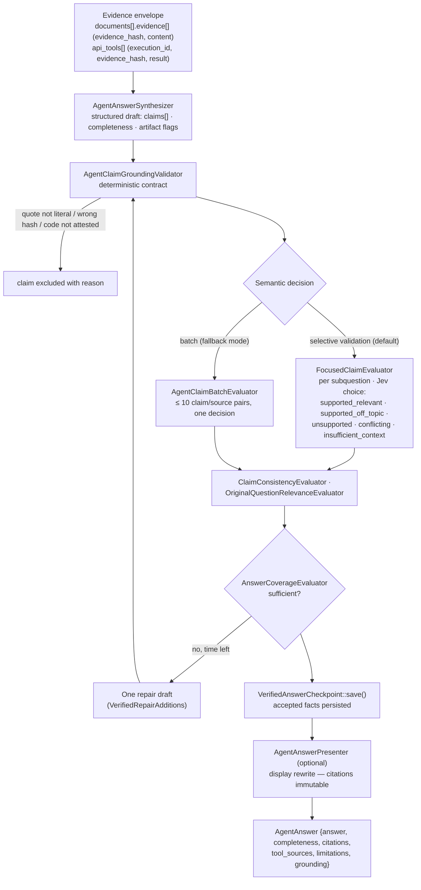

## Motivation

"Grounded" usually means *the model was given some sources and asked to use
them*. That is an instruction, not a guarantee. A fluent answer can cite a real
document while asserting something the document never says: the wrong actor
("the customer confirmed" when the carrier did), a reversed negation, a promise
reported as an executed action, a code with two digits swapped (AB12 → AB21).
Citations make such an answer *more* convincing, not less.

The agent path in AskMyDocs therefore does not accept prose. The synthesizer
must return a list of **claims**, each one bound to a specific piece of
authorized evidence by a verbatim quote and a hash, and the host — not the
model — decides which claims survive. The answer the user reads is assembled
from the survivors. Production defaults fail closed on every agent surface
(`AGENT_CLAIM_GROUNDING_ENABLED=true`); the switch exists only as an emergency
rollback.

## Theory & background

The design follows the **attribution / claim-verification** line of work
(fact-checking pipelines such as FEVER, attributed QA, "AIS"): decompose an
answer into atomic propositions, attach evidence to each, and verify support
independently. Two properties matter:

- **Atomicity.** Verifying a paragraph gives one verdict for many statements;
  one wrong sentence either sinks the paragraph or hides inside it. Verifying a
  claim at a time lets the valid parts survive.
- **Independence.** The verifier must not be the author. A second model call
  with a narrow, typed question — *does this source support this claim, for
  this request?* — catches errors the generator rationalised.

AskMyDocs adds a third: **deterministic gates before semantic ones.** Anything
that can be checked mechanically — is the quote literally in the chunk whose
hash it names, does the code in the claim appear verbatim in the source — is
checked in PHP first, so the semantic judge only ever sees well-formed,
source-bound pairs.

## Design



### 1. The structured draft

`AgentAnswerSynthesizer::synthesize()` receives the run's evidence envelope —
documents with per-chunk `evidence_hash` + content, and API/MCP tool
observations with an `execution_id` and their own `evidence_hash` — and asks
the answer model (`AGENT_ANSWER_MODEL`, inheriting the chat model when unset)
for a structured draft. Each claim is
`{text, quote, evidence_hash, document_id | tool_execution_id[, record_path]}`.
Reasoning models can exhaust the ordinary completion budget before finishing
the structured arguments; exactly one retry gets more room
(`AGENT_STRUCTURED_RETRY_MAX_TOKENS`, default 16384).

### 2. The deterministic contract

`AgentClaimGroundingValidator::validate()` rejects a claim — with a typed
reason — when:

| Reason | Check |
|---|---|
| `missing_claims` | The draft contains no claims at all |
| `invalid_claim` | `text`, `quote` or `evidence_hash` is empty, or the claim is not an object |
| `invalid_claim_source` | It names both, or neither, of `document_id` and `tool_execution_id` |
| `quote_not_in_chunk` | The quote is not literally present in the chunk with that hash in that document |
| `quote_not_in_tool_result` | The tool execution is unknown, its hash differs, or the quote is not in its result |
| `unattested_literal_reference` | A capitalised alphanumeric code in the claim (e.g. `AB12`, `SPD51230`) does not appear verbatim in the bound source |
| `unattested_entity` | An entity the user literally mentioned is not supported by any accepted quote |

Two details are worth noticing. A tool claim is bound to **one record** of the
result: identifiers from another record in the same response envelope cannot
attest it, and only identifiers along a verified dependency path
(`ToolResultLineage`) may add context. And the literal-code rule is applied even
when a semantic judge would accept the paraphrase: *semantic support cannot turn
AB12 into AB21 within a long claim.*

### 3. The semantic decision (Jev)

Claims that pass the contract are judged by a separate **decision model**
through the `App\Decisions` abstraction — by default `JevDecisionModel`, which
posts `{model, state, questions}` to OpenRouter's decisions endpoint with model
`JEV_MODEL` (default `typesafe/jev-1.13`). Questions are typed: `noul`
(yes/no with `probability_true`), `choice` (one of named criteria with a
probability distribution) and `score`.

- **Selective validation** (`AGENT_SELECTIVE_VALIDATION_ENABLED=true`, default):
  `FocusedClaimEvaluator` evaluates claims per active sub-question, so a failure
  in one sub-question never clears another. Each claim/source pair is a `choice`
  over five categories — `supported_relevant`, `supported_off_topic`,
  `unsupported`, `conflicting`, `insufficient_context` — and only
  `supported_relevant` at or above `AGENT_SELECTIVE_VALIDATION_THRESHOLD`
  (0.8) is rendered as narrative.
- **Batch mode** (`AGENT_BATCH_SEMANTIC_GROUNDING_ENABLED=true`): when selective
  validation is off, `AgentClaimBatchEvaluator` sends up to **10** bound
  claim/source pairs in one decision, excluding pairs whose state would exceed
  `DECISION_MAX_STATE_BYTES`.
- **Optional per-claim judge** (`AGENT_SEMANTIC_GROUNDING_ENABLED`, default
  **off**, threshold `AGENT_SEMANTIC_GROUNDING_THRESHOLD`): the older semantic
  gate; the config comment warns there is no universal threshold — calibrate on
  labelled turns first.

Further evaluators refine the verdict: `ClaimConsistencyEvaluator` (already
grounded statements cannot deny a confirmation kept in the same answer),
`OriginalQuestionRelevanceEvaluator` (*support in a source cannot authorise
answering a different user request*), `UncertainSourceSupportEvaluator` (one
source-only adjudication of an ambiguous supported result, never a veto
override) and `DocumentExcerptFallbackEvaluator` (a quotation may survive an
uncertain paraphrase only after its context is checked).

### 4. One bounded repair

`AnswerCoverageEvaluator` asks whether the accepted claims cover the request.
If not — and the run deadline allows (`agent.finalization.repair_min_seconds`,
45 s) — the synthesizer gets **one** repair attempt.
`VerifiedRepairAdditions` merges only independently verified *additional*
material; it never replaces the original answer. *Coverage can request one
better draft; it never authorises a factual claim.*

### 5. At most one decision per phase

Every semantic phase runs through `DecisionOnce`, which records a durable slot
in `agent_runs.result_json` (for example `focused_decision`,
`claim_consistency`). A worker retry with the same state reuses the stored
answer instead of paying for — and possibly getting a different — second
decision. It is an *at most once* guarantee, not exactly-once delivery across a
crash.

### 6. Checkpoint, then presentation

Accepted claims are saved by `VerifiedAnswerCheckpoint` **before** any optional
rewrite. `AgentAnswerPresenter` (`AGENT_PRESENTATION_ENABLED=true`, model
`AGENT_PRESENTATION_MODEL`) may then rewrite accepted facts into readable
paragraphs; the original claims and their citations stay immutable, and the
presentation never feeds citations or session memory. If the worker dies after
the checkpoint, recovery publishes the checkpointed answer without calling a
model (see [Durable research runs](/architecture/durable-research-runs)).

## Data model / contract

`App\Agent\AgentAnswer` (serialised into the message metadata and the run's
`result_json.response`):

| Field | Meaning |
|---|---|
| `answer` | The text shown to the user, assembled from accepted claims |
| `locale` | Supported locale of the answer |
| `completeness` | `complete`, `partial` or `insufficient` (anything else becomes `partial`) |
| `citations` | Document citations bound to accepted claims |
| `tool_sources` | API/MCP executions the accepted claims used |
| `limitations` | Host-owned interpretation limits declared by an API contract (`AgentSourceLimitations`) |
| `artifact` / `requires_selection` | A verified table artifact and whether the user must select a row |
| `grounding` | `status`, accepted `claims`, `semantic_validation` traces, `coverage_validation`, repair trace, per-subquestion status |

When the selective path accepts only part of the request and coverage is not
confirmed, the answer gains a fixed, localized limitation line ("Some aspects of
the request may still need verification.").

### Configuration

| Env | Default | Effect |
|---|---|---|
| `AGENT_CLAIM_GROUNDING_ENABLED` | `true` | Emergency rollback only; off keeps a deterministic verifiable subset |
| `AGENT_BATCH_SEMANTIC_GROUNDING_ENABLED` | `true` | Batch Jev validation when selective validation is off |
| `AGENT_SEMANTIC_GROUNDING_ENABLED` | `false` | Legacy per-claim semantic judge |
| `AGENT_SELECTIVE_VALIDATION_ENABLED` | `true` | Per-subquestion focused validation |
| `AGENT_SELECTIVE_REPAIR_ENABLED` | `true` | One coverage-driven repair |
| `AGENT_SELECTIVE_VALIDATION_THRESHOLD` | `0.8` | Minimum `supported_relevant` probability |
| `AGENT_PRESENTATION_ENABLED` | `true` | Display rewrite of accepted facts |
| `DECISION_MODEL` / `JEV_MODEL` / `JEV_TIMEOUT` | `jev` / `typesafe/jev-1.13` / `15` | Decision adapter |
| `DECISION_MAX_STATE_BYTES` | `131072` (code default) | Sanitised state budget per decision |

## Decision rationale (ADR-style)

- **Drop claims, not answers.** An all-or-nothing gate turns one bad sentence
  into a refusal and trains users to distrust the system. Claim-level grounding
  keeps the verified part and states the gap.
- **Deterministic before semantic.** Literal quote, hash and code checks are
  free, reproducible and immune to persuasion. The paid semantic decision only
  sees pairs that already passed them.
- **A dedicated decision model, typed questions.** A yes/no or five-way choice
  with a probability is auditable and thresholdable; a free-text "looks fine"
  from the generator is neither.
- **Never truncate evidence to make it fit.** The decisions config says it in so
  many words: *keep complete originals and contradictions; never truncate them
  to fit.* A pair that does not fit is excluded, not shortened — a shortened
  source could flip the verdict.
- **Presentation after the checkpoint.** A rewrite can improve readability; it
  must never be the only copy of the verified facts.

## Worked example

Two claims come back for *"what did the carrier say about SPD-51230?"*:

```json
[
  {"text": "VeloxCorriere confirmed the parcel SPD-51230 is held at HUB-MI-07.",
   "quote": "il collo SPD-51230 risulta in giacenza presso HUB-MI-07",
   "evidence_hash": "9f2c…", "document_id": 912},
  {"text": "The parcel was delivered on 3 November.",
   "quote": "consegna prevista il 3 novembre",
   "evidence_hash": "9f2c…", "document_id": 912}
]
```

The first passes the contract and is judged `supported_relevant` (0.93). The
second also passes the contract — the quote is literal — but the judge returns
`unsupported`: "expected delivery" is not "delivered". It is dropped, the
coverage check reports the delivery outcome as missing, the single repair finds
no new evidence, and the user receives the first claim with its citation plus
the limitation line. Re-run the regression set offline with
`php artisan decision:reasoning-eval` (add `--live` to call the provider), or
probe one decision with
`php artisan decision:evidence "<question>" --evidence="<excerpt>" --claim="<claim>"`.

## Gotchas & operations

- **Jev runs on OpenRouter.** Without `ai.providers.openrouter.key` the decision
  adapter throws `DecisionException`; claims needing a semantic decision are not
  accepted. Configure OpenRouter even if chat uses another provider.
- **`.env.example` ships `DECISION_MAX_STATE_BYTES=32768`**, a quarter of the
  code default (131072). Real mixed email/ERP cases exceed 80 KiB; a low value
  excludes pairs as `state_limit`.
- **Deadlines skip optional phases.** Near the worker deadline the repair and the
  presentation are skipped (recorded as `finalization.skipped` diagnostics), not
  attempted and killed.
- **A deterministic rollback is three switches.** Turn off
  `AGENT_SELECTIVE_VALIDATION_ENABLED`, `AGENT_BATCH_SEMANTIC_GROUNDING_ENABLED`
  and `AGENT_SEMANTIC_GROUNDING_ENABLED`; the literal source/citation checks stay.

<CardGroup cols={2}>
  <Card title="Durable research runs" icon="list-check" href="/architecture/durable-research-runs">Budgets, deadlines, checkpoints and progressive findings.</Card>
  <Card title="Grounding & evidence tiers" icon="scale-balanced" href="/grounding-and-evidence-tiers">The conceptual model of grounding.</Card>
  <Card title="Anti-hallucination firewall" icon="shield" href="/anti-hallucination-firewall">Refusal and confidence on the classic path.</Card>
  <Card title="Agent capability planner" icon="route" href="/architecture/agent-capability-planner">How live API/MCP evidence is collected.</Card>
</CardGroup>
