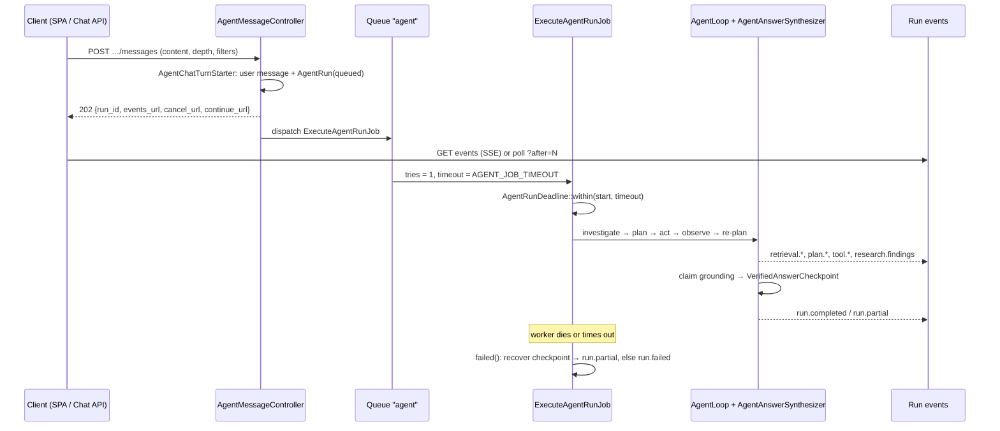

## Motivation

A research turn that searches documents, calls three APIs and verifies a dozen
claims does not fit in an HTTP request. Holding the request open for 90 seconds
means proxy timeouts (a FastCGI gateway closing at 60 s), lost answers when the
browser tab sleeps, and no way to show progress. Running it "in the background"
without discipline is worse: a worker killed at its timeout leaves a spinner
forever, a retry re-pays every model call, and a long investigation has no
ceiling on cost.

AskMyDocs runs the agent turn as a **durable run**: an `agent_runs` row created
in the request, executed by a queue worker, observed through an event stream,
and finished exactly once — completed, partial, failed or cancelled — even when
the worker dies.

## Theory & background

The design is a small application of well-known patterns for long-running work:

- **Request / acknowledge / observe.** The request returns `202 Accepted` with a
  handle; the client follows an event log — the usual shape of asynchronous
  HTTP APIs and job queues.
- **Budgets as first-class state.** Every loop has explicit iteration, call,
  byte and time limits stored on the run, so the budget is fixed for the run's
  whole life — including after a pause for user confirmation.
- **Deadline propagation.** Each downstream call receives the *remaining* time
  of the current worker invocation, not a fixed timeout, so the run finishes
  cleanly before the queue kills it.
- **Checkpoint before optional work.** Verified results are persisted before
  any step that could fail or be skipped; recovery republishes the checkpoint
  instead of recomputing it.

## Design



### Starting a turn

`POST /conversations/{conversation}/messages/agent` (session auth, SPA) and
`POST /api/chat/conversations/{conversation}/messages` (bearer token, chat API)
are both `AgentMessageController@store`. It validates `content` (≤ 10,000
chars), optional `depth` (`1..5`), a row `selection` from a previous table
artifact, and the shared scope rules (`AgentChatScopeRules`: filters and live
sources), stamps `depth` onto `input_json`, and lets `AgentChatTurnStarter`
create the user message and the queued `AgentRun` together. A second turn on a
conversation that already has one running returns `409`
(`agent_conversation_busy`) — no user message or run is created.

### Executing within a deadline

`ExecuteAgentRunJob` runs on `AGENT_QUEUE` (default `agent`) with `$tries = 1`
and `$timeout = max(30, AGENT_JOB_TIMEOUT)` (default 120 s). The config comment
is a deployment rule: **the timeout must stay below the queue connection's
`retry_after`**, otherwise the queue redelivers a run that is still executing.

`AgentRunDeadline::within()` records the invocation start and timeout.
`remaining()` and `activeRemaining()` give every component the time left minus
`agent.finalization.safety_seconds` (5 s); `skip()` refuses to start an optional
phase that needs more than what is left and records a `finalization.skipped`
diagnostic span. Provider text calls are capped at
`AGENT_TEXT_REQUEST_TIMEOUT_SECONDS` (60) with a provider reserve; the Jev
decision adapter shortens its own HTTP timeout to the remaining time and does
not retry hidden inside the same invocation. The planner stops starting new
rounds when less than `AGENT_PLANNER_TIME_RESERVE_SECONDS` (30) remain, and the
synthesizer keeps `AGENT_SYNTHESIS_TIME_RESERVE_SECONDS` (60) for itself.

### Budgets and depth

`AgentBudgetTracker` enforces `agent.limits.*`:

| Limit | Env | Default | Depth-scaled |
|---|---|---|---|
| `iterations` | `AGENT_ITERATION_LIMIT` | 8 | yes |
| `logical_soft` / `logical_hard` | `AGENT_LOGICAL_SOFT_LIMIT` / `AGENT_LOGICAL_HARD_LIMIT` | 12 / 25 | yes |
| `physical_hard` | `AGENT_PHYSICAL_HARD_LIMIT` | 100 | yes |
| `interactive_time_seconds` / `bulk_time_seconds` | `AGENT_INTERACTIVE_TIME_LIMIT` / `AGENT_BULK_TIME_LIMIT` | 60 / 90 | yes |
| `evidence_bytes` | `AGENT_EVIDENCE_BYTE_LIMIT` | 524288 | yes |
| `consecutive_errors` | `AGENT_CONSECUTIVE_ERROR_LIMIT` | 3 | **no** |
| `duplicate_calls` | `AGENT_DUPLICATE_CALL_LIMIT` | 2 | **no** |
| `consecutive_unproductive_searches` | `AGENT_CONSECUTIVE_UNPRODUCTIVE_SEARCH_LIMIT` | 3 | **no** |

The user's depth multiplies the scaled limits by `agent.depth.multipliers`
(`AGENT_DEPTH_MULTIPLIER_1..5` = 0.5, 0.75, 1.0, 2.0, 3.0; default level
`AGENT_DEPTH_DEFAULT=3`). The loop-safety guards are deliberately never scaled:
higher depth means *search more while it is working*, never *search blindly
longer once it demonstrably isn't*. A budget ceiling alone does nothing if the
planner never wants to use it, so the planner also receives a depth-tiered
instruction (at 4–5 it is asked to enumerate follow-up sub-questions and search
each). `AgentResultProjector::searchStats()` writes the searches and calls the
run actually attempted to `Message.metadata.search_stats`, shown as a badge.

When a budget runs out mid-investigation the run can stop for confirmation
(`awaiting_confirmation`); `POST …/runs/{run}/continue` extends the logical and
physical budgets up to `AGENT_CONFIRMATION_LOGICAL_EXTENSION_MAX` /
`AGENT_CONFIRMATION_PHYSICAL_EXTENSION_MAX`.

### Parallel branches divide the budget

When the interpreter splits a message into several independent sub-questions,
`AgentResearchCoordinator::collect()` creates **one child `AgentRun` per
sub-question** (inside a transaction holding the parent row lock, idempotently:
an existing child for an index is reused). Each child receives
`budget_json.research_allocation` — the parent's `logical_soft`,
`logical_hard`, `physical_hard` and `evidence_bytes` **divided** across the
branches, remainders distributed to the first ones — so a five-part question
does not cost five full budgets. Children run in isolated processes through
`ResearchFanout` (concurrency `CHAT_RESEARCH_CONCURRENCY`); a branch that times
out never erases another branch's durable checkpoint. *Only the parent
synthesizes, validates and saves a message.*

### Progressive, verified findings

With `AGENT_PROGRESSIVE_ANSWERS_ENABLED=true` (default) the investigation's
assessor may propose, per iteration, up to five short findings, each with a
`document_id`, a plain-text statement and a verbatim quote.
`ProgressiveAnswerPublisher` does not trust them: it re-reads each source
through `KbSourceReader` under the run's tenant, project, filters and user,
checks the identity and the literal quote, and asks Jev for an independent
decision per finding against the full text and the original question, using
`reasoning.threshold`. Only approved findings are published as durable
`research.findings` events — at most 24 per turn. They are previews, *never
answer memory*: the final answer replaces them and is built from the full
evidence set. Candidate outcomes (hashes and technical states only) are kept in
`progressive_audit`.

### Finishing exactly once, even after a crash

`VerifiedAnswerCheckpoint::save()` writes the accepted answer, its evidence, a
hash of the question and the execution context into
`result_json.verified_answer_checkpoint` **before** the optional presentation
rewrite. If the worker is killed or times out, the job's `failed()` callback
calls `recover()`: it re-validates that the run is still `queued`/`running`,
that the context, question hash and destination match, that the user is still
active, and publishes the checkpoint as `run.partial` — *recovery never calls a
model*. With no checkpoint the run is finalized atomically as `run.failed`.
Neither replaces a run that already reached a terminal or waiting state. A
`SIGKILL`/OOM or an unavailable database can prevent the callback; tool calls and
waves left open on a terminal run can be closed with
`php artisan agent:reconcile-terminal-run {run_id} --tenant=…`
(or the admin `POST /api/chat/runs/{run}/reconcile`).

## Data model / contract

`agent_runs` statuses (`App\Models\AgentRun`): `queued`, `running`,
`waiting_client_tool`, `awaiting_confirmation`, `awaiting_mcp_confirmation`,
`awaiting_mcp_input`, `waiting_mcp_task`, `waiting_api_tool`, `completed`,
`partial`, `failed`, `cancelled`.

Selected `result_json` keys: `response` (the `AgentAnswer`),
`question_understanding`, `evidence`, `research_runs` (child run IDs by
sub-question), `verified_answer_checkpoint`, `focused_decision` and other
`DecisionOnce` slots, `progressive_audit`. Diagnostic spans are stored in
`agent_diagnostic_spans` (`2026_10_22_000001`).

Event types published on the run stream include `run.started`, `run.completed`,
`run.partial`, `run.failed`, `run.cancelled`, `run.awaiting_confirmation`,
`run.mcp_interaction_required`, `retrieval.started` / `.completed` /
`.failed`, `plan.created` / `.updated` / `.ready`, `tool.started` /
`.progress` / `.completed` / `.failed`, `research.planned`, `research.task`,
`research.findings`, `research.limited`, `research.finished`.

### The chat API

`routes/chat-api.php` mounts a token-authenticated surface under `/api/chat`
(`auth:sanctum`, `tenant.authorize`, `ChatApiTokenAccess`,
`ChatApiConversationAccess`; sends also run `redact-chat-pii`,
`ai.disclosure` and `throttle:kb-chat`) for automation and QA against the real
pipeline:

| Method | Path | Purpose |
|---|---|---|
| `GET` | `/api/chat/me` | Identity, tenant, allowed projects, token expiry |
| `GET` / `POST` | `/api/chat/conversations` | List / create the user's conversations |
| `GET` / `POST` | `/api/chat/conversations/{conversation}/messages` | Read messages / start a turn (`202`) |
| `GET` | `/api/chat/runs/{run}?after=N` | Status plus up to 100 events, `next_after`, `has_more` |
| `GET` | `/api/chat/runs/{run}/events` | The SSE event stream |
| `POST` | `/api/chat/runs/{run}/cancel` · `/continue` | Run control |
| `POST` | `/api/chat/runs/{run}/reconcile` | Admin repair (`chat:debug` + admin role) |
| `DELETE` | `/api/chat/token` | Revoke the current token |

Tokens are issued per user and tenant, expiring, with abilities `chat:use` and
`chat:tenant:{tenant}` (plus `chat:debug` on request):

```bash
php artisan chat:issue-api-token reader@example.com --tenant=acme --hours=24
```

The command prints a JSON object with the plain-text `token` and its
`tenant_id`. `--hours` must be between 1 and 168, the user must be active and
hold a membership in the tenant, and `--debug` (which adds `chat:debug`) is
refused for non-administrators.

## Decision rationale (ADR-style)

- **`tries = 1`, recovery instead of retry.** Re-running a research turn
  re-pays every model call and can produce a different answer. One attempt plus
  checkpoint recovery gives deterministic, cost-bounded finalization.
- **Divide, don't multiply, branch budgets.** Fan-out improves latency and
  isolation, not entitlement: the user asked one question.
- **Deadline-aware calls over fixed timeouts.** A fixed 60 s provider timeout
  inside a 120 s job leaves no room for verification; the remaining-time model
  lets each phase use what is actually left and skip what cannot finish.
- **Findings verified before display.** An unverified preview that the final
  answer later contradicts is a hallucination with a delay.
- **Rejected: holding the HTTP request open.** It couples the answer to proxy
  timeouts and tab lifetime; the voice interface keeps an inline mode only
  because the realtime tool call requires it (see
  [Realtime voice](/realtime-voice)).

## Worked example

```bash
TOKEN=$(php artisan chat:issue-api-token reader@example.com --tenant=acme --hours=2 | jq -r .token)

curl -s -X POST https://askmydocs.example/api/chat/conversations/41/messages \
  -H "Authorization: Bearer $TOKEN" -H "X-Tenant-Id: acme" \
  -H "Accept: application/json" -H "Content-Type: application/json" \
  -d '{"content":"Stato della spedizione RL-2024-0815 e penali SLA applicabili?","depth":4}'
```

```json
{
  "run_id": "6f1d6c0e-…",
  "status": "queued",
  "locale": "it",
  "events_url": "/api/chat/runs/6f1d6c0e-…/events",
  "cancel_url": "/api/chat/runs/6f1d6c0e-…/cancel",
  "continue_url": "/api/chat/runs/6f1d6c0e-…/continue",
  "user_message": {"id": 812, "role": "user", "content": "…", "metadata": {}, "created_at": "…"}
}
```

Poll the run until `has_more` is `false` *and* the status is terminal — a
terminal run can still have unread event pages:

```bash
curl -s "https://askmydocs.example/api/chat/runs/6f1d6c0e-…?after=0" \
  -H "Authorization: Bearer $TOKEN" -H "X-Tenant-Id: acme" -H "Accept: application/json"
```

The two sub-questions (shipment status, SLA penalties) appear as
`research.planned` with two tasks, each child run streams its own
`research.task` states, verified previews arrive as `research.findings`, and the
parent finally emits `run.completed` with the grounded answer.

## Gotchas & operations

- **Keep `AGENT_JOB_TIMEOUT` below `retry_after`** of the `agent` queue
  connection, and run a dedicated worker for that queue.
- **Wave process concurrency is a memory knob.** Each wave task boots a full
  PHP application; `AGENT_WAVE_PROCESS_CONCURRENCY` (default 2) is sized for a
  512 MiB worker independently of the logical width `AGENT_WAVE_CONCURRENCY`.
- **A partial run is a result.** `run.partial` means verified claims exist but
  coverage or time ran out; the answer says what is missing.
- **Progressive findings are documents only.** API/MCP structured results are
  consolidated and validated only in the final answer.
- **Debug data needs both an ability and a role.** `diagnostics` in the run
  snapshot and the debug transcript require a `chat:debug` token *and* an admin
  role.

<CardGroup cols={2}>
  <Card title="Claim grounding" icon="scale-balanced" href="/architecture/claim-grounding">What happens to the draft answer.</Card>
  <Card title="Recursive investigation" icon="magnifying-glass-arrow-right" href="/architecture/recursive-investigation">The KB evidence the loop starts from.</Card>
  <Card title="Agent capability planner" icon="route" href="/architecture/agent-capability-planner">Live API/MCP planning and execution.</Card>
  <Card title="Session memory & recap" icon="brain" href="/architecture/session-memory">What carries over to the next turn.</Card>
</CardGroup>
