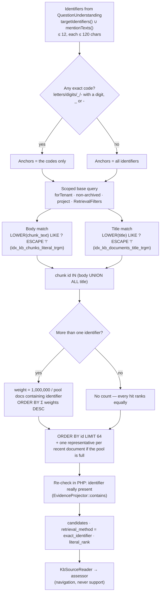

## Motivation

Embeddings are good at meaning and bad at strings. Ask for *"the complaint
SPD-51230"* and a dense model happily returns the five complaints whose prose
is closest to "complaint about a delivery" — including SPD-51203, SPD-15230 and
a ticket with no code at all. For an operational knowledge base (tickets,
emails, order exports, source code) the identifier *is* the question. Missing
the one document that literally contains it, or presenting a lookalike as if it
answered, is the worst failure mode: confident, cited, and about the wrong
record.

Full-text search does not save you either. PostgreSQL's `to_tsvector` splits
`SPD-51230` into tokens and stems words; the existing FTS GIN indexes cannot
answer a substring predicate like `LOWER(chunk_text) LIKE '%spd-51230%'`.

`KbSearchService::exactIdentifierCandidates()` is a separate, literal
navigation channel that runs alongside semantic retrieval on the first round of
the [recursive investigation](/architecture/recursive-investigation).

## Theory & background

Two ideas from classic IR do the work.

**Trigram indexing for substring search.** The `pg_trgm` extension decomposes a
string into overlapping three-character grams and a GIN index over those grams
can accelerate `LIKE '%…%'` and `ILIKE`. It is the standard PostgreSQL answer to
"find this literal fragment anywhere in a large text column" without a
sequential scan.

**Inverse document frequency.** A term that appears in few documents carries
more information than one that appears in many — the intuition behind the
*idf* factor in tf-idf and BM25. When a message names both a rare case code
and a common merchant name, the document containing the rare code should rank
first even if it never repeats the merchant. The lookup applies exactly that
weighting, at **document grain** so that a long document whose chunks repeat a
term does not look more common than it is.

## Design



### Anchoring

A case code anchors the search. If the message contains at least one string that
looks like a code — only letters, digits, `_` and `-`, and containing at least
one digit, `_` or `-` — only the codes are used as `LIKE` anchors; plain names
(a sender, a carrier) can still *rank* the results but cannot OR an entire
merchant's corpus into the candidate pool. A separate name-only task still
searches that name normally.

### Two index-friendly predicates instead of one

The body and the title are matched by two separate sub-queries joined with
`UNION ALL` inside an `IN (…)`. A single query with a correlated title `EXISTS`
inside the body `OR` would defeat both trigram indexes and scan the chunk
population even for a rare code. `UNION ALL` (not `UNION`) is deliberate: `IN`
already removes duplicate membership, so a corpus-sized distinct/sort is avoided
when a code occurs in both places.

### Rarity ranking — only when it matters

With more than one identifier the query computes, per identifier,
`COUNT(DISTINCT knowledge_document_id)` over the **anchored candidate
population** (the scoped chunks that already matched an anchor), and orders
candidates by the sum of `max(1, 1,000,000 ÷ frequency)` over the identifiers
each chunk contains. Rarity is therefore relative to the records the codes
point at, not to the whole corpus. With **one** identifier every candidate would
get the same weight, so the count and the sort are skipped entirely.

### Bounded, with a recency supplement

The ranked pool is capped at 64 chunks. A long quoted email thread can fill all
64 slots before a later reply is reached, so when the pool is full and an exact
code is present the service adds one matching chunk from each of the 64 most
recently arrived matching documents. `MAX(knowledge_chunks.id)` is used only to
order arrivals for this navigation pool — never as a business date.

### Candidates, not evidence

Every candidate is re-checked in PHP (`EvidenceProjector::contains()` against
the chunk text and the document title) so a trigram false positive never
survives, and it is returned with `retrieval_method = "exact_identifier"` and a
`literal_rank` — but **no synthetic similarity score**. The docblock is explicit:
*"These are candidates, not grounded facts: KbSourceReader must recheck the actor
and the assessor must establish relevance."* The assessor additionally narrows
its sources to those that contain an explicitly requested record identifier and
rejects a selection that omits one: *"a similarly titled source without that
identifier cannot establish its facts or its absence."*

## Data model / contract

### Signature

```php
public function exactIdentifierCandidates(
    array $identifiers,
    ?string $projectKey,
    ?RetrievalFilters $filters = null,
): Collection
```

Each element is the ordinary mapped chunk array plus `chunk_hash`,
`literal_rank` (int) and `retrieval_method = 'exact_identifier'`.

### Indexes — `2026_10_22_000002_add_literal_lookup_trigram_indexes.php`

PostgreSQL only (no-op on other drivers). Runs with
`$withinTransaction = false` because the indexes are built `CONCURRENTLY`,
keeping ingestion available during the deploy.

```sql
CREATE EXTENSION IF NOT EXISTS pg_trgm;
CREATE INDEX CONCURRENTLY IF NOT EXISTS idx_kb_chunks_literal_trgm
    ON knowledge_chunks USING GIN (LOWER(chunk_text) gin_trgm_ops);
CREATE INDEX CONCURRENTLY IF NOT EXISTS idx_kb_documents_title_trgm
    ON knowledge_documents USING GIN (LOWER(title) gin_trgm_ops);
```

An interrupted concurrent build can leave an **invalid** index that
`IF NOT EXISTS` would keep forever; the migration checks `pg_index.indisvalid`
first and drops a broken index before rebuilding. The rollback drops only the two
indexes, never `pg_trgm` (other features may use it).

### Escaping

Identifiers are lower-cased and the `LIKE` meta-characters are escaped with `!`
as the escape character — `!` → `!!`, `%` → `!%`, `_` → `!_` — with an explicit
`ESCAPE '!'` (R19: every meta-character, not just `%`). `_` matters: product
codes such as `FW_2024` would otherwise match `FWX2024`.

### Scope

The base query is `KnowledgeChunk::query()->forTenant($tenant)` with the
document eager-loaded under the same tenant, archived documents excluded, the
project key applied on both the chunk and the document, the full
`RetrievalFilters` applied, and folder globs filtered afterwards — the same
population rules as semantic retrieval.

## Decision rationale (ADR-style)

- **A literal channel beside embeddings, not instead of them.** Literal match
  finds the record; semantic retrieval finds the explanation around it. The
  investigation runs both on round 0 and lets the assessor decide.
- **Trigram GIN over a dedicated identifier table.** An extracted-identifiers
  table would need a parser that knows every code format of every tenant. A
  trigram index works for any literal, including source-code symbols — ADR 0035
  addendum I5 pins `test_exact_identifier_lookup_finds_a_code_symbol` and
  explicitly declines to add a second identifier index
  ([ADR 0035](https://github.com/lopadova/AskMyDocs/blob/main/docs/adr/0035-v841-retrieval-quality-cycle.md)).
- **Document-grain rarity.** Counting chunks would make a long manual that
  repeats a supplier name look like a hundred documents.
- **Bounded output with an explicit non-claim.** The comment in the code is the
  contract: *"an incomplete list must never imply global absence."* The lookup
  navigates; it cannot prove that a record does not exist.

## Worked example

The user asks: *"cosa ha detto VeloxCorriere su SPD-51230 e RL-TRACK-8842?"*.
The interpreter returns mentions `VeloxCorriere`, `SPD-51230`, `RL-TRACK-8842`.

1. `SPD-51230` and `RL-TRACK-8842` qualify as codes → anchors are the two codes.
2. The body and title sub-queries match chunks containing either code.
3. Three identifiers → rarity counts inside the anchored pool, say
   `VeloxCorriere` in 40 documents, `SPD-51230` in 3, `RL-TRACK-8842` in 2.
   Weights: 25,000, 333,333 and 500,000.
4. A chunk containing both codes ranks first; a chunk mentioning one code and
   the carrier outranks one with the code alone. A chunk mentioning only the
   carrier never entered the pool, because the carrier is not an anchor.
5. The candidates join the semantic candidates, are read by `KbSourceReader`,
   and the assessor must select a source that actually contains each requested
   code.

Inspect the round with `kb:search … --investigation`: the round-0 attempt
reports `exact_candidates` next to `primary_candidates`.

## Gotchas & operations

- **Deploy the migration before relying on the lookup at scale.** Without the
  trigram indexes the predicates still work but scan the chunk table. The
  migration is additive; no reset or re-ingest is needed.
- **SQLite and other drivers** run the same SQL without indexes (tests only).
- **Round 0 only, and only for a fresh question.** A follow-up anchored to the
  previously cited sources skips the lookup — it re-reads those sources instead.
- **A failure is non-fatal.** If the lookup throws, the round records
  `exact_lookup_error: true` and continues with semantic candidates.
- **More than 12 identifiers are truncated**, and identifiers longer than 120
  characters are ignored.

<CardGroup cols={2}>
  <Card title="Recursive investigation" icon="magnifying-glass-arrow-right" href="/architecture/recursive-investigation">Where the lookup runs.</Card>
  <Card title="Retrieval pipeline" icon="layer-group" href="/architecture/retrieval-pipeline">The semantic channel beside it.</Card>
</CardGroup>
