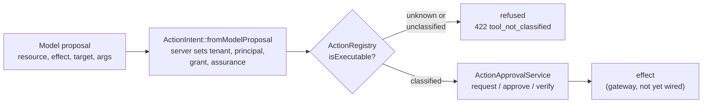

## Motivation

A language model can *propose* an action; it must never be able to *authorize*
one. Two failure modes make that more than a slogan.

1. **The proposal is attacker-influenced text.** Anything the model reads —
   a retrieved chunk, a web page, a tool result — can steer the arguments it
   proposes. If the same structure that carries the arguments also carries
   `tenant_id`, `principal_id` or `grant`, a prompt injection can ask for a
   different tenant or a stronger grant.
2. **Approval and effect are separated in time.** A person approves at 10:00
   and the effect runs at 10:07, or on a queue worker at 14:00. In between, the
   arguments can be swapped, the approver's grant can be revoked, the approval
   can lapse, and the worker can be running for another tenant. An approval that
   is merely "a token that was clicked" authorizes none of those cases
   correctly.

The governed-actions layer is the part of AskMyDocs that closes both gaps. It
is a **primitive**, not a feature switch: nothing in a default deployment calls
the approval service yet, so adopting it changes no behaviour until a gateway
wires it in (see the gotchas at the end of this page).

## Theory & background

Three well-known ideas are combined.

- **The confused deputy.** A privileged component (here: the server executing a
  tool) acts on instructions from a less-privileged one (the model). The cure is
  to make the *authority* — tenant, principal, grant, assurance level — a
  property the server attaches, never a field the proposer can set.
- **Time-of-check to time-of-use (TOCTOU).** Authorization checked at approval
  time is not authorization at effect time. The cure is to *re-check at the last
  moment before the effect* against current state, not to trust a stored
  decision.
- **Canonical form.** To say "this approval is for exactly this action" you need
  one byte-exact representation of the action, so equal actions hash equal and
  different actions hash different. The canonicalizer sorts object keys
  recursively, preserves list order and hashes UTF-8 JSON with SHA-256, in the
  spirit of JSON canonicalization schemes such as RFC 8785 (it is not a full
  implementation of that standard).

The approval itself is not invented here. It reuses the single-use,
hash-at-rest approval tokens of [Flow orchestration](/flow-orchestration): only
the SHA-256 of a token is stored, and the consume is a single atomic
compare-and-set.

## Design

An action travels through three stages. Each stage re-derives what it needs from
server state instead of trusting what the previous stage carried.



The approval service has three operations whose order is enforced by state, not
by the caller's good behaviour.

```mermaid
sequenceDiagram
    autonumber
    participant G as Gateway
    participant S as ActionApprovalService
    participant F as Flow approvals
    participant H as Approver
    participant L as flow_audit

    G->>S: request(intent, runId)
    S->>S: tenant context equals intent tenant and run belongs to it
    S->>F: issue token with digests, execution id, tenant, principal
    S-->>G: PendingActionApproval with token
    H->>S: approve(token, intent, currentAcl)
    S->>S: row, payload and ambient tenant agree; digest matches; ACL returns true
    S->>F: atomic single-use consume
    S-->>H: ActionApprovalReceipt
    Note over G,S: time passes
    G->>S: verifyForExecution(receipt, intent, currentAcl)
    S->>S: approved, not expired, same digest and execution id, ACL still true
    alt any check fails
        S->>L: action_approval.denied with reason
        S-->>G: false
    else all pass
        S-->>G: true, effect may run
    end
```

## Data model / contract

### The intent

`App\Actions\ActionIntent` is a readonly value object, `schemaVersion`
`action-intent.v1`.

| Field | Who sets it | Notes |
| --- | --- | --- |
| `actionId` | server | the registered tool name |
| `tenantId`, `principalId` | server | from the authenticated context, never from the proposal |
| `grant`, `assurance` | server | the permission and the authentication strength the action requires |
| `resource`, `effect`, `target` | model proposal | validated downstream; part of the digest |
| `args` | model proposal | the reserved keys `tenant_id`, `principal_id`, `grant`, `assurance` and `reservation_ref` are stripped before the digest |
| `evidenceRefs` | model proposal | informational; **not** part of the approval digest |
| `reservationRef` | server | `null` when built through `fromModelProposal`; reserved for the gateway |
| `argsDigest` | derived | SHA-256 of the canonical `args` at construction |

Classification lives in `config/actions.php`. A tool absent from the registry,
or present without a non-empty `effect` and `executable => true`, is
non-executable: the widget `/exec-tool` path answers **422** with
`error: tool_not_classified` after the existing skill allowlist and
session/tenant gates have already passed.

### What the approval is bound to

The approval digest is the SHA-256 of one canonical JSON document with these
fields: `action_id`, `schema_version`, `tenant_id`, `principal_id`, `resource`,
`effect`, `args_digest`, `target`, `grant`, `assurance`. Two properties matter:

- the arguments are digested from `args` **itself** each time; the public
  `argsDigest` field is not trusted, so an intent rebuilt with other arguments
  and the old digest does not match;
- the document is structured JSON, not a delimiter-joined string, so a character
  inside `resource` or `target` cannot slide into a neighbouring field.

The Flow approval row (`flow_approvals`, step `action-intent-approval`) stores
only digests and routing data — `execution_id`, `action_id`,
`schema_version`, `tenant_id`, `principal_id`, `action_digest`, `target_digest`.
**The arguments are never persisted in the approval.** The row's own
`tenant_id` column, stamped by the host from the ambient tenant, must equal the
tenant in the payload and the intent's tenant.

### The audit trail

Every denial that can be attributed to an approval row is appended to
`flow_audit` (append-only) on that row's run and tenant:

| Column | Content |
| --- | --- |
| `event` | `action_approval.denied` |
| `step_name` | `action-intent-approval` |
| `payload.reason` | one of `binding_mismatch`, `acl_denied`, `acl_error`, `replayed`, `not_pending`, `not_approved`, `expired`, `execution_mismatch`, `receipt_mismatch` |
| `payload` (other keys) | `approval_id`, `execution_id`, bounded `action_id` and `principal_id`, `attempt_tenant_id`, and the digest of the attempted intent |

The payload never contains the token, the arguments or free text from the
proposal. A failed audit write propagates instead of being swallowed.

### Knobs

There is no feature flag: the primitive is inert until a caller adopts it. The
one setting that shapes behaviour is Flow's approval lifetime,
`LARAVEL_FLOW_APPROVAL_TOKEN_TTL_MINUTES` (config key
`laravel-flow.approval.token_ttl_minutes`, default `1440`). A receipt is valid
until the same expiry as the approval it came from. `LARAVEL_FLOW_STORAGE`
selects the Flow connection; the service uses it for the run lookup and the
audit write exactly as the host's run repository does.

## Decision rationale (ADR-style)

**Reuse Flow's approval tokens instead of a new table.** Flow already provides
hash-at-rest tokens and an atomic single-use consume, and the approval inbox
already exists. A parallel store would duplicate the one invariant that is hard
to get right (atomic consume) and fragment the audit. The cost is coupling to
Flow's row shape, accepted because the service reads it only through the token
manager and its model.

**Persist digests, never arguments.** The approval is evidence that *a
specific* action was approved, not a copy of the action. Storing arguments would
put model-proposed, possibly sensitive data into an inbox and an audit table
with different retention. The cost: the executor must present the intent again,
and a mismatch means refusal, not repair.

**Digest the structure, derive the argument digest.** Joining fields with a
delimiter, or trusting a caller-supplied argument digest, are the same mistake —
treating a representation as the thing it represents — and either lets a
different action share an approval. Canonical JSON over the real fields removes
the class of bug rather than one instance of it.

**Re-verify at the last moment, and refuse by default.** `approve` and
`verifyForExecution` both call the caller's current-ACL callback and accept only
an exact `true`: a denied `Response` object or a message string is truthy and
therefore not an allow, and a callback that throws is a refusal. Expiry is
enforced on the approved row because Flow only expires rows that are still
pending.

**Three-way tenant agreement.** Flow stamps the approval row from the ambient
tenant while the intent carries its own. Trusting either alone lets a row owned
by one tenant carry a payload bound to another, or lets a queue worker with a
stale ambient tenant verify another tenant's receipt. The service therefore
requires the ambient tenant, the persisted row and the payload to agree, and
requires the parent run to belong to that tenant before issuing.

**Verification is a pure check; exactly-once is the gateway's job.**
`verifyForExecution` does not record that the execution identity was spent. A
unique reservation of `execution_id` belongs next to the effect, in the same
transaction as the side effect, which is where the gateway sits. Putting it in
the service would claim a guarantee it cannot honour for effects it does not
perform.

Alternatives that do not fit: a signed, self-contained receipt (it would not see
revocation or an ACL change after signing), and a check expressed in the model
prompt (a prompt is guidance, not authorization). The human-gated boundary this builds on is the one in
[ADR 0003](https://github.com/lopadova/AskMyDocs/blob/main/docs/adr/0003-promotion-pipeline.md);
the widget identity it sits behind is in
[ADR 0027](https://github.com/lopadova/AskMyDocs/blob/main/docs/adr/0027-v830-widget-identity-and-current-session.md).

## Worked example

A tool call proposes searching one project's knowledge base. The server builds
the intent, the approver confirms, and the gateway verifies before running.

```php
use App\Actions\ActionApprovalService;
use App\Actions\ActionIntent;

$intent = ActionIntent::fromModelProposal(
    actionId: 'search_knowledge_base',
    tenantId: 'acme',
    principalId: 'user-42',
    proposal: [
        'resource' => 'knowledge_document',
        'effect' => 'read',
        'target' => 'project/hr',
        'args' => ['query' => 'retention policy'],
    ],
    grant: 'kb.read',
    assurance: 'mfa',
);

$acl = static fn (ActionIntent $i): bool => $user->can('kb.read');

// TenantContext must already be 'acme' and $runId must belong to 'acme'.
$pending = $service->request($intent, $runId);

// ...later, when the approver confirms with $pending->plainTextToken:
$receipt = $service->approve($pending->plainTextToken, $intent, $acl, actor: ['user_id' => 'approver-7']);

// ...immediately before the effect, possibly on another worker:
if ($service->verifyForExecution($receipt, $intent, $acl)) {
    // run the effect
}
```

If the approver's grant is revoked between `approve` and `verifyForExecution`,
or the arguments are altered, or the approval has lapsed, `verifyForExecution`
returns `false` and one row is appended:

```json
{
  "event": "action_approval.denied",
  "step_name": "action-intent-approval",
  "payload": {
    "reason": "acl_denied",
    "approval_id": "…",
    "execution_id": "…",
    "action_id": "search_knowledge_base",
    "principal_id": "user-42",
    "attempt_tenant_id": "acme",
    "action_digest": "…"
  }
}
```

## Gotchas & operations

- **Not wired yet.** No MCP, Flow or widget executor calls the service today.
  The only enforced piece in production is the classification gate on the widget
  `/exec-tool` path. Treat the approval service as a contract the gateway adopts.
- **A receipt verifies repeatedly.** Within its validity window the same receipt
  returns `true` every time. Until the gateway reserves `execution_id` under a
  database uniqueness constraint, no caller may treat one successful verification
  as permission to run an effect more than once.
- **The ACL callback must return exactly `true`.** Return a boolean from your
  policy check; do not return a `Response` object or a string.
- **Match the ambient tenant.** On a queue worker, set `TenantContext` from the
  job's immutable tenant before calling `approve` or `verifyForExecution`; a
  mismatch is refused and audited as `binding_mismatch`.
- **Pin the run and step in the gateway.** Flow's engine and cockpit consume path
  can replace an approval's stored payload; the service then denies (fail closed)
  but the approval is spent.
- **Do not wrap denials in a transaction you may roll back.** The denial audit row
  is written on the same connection; a rollback discards it.
- **Unknown tokens are not audited by the service.** A token Flow does not know
  has no run to attribute a denial to; the gateway records that refusal.
- **`evidenceRefs` and key order.** Evidence references are not part of the
  digest, and object key order does not change it, but list order does.

Related: [Security & threat model](/architecture/security-and-threat-model),
[Flow orchestration](/flow-orchestration), [Kitt widget](/kitt-widget),
[Architecture decisions](/architecture/decisions).
