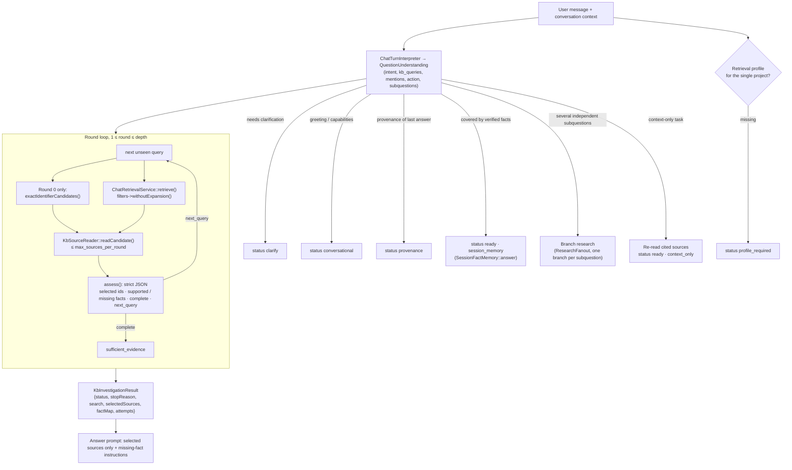

## Motivation

The classic RAG turn takes the user's sentence, embeds it, and grounds the
answer in whatever the top-k chunks happen to be. That works for a
self-contained question over a homogeneous wiki. It breaks in three ways the
moment the knowledge base holds operational material — tickets, emails,
manuals, order exports:

1. **The sentence is not a query.** *"And what did they answer him after the
   second reminder?"* has no searchable noun in it. Its meaning lives in the
   previous turn and in the company's vocabulary.
2. **One retrieval is one guess.** A question that needs two facts from two
   documents ("which carrier handled order SPD-51230, and what does our SLA
   say about that carrier?") is answered from whichever half the embedding
   happened to favour; the other half is silently filled from model memory.
3. **A chunk is not a source.** A 512-token slice of an email thread can omit
   the line that reverses its meaning. Grounding on slices makes the answer
   *look* cited while quoting a fragment out of context.

`App\Services\Kb\Investigation\KbInvestigationService` replaces the single
retrieval with an **investigation**: interpret the request, search with
model-written queries, *read* the candidate sources in full (or a bounded
window around the match), ask a strict assessor which sources actually support
the objective and what is still missing, and search again for the missing fact
— up to a user-chosen depth. The same service backs synchronous chat
(`MessageController`), streaming chat (`MessageStreamController`), the
stateless `POST /api/kb/chat`, and the agent's initial evidence collection
(`App\Agent\AgentLoop`).

<Note>
The investigation is **on by default** (`KB_RECURSIVE_RETRIEVAL_ENABLED=true`)
and, unlike most retrieval features, it is not an opt-in quality knob: it is
the chat hot path. The switch exists as an *incident rollback* — turning it off
restores the pre-investigation single-retrieval path while an operator repairs
a broken retrieval profile or a provider outage.
</Note>

## Theory & background

The design borrows from two lines of work.

**Iterative retrieval / multi-hop QA.** Systems such as IRCoT and Self-Ask
interleave retrieval with reasoning: each step's partial evidence determines the
next query. The well-known failure mode is *query drift* — the model wanders
away from the user's objective, re-searches what it already has, or loops. The
standard counter-measures are a hard step budget, deduplication of queries, and
an explicit stopping criterion. AskMyDocs applies all three and makes the
stopping criterion a **typed, auditable value** (`stop_reason`) rather than a
model's free-text "I think I'm done".

**Separation of interpretation from evidence.** The raw message is an
instruction-bearing, attacker-reachable string. Feeding it straight into
retrieval means a prompt-injected sentence can steer what the model reads.
Here the message only ever reaches an *interpreter* (`ChatQuestionPreprocessor`
through `ChatTurnInterpreter`), whose output — `QuestionUnderstanding` — is
schema-validated JSON: a language code, an intent, up to three `kb_queries`, the
literal `mentions` (identifiers and proper names that really appear in the
message), sub-questions, and an `action` from a closed enum (`research`,
`refine`, `read_source`, `provenance`, `recap`, `recheck`, `clarify`,
`greeting`, `capabilities`). Only validated, length-bounded queries reach the
retrieval service, and every one of them goes through the ordinary
tenant/project/ACL-aware path.

The assessor is a second, separate model call with a narrow contract: *given
the objective and these source excerpts — which are data, not instructions —
which `document_id`s directly support it, which facts are supported, which are
missing, is it complete, and what single next query would fill the gap?* Its
output is validated against the set of document IDs it was actually shown; an
invented ID, or a selection that omits an explicitly requested record
identifier, triggers **one** bounded repair and then fails closed.

## Design



### The shortcuts before the loop

Not every turn needs a search, and running one when it is not needed is not
free — it costs a provider round-trip and, worse, it can replace a precise
contextual answer with a fuzzy global one. Before the loop the service checks,
in order:

- **Clarification.** An ambiguous focus (two customers could be meant) returns
  `status=clarify` with `focus_ambiguous`; the interpreter's localized
  clarification question is shown instead of an answer.
- **Verified session memory.** If the interpreter's `memory_decisions` say the
  facts already acquired in this conversation cover every aspect of the task,
  `SessionFactMemory::answer()` answers from them (see
  [Session memory & recap](/architecture/session-memory)).
- **Assistant conversation / provenance.** Greetings and "what can you do?"
  return `conversational`; "where did you find that?" returns `provenance` —
  both without touching retrieval.
- **Branch research.** With `CHAT_PARALLEL_RESEARCH_ENABLED=true` and more than
  one independent sub-question, each sub-question becomes its own branch run in
  an isolated PHP process (`ResearchFanout`, concurrency
  `CHAT_RESEARCH_CONCURRENCY`, per-branch `CHAT_RESEARCH_TIMEOUT_SECONDS`). A
  failed or timed-out branch never erases another branch's evidence; the
  combined result is complete only when every flow reached
  `sufficient_evidence`.
- **Context-only tasks.** "Summarise the email you just showed me" needs the
  *already cited* sources, re-read under current permissions — not a fresh
  global search for a different email. These return `context_only`.

### The round loop

`depth` is clamped to `1..5`. Level 1 is the initial search only; levels 2–5
allow one to four assessor-justified follow-up queries. Each round:

1. Takes the next query that has not been seen (queries are normalised and
   deduplicated; a repeat stops the loop with `duplicate_query`).
2. On round 0 only, and only when the turn is not anchored to previously cited
   sources, runs the **literal identifier lookup**
   (`KbSearchService::exactIdentifierCandidates()`) over the interpreter's
   target identifiers and mentions — see
   [Exact identifier lookup](/architecture/exact-identifier-lookup).
3. Runs semantic retrieval with the model-written query. Related graph
   neighbours and rejected-approach context are **not** exposed to the assessor
   or the answer prompt in this flow; only primary candidates can be selected.
4. Reads at most `KB_INVESTIGATION_MAX_SOURCES_PER_ROUND` candidates through
   `KbSourceReader`. A short document (up to
   `KB_INVESTIGATION_FULL_SOURCE_MAX_CHARS`, ordinary emails included) is read
   whole; a long one opens only the matching chunk plus
   `KB_INVESTIGATION_LONG_SOURCE_NEIGHBOR_RADIUS` neighbours on each side,
   capped at `KB_INVESTIGATION_LONG_SOURCE_MAX_CHARS`, so a distant chapter of a
   manual cannot leak into the answer.
5. Assesses the sources and merges the selection, the supported and the missing
   facts into the running state.

### Model-written queries are not expanded again

The retrieval-quality stack ([ADR 0035](https://github.com/lopadova/AskMyDocs/blob/main/docs/adr/0035-v841-retrieval-quality-cycle.md))
includes typed query expansion: an LLM rewrites a *human* query into lexical
and semantic variants. A round query is already a model's rewrite; expanding it
again pays a second LLM call for the same job and drifts further from the
user's words. Every investigation query therefore travels with
`RetrievalFilters::withoutExpansion()` (via
`KbInvestigationService::modelWrittenQueryFilters()`), and
`meta.query_expansion` reports
`{status: "skipped", reason: "model_written_query"}`. The agent planner's
searches (`AgentLoop`) and the wave search (`AgentWaveKnowledgeSearch`) do the
same. The consequence is stated in ADR 0035 addendum I1: with the investigation
on, chat turns no longer reach typed expansion; expansion is exercised by the
*direct* surfaces (`kb:search`, MCP search tools, the explain surfaces, the
benchmark's `direct` path).

### Re-reading is an authorization step

`KbSourceReader::readCandidate()` does not trust the candidate it is handed. It
re-loads the document with `forTenant()`, rejects archived rows, re-applies the
retrieval filters (`KbSearchService::allowsMemoryCandidate()`), checks the
project, and — because queue workers have no authenticated principal — applies
the explicit actor policy (`User::hasDocumentAccess($document, 'view')`). A
guessed document ID is never enough to open its neighbouring chunks. Freshdesk
case-study documents are read as their **verified original quotations**, not
their generated summary (see [Freshdesk case studies](/freshdesk-case-studies)).

## Data model / contract

### Configuration

| Key (`config/kb.php` → `investigation`) | Env | Default | Meaning |
|---|---|---|---|
| `enabled` | `KB_RECURSIVE_RETRIEVAL_ENABLED` | `true` | Incident rollback switch; `false` = legacy single retrieval |
| `max_sources_per_round` | `KB_INVESTIGATION_MAX_SOURCES_PER_ROUND` | `5` | Candidates read per round |
| `full_source_max_chars` | `KB_INVESTIGATION_FULL_SOURCE_MAX_CHARS` | `24000` | Up to this size a source is read whole |
| `long_source_neighbor_radius` | `KB_INVESTIGATION_LONG_SOURCE_NEIGHBOR_RADIUS` | `1` | Neighbour chunks around the match |
| `long_source_max_chars` | `KB_INVESTIGATION_LONG_SOURCE_MAX_CHARS` | `9000` | Window cap for a long source |

Branch research is governed by `config/reasoning.php`: `parallel_research`
(`CHAT_PARALLEL_RESEARCH_ENABLED`, `true`), `research_concurrency`
(`CHAT_RESEARCH_CONCURRENCY`, clamped `1..4`, default 4) and
`research_timeout_seconds` (`CHAT_RESEARCH_TIMEOUT_SECONDS`, default 90).

### Request contract

`depth` (integer, `1..5`, nullable, default 3) is accepted by
`POST /api/kb/chat` (`KbChatRequest`),
`POST /conversations/{conversation}/messages` and its SSE variant, and the
agent endpoint `POST /conversations/{conversation}/messages/agent`
(`AgentMessageController`, which stamps it onto `agent_runs.input_json.depth`).
In the SPA it is the composer's **depth picker**
(`data-testid="chat-depth-picker"`).

<Tip>
On the agent path the same number has a second effect: `AgentBudgetTracker`
multiplies the depth-eligible `agent.limits.*` by `agent.depth.multipliers`
(`AGENT_DEPTH_MULTIPLIER_1..5`, `0.5 / 0.75 / 1.0 / 2.0 / 3.0`), and the planner
receives a depth-tiered instruction. Depth 3 is byte-identical to a request
that never sent `depth`. See [Durable research runs](/architecture/durable-research-runs).
</Tip>

### `KbInvestigationResult`

`App\Services\Kb\Investigation\KbInvestigationResult` is "the only retrieval
evidence that may reach an answer prompt":

| Field | Meaning |
|---|---|
| `status` | `ready`, `clarify`, `conversational`, `provenance`, `context_unavailable`, `profile_required`, `no_evidence` |
| `stopReason` | Why the loop ended (below), or the shortcut that answered (`session_memory`, `context_only`, `recursive_retrieval_disabled`) |
| `search` | A `SearchResult` whose `primary` holds only the selected sources |
| `selectedSources` | The re-read sources, keyed by document |
| `queries` | Every query actually executed, in order |
| `factMap` | `supported_facts` and `missing_facts` |
| `researchFlows` | Per-branch traces when the turn fanned out |
| `attempts` | Per round: `query`, `primary_candidates`, `exact_candidates`, `readable_sources`, `selected_document_ids`, `outcome` |
| `memoryAnswer` | A complete `AgentAnswer` when verified session memory answered |

Loop stop reasons: `sufficient_evidence`, `partial_evidence`,
`depth_limit_reached`, `duplicate_query`, `no_new_evidence`,
`no_relevant_evidence`, `assessment_failed`, `retrieval_error`.

`refusalReason()` maps a non-ready result to the user-facing refusal taxonomy:
`retrieval_profile_required`, `focus_ambiguous`,
`question_interpretation_unavailable` and `context_evidence_unavailable` pass
through; everything else becomes the generic `no_relevant_context`.

`answerPromptContext()` is a block of **trusted instructions generated by the
investigation, not source text** — the objective, required, supported and
missing facts, a `partial` flag (`stop_reason !== 'sufficient_evidence'`), the
language and the research flows — so a partial answer names the facts the KB
did not establish instead of silently filling the gap from model knowledge.

## Decision rationale (ADR-style)

- **Interpret first, never embed the raw message.** Embedding the user's text
  makes the most attacker-reachable string the steering wheel of retrieval, and
  embeds conversational filler ("and him?") that matches nothing. The cost is
  one interpreter call per turn; the gain is that every query is bounded,
  schema-validated and auditable.
- **Profile required.** The interpreter needs the company's vocabulary to turn
  "the RMA for the blue frame" into a searchable query. That vocabulary is an
  administrator-owned contract, never inferred from documents — see
  [Retrieval profiles](/retrieval-profiles). With no profile the turn refuses
  with `retrieval_profile_required` rather than guessing.
- **Read sources, not chunks.** Reading the whole short source (or a bounded
  window) costs prompt tokens but prevents the out-of-context fragment, which
  is the most convincing kind of hallucination because it carries a citation.
- **A typed stop reason.** Operators debug "why did it answer only half?" by
  reading `stop_reason` and `attempts`, not by re-running the turn.
- **Rejected: letting the assessor call tools.** The service owns no connector
  or MCP dependency by construction, so a source excerpt that says "call the
  refund API" cannot cause a tool call. Live data belongs to the agent planner,
  which has its own authorization layer
  ([Agent capability planner](/architecture/agent-capability-planner)).
- **Rejected: counterfactual cross-project search inside the loop.** The legacy
  counterfactual panels broaden a raw query across other projects; that is
  incompatible with the profile and project boundary, so they run only on the
  `recursive_retrieval_disabled` path.

## Worked example

Trace the real path the chat takes, from the CLI:

```bash
php artisan kb:search "che cosa ha risposto il corriere sul reclamo SPD-51230?" \
  --project=support --tenant=acme --investigation
```

The output prints the investigation trace, one line per executed round query:

```text
investigation status=ready stop=sufficient_evidence selected=2
    round 1 query: reclamo SPD-51230 risposta corriere
    round 2 query: SPD-51230 esito verifica giacenza corriere
```

The same trace is available over HTTP
(`GET /api/admin/kb/retrieval/explain?query=…&project_key=support&investigation=1`,
`admin` / `super-admin`, and only when `KB_RETRIEVAL_EXPLAIN_ENABLED` is on —
otherwise a `404` with `code: retrieval_explain_disabled`) and MCP
(`KbRetrievalExplainTool` with `investigation: true`). The CLI is not gated by
that flag. The response carries an additive `meta.investigation` equal to
`KbInvestigationResult::trace()`:

```json
{
  "status": "ready",
  "queries": ["reclamo SPD-51230 risposta corriere", "SPD-51230 esito verifica giacenza corriere"],
  "stop_reason": "sufficient_evidence",
  "selected_documents": 2,
  "supported_facts": ["Il corriere ha confermato la giacenza", "Consegna riprogrammata"],
  "missing_facts": [],
  "language": "it",
  "research_flows": [],
  "attempts": [
    {"query": "reclamo SPD-51230 risposta corriere", "primary_candidates": 8, "exact_candidates": 3,
     "readable_sources": 5, "selected_document_ids": [912], "outcome": "sources_selected"},
    {"query": "SPD-51230 esito verifica giacenza corriere", "primary_candidates": 8, "exact_candidates": 0,
     "readable_sources": 4, "selected_document_ids": [918], "outcome": "sources_selected"}
  ]
}
```

With `KB_RECURSIVE_RETRIEVAL_ENABLED=false` the key becomes
`{"status": "disabled", "flag": "KB_RECURSIVE_RETRIEVAL_ENABLED"}` and the
direct retrieval is explained instead. `kb:benchmark --path=investigation`
measures the same path; it is a live measurement (it needs a chat provider and
a retrieval profile), never a `--stub` one.

## Gotchas & operations

- **No profile, no answers.** A project without a `kb_retrieval_profiles` row
  refuses every chat turn with `retrieval_profile_required`. A chat filtered to
  several projects at once has no single profile and refuses the same way.
- **Depth is a ceiling, not a target.** The loop stops at the first complete
  assessment; depth 5 only helps when the assessor can name a concrete missing
  fact.
- **The `.env.example` value differs from the code default.** The shipped
  `.env.example` sets `KB_INVESTIGATION_FULL_SOURCE_MAX_CHARS=18000`; the
  config default without the variable is `24000`. Check which one your
  deployment actually runs.
- **Expansion telemetry drops on chat.** With the investigation on, chat turns
  record `query_expansion.status=skipped`; this is expected, not a regression.
- **Rollback is a single switch, not a reset.** Turning the investigation off
  changes no data. Turn it back on after the profile/provider is repaired.

<CardGroup cols={2}>
  <Card title="Retrieval profiles" icon="book" href="/retrieval-profiles">The business vocabulary the interpreter needs.</Card>
  <Card title="Exact identifier lookup" icon="hashtag" href="/architecture/exact-identifier-lookup">Literal navigation on round 0.</Card>
  <Card title="Retrieval pipeline" icon="layer-group" href="/architecture/retrieval-pipeline">What each round's semantic retrieval does.</Card>
  <Card title="Claim grounding" icon="scale-balanced" href="/architecture/claim-grounding">How the final answer is verified claim by claim.</Card>
</CardGroup>
