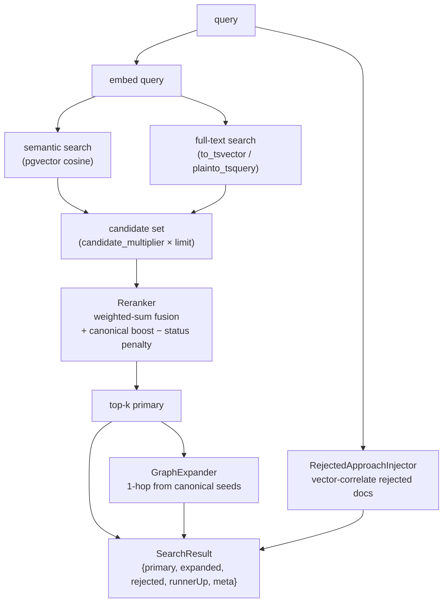
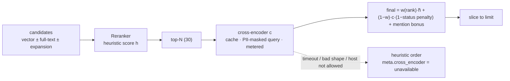
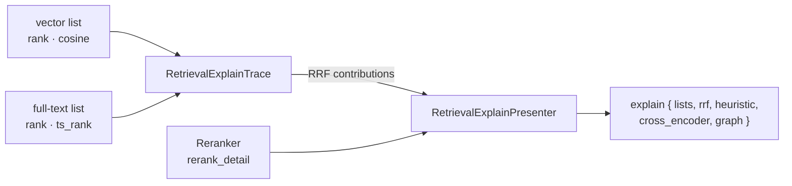

## Motivation

The quality of a grounded answer is bounded by the quality of retrieval. A
single-signal vector search is brittle: it misses lexical-exact matches
(acronyms, error codes, identifiers), weights a stale blog post like a ratified
standard, and has no notion of *related* decisions. AskMyDocs' retrieval is a
**multi-signal pipeline with a trust gradient**: it over-retrieves, fuses
several signals, applies a canonical boost and a status penalty, then optionally
expands along the graph and injects dismissed approaches.

## Theory & background

The pipeline composes four ideas:

1. **Over-retrieval + rerank.** Embedding similarity alone is a coarse filter.
   Retrieving a wider candidate set (`candidate_multiplier × limit`) and then
   reranking lets weaker-vector-but-strong-keyword matches survive.
2. **Weighted-sum fusion.** Multiple normalised signals (vector, keyword,
   heading, tag, recency, …) combine linearly into one comparable score.
3. **Trust gradient.** The canonical layer adds a *priority boost* and a *status
   penalty*, so a ratified `accepted` decision outranks a `superseded` one and an
   auto-compiled page sits below human-curated content.
4. **Graph + counter-evidence.** Beyond the top-k, a 1-hop graph walk pulls in
   structurally related docs, and a separate channel injects *rejected*
   approaches so the model stops re-proposing dismissed options.

## Design



`KbSearchService::searchWithContext()` is the entry point. Its core,
`search()`, runs semantic search (and optionally FTS when
`KB_HYBRID_SEARCH_ENABLED=true`), assembles the candidate set, and hands it to
the `Reranker`. `searchWithContext()` then layers graph expansion and
rejected-approach injection on top and returns a typed `SearchResult`.

### The reranker fusion

The `Reranker::rerank()` score for a chunk is a linear combination of normalised
signals plus the canonical adjustment:

```
base      = vector_weight·vec + keyword_weight·kw + heading_weight·head
additive  = tag_overlap_weight·tags + preamble_match_weight·preamble
          + recency_weight·recency + status_active_weight·active
          + mention_boost (if the doc is @mentioned)
canonical = priority_weight·retrieval_priority − status_penalty − auto_tier_penalty
score     = base + additive + canonical
```

Shipped defaults (`config/kb.php`):

| Signal | Weight (default) | Env |
|---|---|---|
| vector | `0.55` | `KB_RERANK_VECTOR_WEIGHT` |
| keyword | `0.25` | `KB_RERANK_KEYWORD_WEIGHT` |
| heading | `0.05` | `KB_RERANK_HEADING_WEIGHT` |
| tag overlap | `0.05` | `KB_RERANK_TAG_OVERLAP_WEIGHT` |
| preamble | `0.05` | `KB_RERANK_PREAMBLE_WEIGHT` |
| recency | `0.02` | `KB_RERANK_RECENCY_WEIGHT` |
| status active | `0.02` | `KB_RERANK_STATUS_WEIGHT` |
| mention boost | `0.50` | `KB_RERANK_MENTION_BOOST_WEIGHT` |

Canonical adjustment (`kb.canonical.*`): `priority_weight` `0.001` (multiplies
`retrieval_priority` 0–100), `superseded_penalty` `0.40`, `deprecated_penalty`
`0.40`, `archived_penalty` `0.60`, `auto_tier_penalty` `0.02`. Vector scores are
min-max normalised before fusion when `KB_RERANK_NORMALIZE_SCORES=true`. After
fusion, `kb.diversification.max_chunks_per_doc` (default 3) caps how many chunks
of a single document can occupy the top-k.

### Hybrid fusion mode

When hybrid search is enabled, semantic and FTS result lists are merged via
**Reciprocal Rank Fusion** (`score = weight / (rrf_k + rank)`, `KB_RRF_K=60`,
`KB_HYBRID_SEMANTIC_WEIGHT=0.70`, `KB_HYBRID_FTS_WEIGHT=0.30`) before reranking.
The `meta.search_strategy.fusion_method` field records which path ran
(`rerank_weighted_sum` | `rrf` | `semantic_only`).

### Cross-encoder stage

*v8.43 · [ADR 0035](https://github.com/lopadova/AskMyDocs/blob/main/docs/adr/0035-v841-retrieval-quality-cycle.md) §D4.*
The heuristic `Reranker` scores overlap and metadata; **nothing in it ever reads the
pair (query, chunk)**. With `KB_CROSS_RERANK_ENABLED=true` the heuristic top-N
(default 30) is re-scored by a cross-encoder and blended **position-aware**, so the
model decides the tail while the clear heuristic winners keep their place:



`h̃` is the heuristic score min-max normalised over the candidate set with the
@mention boost removed; `w` is **0.75** for heuristic ranks 1-3, **0.60** for 4-10,
**0.40** beyond (`kb.cross_rerank.tiers.*`). The status penalty multiplies the
model's score too, so a deprecated or superseded document cannot regain rank
through text similarity; an explicit @mention is a precedence (a flat +1.0, above
anything the blend can produce).

Invariants the tests pin: **`rerank_score` and `vector_score` — the refusal gate's
inputs — are never modified** (the refusal decision is identical ON and OFF);
the blended value lives under `cross_encoder.blended` and only decides *order*;
OFF calls the Reranker with the plain `limit`, exactly as before; any failure falls
back to the heuristic order and says so in `meta.cross_encoder`
(`{status:"unavailable", reason:"http_503"|"bad_shape"|"endpoint_not_allowed"|…}`).

Two **profiles** share one hardened driver: `self_hosted` (default — an inference
server you run: vLLM / TEI / Infinity serving e.g. Qwen3-Reranker) and `api` (a
hosted rerank API: Cohere / Jina / Voyage). The endpoint host[:port] must be in the
profile's exact allow-list; redirects are not followed; the response is validated
against a closed shape (count, integer indexes, finite numbers; raw logits go
through a sigmoid); `api` is https-only and `self_hosted` tolerates plain http only
with `allow_http`. Scores are cached by `sha256(tenant | model | query | passage)` —
the score only, never text — and every uncached call leaves a FinOps ledger row under
`purpose_tag = cross_rerank`.

### Typed query expansion

*v8.44 · ADR 0035 §D5.* A short or oddly-phrased query ("timeout milano") shares
few words with the document that answers it. With `KB_QUERY_EXPANSION_ENABLED=true`
a cheap model proposes three kinds of variants, each routed where it helps:

| type | meaning | goes to |
|---|---|---|
| `lex` | keyword variants (other words a document might use) | the full-text branch (needs hybrid search on) |
| `vec` | paraphrases of the question | the vector branch |
| `hyde` | one short hypothetical answer passage | the vector branch |

All lists are fused by weighted RRF with the **original query's lists at twice the
weight** of each expansion list, independent of insertion order. Three details are
load-bearing:

- **`vector_score` always measures similarity to the original query.** A chunk that
  only an expansion list surfaced gets its cosine against the *user's* embedding
  computed after fusion — never the score against a model-written paraphrase — so
  the refusal gate cannot be talked into grounding.
- **Strong-signal skip.** When the original query already has a clear winner (top
  lexical — or, with hybrid off, vector — score ≥ `skip_min_score` and ≥
  `skip_min_gap` ahead of the runner-up) no model is called at all (proved with
  `shouldNotReceive`). A supplied `intent` disables the skip: the obvious match may
  not be what the caller wants.
- **The model's answer is a closed JSON object** (`lex`, `vec`, `hyde` only; limits
  on count and length; every variant must keep a significant word of the original;
  unknown keys discard the *whole* answer — nothing is repaired). The query goes in
  the user role between delimiters under a fixed system prompt and is PII-masked
  first; the expansion is cached per (tenant, project, model, query), a dud (all
  sub-queries empty) is evicted, and `intent` is **never** sent to the model (it
  gets copied into sub-queries as meta-language).

### Intent

An optional `intent` string (`"web page load times"` for the query `"performance"`)
is accepted by `/api/kb/chat`, `KbSearchTool`, `KbSearchByProjectTool`, `kb:search
--intent` and the explain surfaces. It is **not searched on its own**: it prefixes the
query for the cross-encoder and disables the expansion skip. Absent = identical
behaviour.

### Graph expansion & rejected injection

`GraphExpander::expand()` walks a fixed **1 hop** of `kb_edges` from the
canonical seed docs in the primary set, restricted to the edge-type allow-list
(`KB_GRAPH_EXPANSION_EDGE_TYPES`) and capped at `KB_GRAPH_EXPANSION_MAX_NODES=20`.
(The `KB_GRAPH_EXPANSION_HOPS` config key exists but the expander is currently
1-hop regardless of its value.) Expanded chunks carry
`metadata.origin='graph_expansion'`. `RejectedApproachInjector::pick()`
vector-correlates the query against `rejected-approach` canonical docs (summary
chunks only) and returns up to `KB_REJECTED_INJECTION_MAX_DOCS=3` above
`KB_REJECTED_MIN_SIMILARITY=0.40`. Both **degrade to empty** for a tenant with no
canonical docs.

### Explaining a ranking

*v8.41 · [ADR 0035](https://github.com/lopadova/AskMyDocs/blob/main/docs/adr/0035-v841-retrieval-quality-cycle.md) §D1.*
"The answer got worse" is not debuggable; "the vector list ranked chunk 4182 first
but the status penalty pushed it to rank 9" is. When a caller asks for it
(`RetrievalFilters::$explain`), every returned chunk carries an `explain` block
assembled from values the pipeline **already holds** — no extra query, no extra
provider call (a test pins the query count equal with and without it):



| key | content |
|---|---|
| `lists[]` | one entry per ranked list that produced the chunk: `source` (`vector`/`fts`), `rank` (1-based), `weight`, `backend_score`, `rrf_contribution` |
| `rrf` | `{base, total}` — the fused score when hybrid search ran, else `null`. The listed contributions **sum to it** (asserted) |
| `heuristic` | the `Reranker` terms: `vector`, `keyword`, `heading`, `tags`, `recency`, `preamble`, `canonical_boost`, `status_penalty`, `mention_boost`, `total`; `null` when reranking is off |
| `cross_encoder`, `graph` | reserved for later workstreams; present and `null` so the contract is stable |

It never carries chunk text beyond a 160-character preview and never a provider
payload. Three surfaces over one core (`RetrievalExplainService`):
`php artisan kb:search "…" --explain` (always available to operators),
`GET /api/admin/kb/retrieval/explain` and the `KbRetrievalExplainTool` MCP tool —
both `admin`/`super-admin` only and gated by `KB_RETRIEVAL_EXPLAIN_ENABLED`
(default off → a clean `404 retrieval_explain_disabled` / `{disabled: true}`).
Asking for an explanation **never changes the ranking** (also asserted).

### Lexical query syntax

*v8.41 · ADR 0035 §D3.* `KB_FTS_QUERY_SYNTAX` selects how the full-text branch
builds its `tsquery`:

- `plain` (default) — one `plainto_tsquery` per phrase; quotes and `-negation`
  are ignored. Byte-identical SQL to before v8.41.
- `websearch` — per phrase: `websearch_to_tsquery` for anything with structure
  (`"exact phrase"`, `-exclusion`, `or`, several words); a **prefix** match for a
  bare single word; a **phrase** match for a compound identifier
  (`DEC-0054`, `src/lib/i18n.ts`, `ERR_STOCK_0417`, `2026.4.10`) — Postgres'
  parser splits those at index time, so they have to be matched as the phrase
  their parts form. Ranking switches to `ts_rank_cd(…, 32)`, which is bounded 0..1.

User text is only ever a **bound parameter**: the prefix path reduces the token to
letters and digits before it is bound, so no `tsquery` operator can survive
(SEC-RAWSQL-001; a hostile-input test covers `& | ! ( ) :* ' ; --`). The default
flips to `websearch` only on benchmark-v2 evidence recorded in the W1 closure doc.

## Data model / contract

`SearchResult` (`app/Services/Kb/Retrieval/SearchResult.php`):

```php
final class SearchResult {
    public readonly Collection $primary;   // reranked top-k
    public readonly Collection $expanded;  // 1-hop graph neighbours
    public readonly Collection $rejected;  // rejected-approach docs (⚠ block)
    public readonly ?Collection $runnerUp; // candidates below top-k
    public readonly array $meta;           // counts, timing, strategy, stats
}
```

`meta` carries the top-level counts (`primary_count` / `expanded_count` /
`rejected_count` / `runner_up_count`) and `retrieval_ms`, a nested
**`meta.search_strategy`** object (`semantic_enabled`, `fts_enabled`,
`fusion_method`, `graph_expansion_enabled`, `rejected_injection_enabled`,
`filters_applied`), and a nested **`meta.retrieval_stats`** object
(`candidates_pre_threshold`, `candidates_post_threshold`, `min_score_used`,
`max_score_used`). The prompt is composed from these typed blocks — a
`⚠ REJECTED APPROACHES` section, a `📎 RELATED CONTEXT` section, and the primary
`## Context`.

## Decision rationale (ADR-style)

- **Why over-retrieve then rerank, not just top-k by cosine?** Pure cosine
  drops lexical-exact matches whose embeddings sit slightly further out. A 3×
  candidate window costs one wider SQL read and lets keyword and heading signals
  rescue them. Rejected as alternative: raising `default_min_similarity` (loses
  recall uniformly).
- **Why a linear weighted sum, not a learned reranker?** Transparency and
  tunability. Every weight is a config knob an operator can reason about and the
  `kb:benchmark` harness validates; a learned cross-encoder is a future option
  but would forfeit the auditable trust gradient.
- **Why bake canonical status into the score, not filter on it?** Filtering
  would hide superseded decisions entirely; penalising keeps them retrievable
  (for "why did we move off X?") while ensuring the current decision ranks first.
  See [ADR 0001](/architecture/decisions) (canonical layer) and
  [grounding & evidence tiers](/grounding-and-evidence-tiers).

## Worked example

```text
query: "what cache layer did we standardise on?"

candidates (multiplier 3 → 24 for limit 8):
  dec-cache-v2      vec 0.81  kw 0.40  status accepted     → score 0.71
  dec-cache-v1      vec 0.78  kw 0.38  status superseded   → 0.71 − 0.40 = 0.31
  blog-redis-notes  vec 0.74  kw 0.20  (non-canonical)     → 0.49

primary top-k:        dec-cache-v2, blog-redis-notes, …
graph expansion:      dec-cache-v2 --depends_on--> mod-session-store
rejected injection:   rej-memcached-2023 (cosine 0.52 ≥ 0.40)  → ⚠ block
```

The superseded v1 is still retrievable but demoted below v2; the rejected
Memcached approach is surfaced under the ⚠ marker so the model does not
re-propose it.

## Gotchas & operations

- **Weights are tuned together.** Raising `vector_weight` without lowering the
  rest skews the whole gradient — re-run `kb:benchmark` after changes.
- **Penalties dominate boosts by design.** A `0.40` status penalty outweighs the
  `≤0.10` canonical priority boost, so a superseded doc never outranks an active
  peer on priority alone.
- **No canonical docs → identical to plain hybrid RAG.** The boost, graph
  expansion, and rejected injection all no-op.
- **Retrieval-metric math is delegated to `padosoft/eval-harness` (since v8.18).**
  The ranking metrics the `kb:benchmark` harness reports — MRR, nDCG@k, and the
  new answer-containment@k — are no longer hand-rolled in the host. They are
  computed by the package's `RetrievalMrrMetric` / `RetrievalNdcgAtKMetric` /
  `AnswerContainmentAtKMetric`, reached through a single anti-corruption adapter
  (`App\Services\Kb\Metrics\PackageMetricAdapter`) — the only file in the host
  that imports a `Padosoft\EvalHarness\…` symbol, so a package API change is
  absorbed in one place. The delegated nDCG keeps the historical `2^grade − 1`
  gain so scores stay byte-comparable with pre-v8.18 baselines. `eval-harness`
  is therefore a runtime `require` (`^1.3.0`), not just the CI gate.

<CardGroup cols={2}>
  <Card title="Canonical graph" icon="share-nodes" href="/architecture/canonical-graph">
    The nodes/edges graph expansion walks.
  </Card>
  <Card title="Grounding & evidence tiers" icon="scale-balanced" href="/grounding-and-evidence-tiers">
    How the trust gradient maps to evidence tiers.
  </Card>
</CardGroup>
