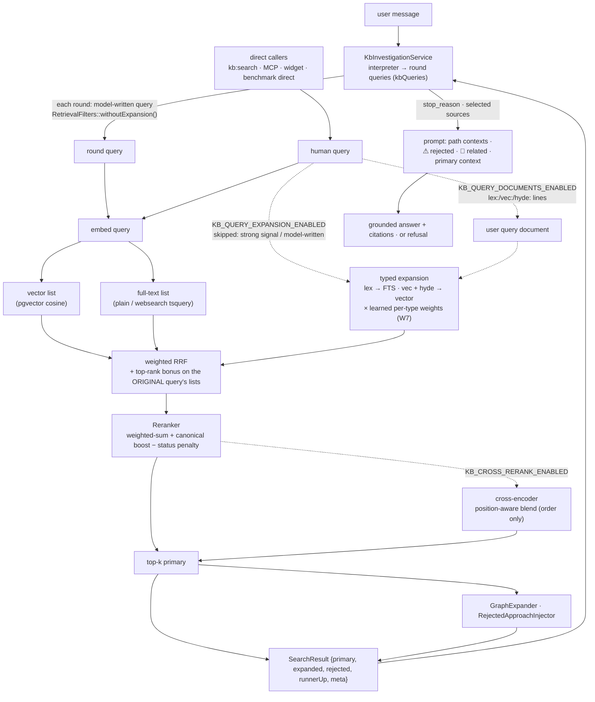
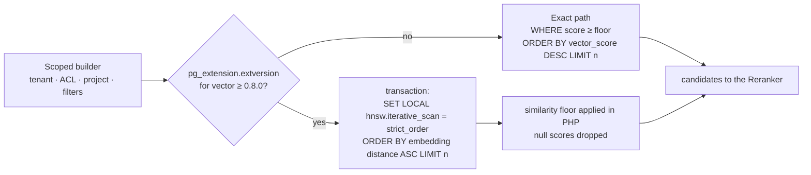
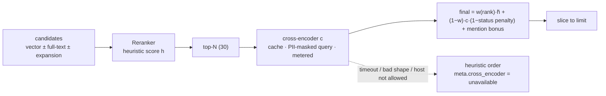
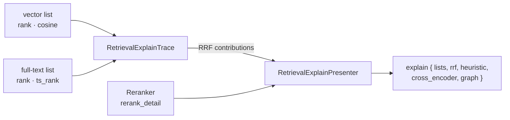

## Motivation

The quality of a grounded answer is bounded by the quality of retrieval. A
single-signal vector search is brittle: it misses lexical-exact matches
(acronyms, error codes, identifiers), weights a stale blog post like a ratified
standard, and has no notion of *related* decisions. AskMyDocs' retrieval is a
**multi-signal pipeline with a trust gradient**: it over-retrieves, fuses
several signals, applies a canonical boost and a status penalty, then optionally
expands along the graph and injects dismissed approaches.

## Theory & background

The pipeline composes four ideas:

1. **Over-retrieval + rerank.** Embedding similarity alone is a coarse filter.
   Retrieving a wider candidate set (`candidate_multiplier × limit`) and then
   reranking lets weaker-vector-but-strong-keyword matches survive.
2. **Weighted-sum fusion.** Multiple normalised signals (vector, keyword,
   heading, tag, recency, …) combine linearly into one comparable score.
3. **Trust gradient.** The canonical layer adds a *priority boost* and a *status
   penalty*, so a ratified `accepted` decision outranks a `superseded` one and an
   auto-compiled page sits below human-curated content.
4. **Graph + counter-evidence.** Beyond the top-k, a 1-hop graph walk pulls in
   structurally related docs, and a separate channel injects *rejected*
   approaches so the model stops re-proposing dismissed options.

## Design

The whole path a chat turn takes, from the user's message to a grounded answer.
Every box after "round query" is the same `KbSearchService` the CLI, the MCP tools
and the widget call directly; the dashed stages are default-OFF and switched on
one at a time on benchmark evidence ([ADR 0035](https://github.com/lopadova/AskMyDocs/blob/main/docs/adr/0035-v841-retrieval-quality-cycle.md)).



`KbSearchService::searchWithContext()` is the entry point. Its core,
`search()`, runs semantic search (and FTS when `KB_HYBRID_SEARCH_ENABLED=true`),
the optional expansion lists, fuses them, and hands the candidate set to the
`Reranker` (and, when enabled, the cross-encoder). `searchWithContext()` then
layers graph expansion and rejected-approach injection on top and returns a
typed `SearchResult`.

### The investigation drives chat

Since the main consolidation, chat (`/api/kb/chat`, the conversation message and
stream controllers, the agent's first evidence round) does **not** search the raw
user message. `KbInvestigationService` asks an interpreter model to rewrite it into
round queries, runs each through the same retrieval service, reads the selected
sources and assesses whether the facts are covered — stopping on a typed
`stop_reason`. It runs whenever `KB_RECURSIVE_RETRIEVAL_ENABLED=true` (the default;
`false` is an emergency rollback to direct retrieval). The loop itself is described in
[Recursive investigation](/architecture/recursive-investigation) and its per-project
vocabulary in [Retrieval profiles](/retrieval-profiles).

Two consequences for the stages below:

- **Expansion is skipped for model-written queries.** The round queries are already
  a model's rewrite, so `KbInvestigationService`, `AgentLoop` and
  `AgentWaveKnowledgeSearch` pass `RetrievalFilters::withoutExpansion()`; the meta
  reads `query_expansion = {status: "skipped", reason: "model_written_query"}` and no
  second LLM call is made. The vector/full-text lists, the fusion bonus, the
  reranker and the cross-encoder still act on every round.
- **Diagnostics cover every stage.** The investigation's per-phase `$observe`
  trace wraps `kb.embedding`, `kb.vector_query`, `kb.full_text_query`,
  `kb.query_expansion`, `kb.rerank` and `kb.cross_encoder`, so a slow model call is
  attributed to its own phase.

To see the path a user's answer really took, explain it with
`kb:search "…" --investigation` (below).

### The vector candidate scan (pgvector HNSW iterative scan)

On PostgreSQL every vector read — the primary candidate set and the runner-up
pass — goes through one private method,
`KbSearchService::pgvectorCandidates()`, and only **after** the tenant,
document-access and retrieval filters have been applied to the query builder.
Two details of that method decide whether an approximate index can be used at
all, and whether filtering silently starves the result.

**Order by the distance operator, not by the score.** pgvector can only use an
HNSW index when the query orders by the distance expression itself, ascending.
`ORDER BY vector_score DESC` — with `vector_score = 1 - (embedding <=> q)` —
is the same order mathematically but opaque to the planner, which then falls
back to an exact scan. The method therefore selects the score for the reranker
(`(1 - (embedding <=> ?::vector)) as vector_score`) but orders with
`ORDER BY embedding <=> ?::vector ASC`. It also selects an explicit column list
that **omits the stored `embedding`**: the database computes the distance, and
transferring and hydrating a full vector per candidate is pure overhead.

**Keep scanning past filtered-out neighbours.** An HNSW index returns the
nearest neighbours of the whole table; the tenant, project, ACL and filter
predicates are applied afterwards. In a multi-tenant table the nearest vectors
can all belong to other tenants, and a plain index scan then returns *fewer*
rows than requested — sometimes none — although good in-scope candidates exist
further out. pgvector 0.8 introduced
[iterative index scans](https://github.com/pgvector/pgvector#iterative-index-scans):
with `hnsw.iterative_scan` enabled the scan continues until enough rows survive
the filters. The method enables it with

```sql
SET LOCAL hnsw.iterative_scan = 'strict_order';
```

inside a dedicated transaction, so the setting never leaks to other queries on
a pooled connection. `strict_order` keeps results in exact distance order
(rather than `relaxed_order`), which the reranker's vector signal assumes.



**The similarity floor is applied after the ordered top-n**, in PHP, not as a
`WHERE` clause. Filtering the ordered top-n yields the same accepted candidates
and avoids making an iterative scan walk the entire index when every score is
below the floor.

On pgvector **older than 0.8.0** the method keeps the previous exact behaviour
(`WHERE` floor + `ORDER BY vector_score DESC`): without iterative scans an index
scan could lose in-scope candidates, and correctness wins over speed — upgrade
the extension to benefit. On non-PostgreSQL drivers (tests) cosine is computed
in PHP over at most `KB_SEARCH_PHP_COSINE_PREFETCH_CAP` (default 2000) rows.

<Note>
The repository migrations do **not** create an HNSW index on
`knowledge_chunks.embedding`; the index is a deployment-side decision (its
parameters depend on corpus size and memory). The query shape above is what lets
PostgreSQL use one when it exists, and it is equally correct without one. HNSW
stays approximate and bounded by the extension's own scan limits.
</Note>

### The reranker fusion

The `Reranker::rerank()` score for a chunk is a linear combination of normalised
signals plus the canonical adjustment:

```
base      = vector_weight·vec + keyword_weight·kw + heading_weight·head
additive  = tag_overlap_weight·tags + preamble_match_weight·preamble
          + recency_weight·recency + status_active_weight·active
          + mention_boost (if the doc is @mentioned)
canonical = priority_weight·retrieval_priority − status_penalty − auto_tier_penalty
score     = base + additive + canonical
```

Shipped defaults (`config/kb.php`):

| Signal | Weight (default) | Env |
|---|---|---|
| vector | `0.55` | `KB_RERANK_VECTOR_WEIGHT` |
| keyword | `0.25` | `KB_RERANK_KEYWORD_WEIGHT` |
| heading | `0.05` | `KB_RERANK_HEADING_WEIGHT` |
| tag overlap | `0.05` | `KB_RERANK_TAG_OVERLAP_WEIGHT` |
| preamble | `0.05` | `KB_RERANK_PREAMBLE_WEIGHT` |
| recency | `0.02` | `KB_RERANK_RECENCY_WEIGHT` |
| status active | `0.02` | `KB_RERANK_STATUS_WEIGHT` |
| mention boost | `0.50` | `KB_RERANK_MENTION_BOOST_WEIGHT` |

Canonical adjustment (`kb.canonical.*`): `priority_weight` `0.001` (multiplies
`retrieval_priority` 0–100), `superseded_penalty` `0.40`, `deprecated_penalty`
`0.40`, `archived_penalty` `0.60`, `auto_tier_penalty` `0.02`. Vector scores are
min-max normalised before fusion when `KB_RERANK_NORMALIZE_SCORES=true`. After
fusion, `kb.diversification.max_chunks_per_doc` (default 3) caps how many chunks
of a single document can occupy the top-k.

### Hybrid fusion mode

When hybrid search is enabled, semantic and FTS result lists are merged via
**Reciprocal Rank Fusion** (`score = weight / (rrf_k + rank)`, `KB_RRF_K=60`,
`KB_HYBRID_SEMANTIC_WEIGHT=0.70`, `KB_HYBRID_FTS_WEIGHT=0.30`) before reranking.
The `meta.search_strategy.fusion_method` field records which path ran
(`rerank_weighted_sum` | `rrf` | `semantic_only`).

#### Top-rank bonus

*W6 · ADR 0035 addendum (qmd parity).* RRF flattens the head of a list: with
`k = 60`, rank 1 contributes `1/61` and rank 3 `1/63` — about 3 % apart. A chunk that
is the **exact** hit for the user's own words can therefore be overtaken by one that
three paraphrase lists placed mid-table. With `KB_RRF_TOP_RANK_BONUS_ENABLED=true`,
`TopRankBonus` adds `KB_RRF_TOP_RANK_BONUS_FIRST` (default `0.05`) to a chunk whose
best rank in any **original-query** list is 1, and `KB_RRF_TOP_RANK_BONUS_PODIUM`
(`0.02`) for ranks 2–3. Expansion lists never earn it, so a model-written variant
cannot push a chunk to the head. The bonus applies in both fusion paths (two-list
hybrid and the N-list expansion fusion); OFF adds `0.0` everywhere and the fusion is
byte-identical. The explain trace splits it out: `rrf = {base, top_rank_bonus,
total}`, with `total` equal to the fused score.

### Cross-encoder stage

*v8.43 · [ADR 0035](https://github.com/lopadova/AskMyDocs/blob/main/docs/adr/0035-v841-retrieval-quality-cycle.md) §D4.*
The heuristic `Reranker` scores overlap and metadata; **nothing in it ever reads the
pair (query, chunk)**. With `KB_CROSS_RERANK_ENABLED=true` the heuristic top-N
(default 30) is re-scored by a cross-encoder and blended **position-aware**, so the
model decides the tail while the clear heuristic winners keep their place:



`h̃` is the heuristic score min-max normalised over the candidate set with the
@mention boost removed; `w` is **0.75** for heuristic ranks 1-3, **0.60** for 4-10,
**0.40** beyond (`kb.cross_rerank.tiers.*`). The status penalty multiplies the
model's score too, so a deprecated or superseded document cannot regain rank
through text similarity; an explicit @mention is a precedence (a flat +1.0, above
anything the blend can produce).

Invariants the tests pin: **`rerank_score` and `vector_score` — the refusal gate's
inputs — are never modified** (the refusal decision is identical ON and OFF);
the blended value lives under `cross_encoder.blended` and only decides *order*;
OFF calls the Reranker with the plain `limit`, exactly as before; any failure falls
back to the heuristic order and says so in `meta.cross_encoder`
(`{status:"unavailable", reason:"http_503"|"bad_shape"|"endpoint_not_allowed"|…}`).

Two **profiles** share one hardened driver: `self_hosted` (default — an inference
server you run: vLLM / TEI / Infinity serving e.g. Qwen3-Reranker) and `api` (a
hosted rerank API: Cohere / Jina / Voyage). The endpoint host[:port] must be in the
profile's exact allow-list; redirects are not followed; the response is validated
against a closed shape (count, integer indexes, finite numbers; raw logits go
through a sigmoid); `api` is https-only and `self_hosted` tolerates plain http only
with `allow_http`. Scores are cached by `sha256(tenant | model | query | passage)` —
the score only, never text — and every uncached call leaves a FinOps ledger row under
`purpose_tag = cross_rerank`.

### Typed query expansion

*v8.44 · ADR 0035 §D5.* A short or oddly-phrased query ("timeout milano") shares
few words with the document that answers it. With `KB_QUERY_EXPANSION_ENABLED=true`
a cheap model proposes three kinds of variants, each routed where it helps:

| type | meaning | goes to |
|---|---|---|
| `lex` | keyword variants (other words a document might use) | the full-text branch (needs hybrid search on) |
| `vec` | paraphrases of the question | the vector branch |
| `hyde` | one short hypothetical answer passage | the vector branch |

All lists are fused by weighted RRF with the **original query's lists at twice the
weight** of each expansion list, independent of insertion order. Three details are
load-bearing:

- **`vector_score` always measures similarity to the original query.** A chunk that
  only an expansion list surfaced gets its cosine against the *user's* embedding
  computed after fusion — never the score against a model-written paraphrase — so
  the refusal gate cannot be talked into grounding.
- **Strong-signal skip.** When the original query already has a clear winner (top
  lexical — or, with hybrid off, vector — score ≥ `skip_min_score` and ≥
  `skip_min_gap` ahead of the runner-up) no model is called at all (proved with
  `shouldNotReceive`). A supplied `intent` disables the skip: the obvious match may
  not be what the caller wants.
- **The model's answer is a closed JSON object** (`lex`, `vec`, `hyde` only; limits
  on count and length; every variant must keep a significant word of the original;
  unknown keys discard the *whole* answer — nothing is repaired). The query goes in
  the user role between delimiters under a fixed system prompt and is PII-masked
  first; the expansion is cached per (tenant, project, model, applied tuning, query),
  a dud (all sub-queries empty) is evicted, and `intent` is **never** sent to the
  model (it gets copied into sub-queries as meta-language).

Four later additions shape the same stage:

- **Model-written queries skip it** (`reason: model_written_query`, see *The
  investigation drives chat*).
- **User query documents** (W6, `KB_QUERY_DOCUMENTS_ENABLED`). A caller may write the
  expansion itself — `lex:` / `vec:` / `hyde:` / `intent:` lines under the plain
  question. `UserQueryDocument` parses it into the same typed shape, the variants
  join the fusion, `meta.query_expansion.status` reads `user_document`, and **no model
  is called** — it works even with model expansion OFF. See
  [Batch reads, references & query documents](/batch-reads-and-references).
- **Self-hosted profile** (W6). `KB_QUERY_EXPANSION_PROFILE=self_hosted` sends the
  call to an OpenAI-compatible endpoint you run (vLLM, llama.cpp server, Ollama, TGI)
  instead of the provider layer, behind the same exact host allow-list
  (`App\Support\Http\AllowListedEndpoint`) the cross-encoder uses.
- **Learned weights and examples** (W7, `KB_EXPANSION_LEARNING_ENABLED`). Each
  expansion list's weight is multiplied by the per-type weight the learning loop
  applied for the project, and up to four curated examples ride in the user turn as
  delimited data. Neutral (1.0, no examples) until a human — or a passed benchmark
  gate with auto-apply — applies a tuning. See
  [Expansion learning loop](/expansion-learning-loop).

### Intent

An optional `intent` string (`"web page load times"` for the query `"performance"`)
is accepted by `/api/kb/chat`, `KbSearchTool`, `KbSearchByProjectTool`, `kb:search
--intent` and the explain surfaces. It is **not searched on its own**: it prefixes the
query for the cross-encoder and disables the expansion skip. Absent = identical
behaviour.

### Graph expansion & rejected injection

`GraphExpander::expand()` walks a fixed **1 hop** of `kb_edges` from the
canonical seed docs in the primary set, restricted to the edge-type allow-list
(`KB_GRAPH_EXPANSION_EDGE_TYPES`) and capped at `KB_GRAPH_EXPANSION_MAX_NODES=20`.
(The `KB_GRAPH_EXPANSION_HOPS` config key exists but the expander is currently
1-hop regardless of its value.) Expanded chunks carry
`metadata.origin='graph_expansion'`. `RejectedApproachInjector::pick()`
vector-correlates the query against `rejected-approach` canonical docs (summary
chunks only) and returns up to `KB_REJECTED_INJECTION_MAX_DOCS=3` above
`KB_REJECTED_MIN_SIMILARITY=0.40`. Both **degrade to empty** for a tenant with no
canonical docs.

### Explaining a ranking

*v8.41 · [ADR 0035](https://github.com/lopadova/AskMyDocs/blob/main/docs/adr/0035-v841-retrieval-quality-cycle.md) §D1.*
"The answer got worse" is not debuggable; "the vector list ranked chunk 4182 first
but the status penalty pushed it to rank 9" is. When a caller asks for it
(`RetrievalFilters::$explain`), every returned chunk carries an `explain` block
assembled from values the pipeline **already holds** — no extra query, no extra
provider call (a test pins the query count equal with and without it):



| key | content |
|---|---|
| `lists[]` | one entry per ranked list that produced the chunk: `source` (`vector`/`fts`), `rank` (1-based), `weight`, `backend_score`, `rrf_contribution` |
| `rrf` | `{base, top_rank_bonus, total}` — the fused score when hybrid search ran, else `null`. The listed contributions **sum to `base`** (asserted); `total` adds the W6 top-rank bonus (0 while it is off) and equals the chunk's fused score |
| `heuristic` | the `Reranker` terms: `vector`, `keyword`, `heading`, `tags`, `recency`, `preamble`, `canonical_boost`, `status_penalty`, `mention_boost`, `total`; `null` when reranking is off |
| `cross_encoder` | the cross-encoder score and blend for this chunk when the stage ran, else `null` |
| `graph` | reserved; present and `null` so the contract is stable |

It never carries chunk text beyond a 160-character preview and never a provider
payload. Three surfaces over one core (`RetrievalExplainService`):
`php artisan kb:search "…" --explain` (always available to operators),
`GET /api/admin/kb/retrieval/explain` and the `KbRetrievalExplainTool` MCP tool —
both `admin`/`super-admin` only and gated by `KB_RETRIEVAL_EXPLAIN_ENABLED`
(default off → a clean `404 retrieval_explain_disabled` / `{disabled: true}`).
Asking for an explanation **never changes the ranking** (also asserted).

Since W6 and the main integration the explain surfaces also accept:

| Option | CLI | HTTP (`GET …/retrieval/explain`) | MCP (`KbRetrievalExplainTool`) | Effect |
|---|---|---|---|---|
| investigation | `--investigation` | `investigation=1` | `investigation: true` | Run the recursive investigation instead of the direct retrieval; `meta.investigation` = `{status, queries, stop_reason, selected_documents, supported_facts, missing_facts, language, research_flows, attempts}`, or `{status: "disabled", flag: "KB_RECURSIVE_RETRIEVAL_ENABLED"}` when the switch is off |
| score floor | `--min-score=` | `min_score` | `min_score` | Drop results below the score they are ordered by (`rerank_score`, else `vector_score`) — after ranking, never a reorder, never the refusal gate |
| line numbers | `--line-numbers` | `line_numbers=1` | `line_numbers: true` | Additive `lines = {start_line, end_line}` per result — the range `kb:show --from` / `KbReadDocumentTool from_line` read |
| widen | `--all` | `limit` up to the cap | `limit` | Up to `KB_RETRIEVAL_EXPLAIN_MAX_LIMIT` (20) results |

Every result also carries `document.ref` — the `#docid` short reference agents can
cite and re-open.

### Lexical query syntax

*v8.41 · ADR 0035 §D3.* `KB_FTS_QUERY_SYNTAX` selects how the full-text branch
builds its `tsquery`:

- `plain` (default) — one `plainto_tsquery` per phrase; quotes and `-negation`
  are ignored. Byte-identical SQL to before v8.41.
- `websearch` — per phrase: `websearch_to_tsquery` for anything with structure
  (`"exact phrase"`, `-exclusion`, `or`, several words); a **prefix** match for a
  bare single word; a **phrase** match for a compound identifier
  (`DEC-0054`, `src/lib/i18n.ts`, `ERR_STOCK_0417`, `2026.4.10`) — Postgres'
  parser splits those at index time, so they have to be matched as the phrase
  their parts form. Ranking switches to `ts_rank_cd(…, 32)`, which is bounded 0..1.

User text is only ever a **bound parameter**: the prefix path reduces the token to
letters and digits before it is bound, so no `tsquery` operator can survive
(SEC-RAWSQL-001; a hostile-input test covers `& | ! ( ) :* ' ; --`). The default
flips to `websearch` only on benchmark-v2 evidence recorded in the W1 closure doc.

## Data model / contract

`SearchResult` (`app/Services/Kb/Retrieval/SearchResult.php`):

```php
final class SearchResult {
    public readonly Collection $primary;   // reranked top-k
    public readonly Collection $expanded;  // 1-hop graph neighbours
    public readonly Collection $rejected;  // rejected-approach docs (⚠ block)
    public readonly ?Collection $runnerUp; // candidates below top-k
    public readonly array $meta;           // counts, timing, strategy, stats
}
```

`meta` carries the top-level counts (`primary_count` / `expanded_count` /
`rejected_count` / `runner_up_count`) and `retrieval_ms`, a nested
**`meta.search_strategy`** object (`semantic_enabled`, `fts_enabled`,
`fusion_method`, `graph_expansion_enabled`, `rejected_injection_enabled`,
`filters_applied`), and a nested **`meta.retrieval_stats`** object
(`candidates_pre_threshold`, `candidates_post_threshold`, `min_score_used`,
`max_score_used`). The prompt is composed from these typed blocks — a
`⚠ REJECTED APPROACHES` section, a `📎 RELATED CONTEXT` section, and the primary
`## Context`.

## Decision rationale (ADR-style)

- **Why over-retrieve then rerank, not just top-k by cosine?** Pure cosine
  drops lexical-exact matches whose embeddings sit slightly further out. A 3×
  candidate window costs one wider SQL read and lets keyword and heading signals
  rescue them. Rejected as alternative: raising `default_min_similarity` (loses
  recall uniformly).
- **Why a linear weighted sum, not a learned reranker?** Transparency and
  tunability. Every weight is a config knob an operator can reason about and the
  `kb:benchmark` harness validates. The cross-encoder (W3) was added *beside* the
  heuristic, not instead of it: it only reorders, its blend is position-aware, and
  it never rewrites `rerank_score` / `vector_score`, so the auditable trust gradient
  and the refusal gate survive.
- **Why skip expansion for the investigation's queries?** They are already a
  model's rewrite of the user's question; expanding them again costs a second LLM
  call and drifts further from the user's words. The vector/full-text lists, the
  bonus, the reranker and the cross-encoder still run. (ADR 0035, *Integration with
  the recursive investigation*, I1.)
- **Why give the top-rank bonus only to the original query's lists?** The head of
  the user's own list is the strongest evidence of an exact hit; a model-written
  variant must never be able to buy a chunk that position. (ADR 0035 W6, P1.)
- **Why bake canonical status into the score, not filter on it?** Filtering
  would hide superseded decisions entirely; penalising keeps them retrievable
  (for "why did we move off X?") while ensuring the current decision ranks first.
  See [ADR 0001](/architecture/decisions) (canonical layer) and
  [grounding & evidence tiers](/grounding-and-evidence-tiers).

## Worked example

```text
query: "what cache layer did we standardise on?"

candidates (multiplier 3 → 24 for limit 8):
  dec-cache-v2      vec 0.81  kw 0.40  status accepted     → score 0.71
  dec-cache-v1      vec 0.78  kw 0.38  status superseded   → 0.71 − 0.40 = 0.31
  blog-redis-notes  vec 0.74  kw 0.20  (non-canonical)     → 0.49

primary top-k:        dec-cache-v2, blog-redis-notes, …
graph expansion:      dec-cache-v2 --depends_on--> mod-session-store
rejected injection:   rej-memcached-2023 (cosine 0.52 ≥ 0.40)  → ⚠ block
```

The superseded v1 is still retrievable but demoted below v2; the rejected
Memcached approach is surfaced under the ⚠ marker so the model does not
re-propose it.

### Tracing a chat turn

```bash
php artisan kb:search "come si annulla un ordine?" --project=shop --investigation --explain
```

```text
3 result(s) — fusion=rrf hybrid=on fts_syntax=websearch
investigation status=ready stop=sufficient_evidence selected=2
    round 1 query: annullamento ordine cliente procedura
    round 2 query: storno documento dopo pagamento

#1  chunk 4182  ops/storno-documenti.md  score=0.81
    Storno documenti > Ordini pagati
    list vector rank=1 weight=0.70 backend=0.83 rrf=0.011475
    list fts    rank=2 weight=0.30 backend=0.41 rrf=0.004839
    heuristic vec=0.83 kw=0.40 head=0.50 tags=0 rec=0.10 canon+=0.05 status-=0 mention+=0 => 0.81
```

The round queries are the interpreter's, so every round ran with expansion skipped
(`query_expansion = {status: "skipped", reason: "model_written_query"}`); with the bonus on, the
chunk's `explain.rrf` reads `{base: 0.016314, top_rank_bonus: 0.05, total: 0.066314}`
because its own vector list ranked it first. (Illustrative values.)

## Gotchas & operations

- **Explain the path users get.** With the investigation on, `kb:search` without
  `--investigation` explains the *direct* retrieval — useful for a stage, misleading
  for "why did the chat answer this?". Add `--investigation` for the latter; it makes
  real model calls.

- **Weights are tuned together.** Raising `vector_weight` without lowering the
  rest skews the whole gradient — re-run `kb:benchmark` after changes.
- **Penalties dominate boosts by design.** A `0.40` status penalty outweighs the
  `≤0.10` canonical priority boost, so a superseded doc never outranks an active
  peer on priority alone.
- **No canonical docs → identical to plain hybrid RAG.** The boost, graph
  expansion, and rejected injection all no-op.
- **Check the pgvector version before tuning an HNSW index.** Below 0.8.0 the
  vector read deliberately stays exact and cannot use the index; `SELECT
  extversion FROM pg_extension WHERE extname = 'vector'` tells you which path
  runs. Do not set `hnsw.iterative_scan` globally to "fix" recall — the search
  sets it transaction-locally where it is needed.
- **Codes are found by a separate literal channel.** On the investigation's
  first round, [exact identifier lookup](/architecture/exact-identifier-lookup)
  runs beside this pipeline over trigram indexes; a code that embeddings rank
  poorly is still a candidate.
- **Retrieval-metric math is delegated to `padosoft/eval-harness` (since v8.18).**
  The ranking metrics the `kb:benchmark` harness reports — MRR, nDCG@k, and the
  new answer-containment@k — are no longer hand-rolled in the host. They are
  computed by the package's `RetrievalMrrMetric` / `RetrievalNdcgAtKMetric` /
  `AnswerContainmentAtKMetric`, reached through a single anti-corruption adapter
  (`App\Services\Kb\Metrics\PackageMetricAdapter`) — the only file in the host
  that imports a `Padosoft\EvalHarness\…` symbol, so a package API change is
  absorbed in one place. The delegated nDCG keeps the historical `2^grade − 1`
  gain so scores stay byte-comparable with pre-v8.18 baselines. `eval-harness`
  is therefore a runtime `require` (`^1.3.0`), not just the CI gate.

<CardGroup cols={2}>
  <Card title="Expansion learning loop" icon="graduation-cap" href="/expansion-learning-loop">
    How expansion learns per-type weights and examples from real searches.
  </Card>
  <Card title="AskMyDocs vs qmd" icon="scale-unbalanced" href="/askmydocs-vs-qmd">
    The retrieval stack compared feature by feature with tobi/qmd.
  </Card>
  <Card title="Canonical graph" icon="share-nodes" href="/architecture/canonical-graph">
    The nodes/edges graph expansion walks.
  </Card>
  <Card title="Grounding & evidence tiers" icon="scale-balanced" href="/grounding-and-evidence-tiers">
    How the trust gradient maps to evidence tiers.
  </Card>
</CardGroup>
