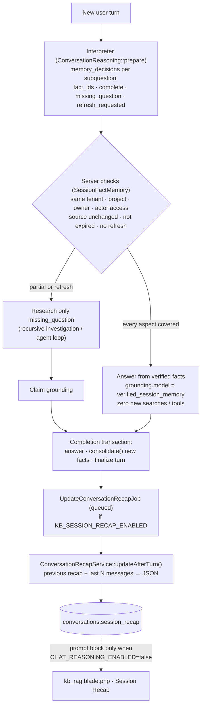

## Motivation

A useful assistant remembers. After *"what is the status of order ORD-2024-3471?"*
the user asks *"and the tracking code?"* — re-running the whole investigation for
a field that was already retrieved thirty seconds ago is slow and costly. But a
careless memory is the most dangerous component in a grounded system: the
previous **answer** is model prose, not evidence; the previous **API value** may
be stale; and a summary of the conversation, fed back into the prompt, can
quietly launder an earlier hallucination into "context".

AskMyDocs therefore keeps two memories with deliberately different powers:

| | Verified session memory | Session recap |
|---|---|---|
| What | Source-bound **facts** with their evidence and acquisition time | A rolling **summary**: gist, topics, open questions |
| Can answer a question | Yes, after server-side checks | Never |
| Lifetime | 300 s per acquisition (`CHAT_VERIFIED_SESSION_MEMORY_TTL_SECONDS`) | Until replaced by the next update |
| Storage | `session_memory_observations` + `session_memory_facts` | `conversations.session_recap` (JSON) |
| Default | On (`CHAT_VERIFIED_SESSION_MEMORY_ENABLED=true`) | On (`KB_SESSION_RECAP_ENABLED=true`) |

## Theory & background

The distinction is the one between **episodic records** and **semantic gist**
in memory research, applied with a provenance discipline. A record keeps *what
was observed, where, and when*; it can be checked and it can expire. A gist is
compressed, lossy and convenient for orientation, but it cannot be checked
against anything. In a retrieval system the consequence is direct: only
something you can re-verify against its source may be cited.

A second principle is that **reuse must not refresh the clock**. If reading a
cached fact extended its validity, a value observed once could be served as
"current" indefinitely. Facts keep their original `acquired_at` and
`expires_at` across every reuse; an expired fact is usable only for an explicit
historical recap, and is presented with its date.

## Design



### Verified session memory

`App\Services\Chat\Reasoning\SessionFactMemory` manages a per-owner register.
The owner is a `Conversation` or a `WidgetSession`.

**Acquisition (`consolidate()`).** At the end of a turn, inside the completion
transaction, facts are stored in three ways:

- **Exact record fields.** For each API/MCP tool observation whose records have
  a verified identity, every scalar field is stored with the record path, the
  field path and the observation's `evidence_hash` (method
  `exact_record_field`). Catalog listings are skipped; a result flagged
  `meta.ambiguous` is skipped; a memory import never creates a new acquisition
  or extends a TTL.
- **Complete collections.** A list is reusable only when the source attests
  `meta.complete = true` and `meta.has_more = false`; it is stored as a
  `$collection` fact with its arguments, because a partial page cannot prove
  absence, completeness or order.
- **Narrative facts.** Additional statements from documents
  (`memory_candidates`) are extracted from the original sources — never from the
  assistant's prose — and admitted only after the grounding checks and an
  independent Jev decision (`SessionMemoryConsolidator`, durable slot
  `session_memory_decision`).

**Reuse (`answer()`).** The interpreter receives a bounded projection of the
register (at most 100 facts / 32 KiB: `reasoning.session_memory.max_prompt_facts`,
`reasoning.session_memory.max_prompt_bytes`) and proposes `memory_decisions` per
active sub-question. The server then answers from memory only if the resolution
is `complete`, the turn needs no composition, every proposed `fact_id` exists in
the authorized projection, every fact is still `valid` (unless the action is an
explicit `recap`), and the underlying sources are still readable by this actor.
Otherwise the planner receives a `missing_question` covering only the gap. An
explicit refresh request ("check again now", action `recheck`) bypasses reuse
even before expiry. The memory answer is an ordinary `AgentAnswer` whose
`grounding.model` is `verified_session_memory`, with the reused claims listed
and a "Sources consulted: …" line carrying the acquisition times.

The investigation consults memory **before** any retrieval, and only when the
memory owner's `project_key` equals the turn's project.

### Session recap

`App\Services\Chat\ConversationRecapService` keeps a rolling, **incremental**
summary. Each update renders `prompts/kb_session_recap.blade.php` with the
*previous* recap and only the last `KB_SESSION_RECAP_WINDOW_MESSAGES` messages
(default 6) — never the whole history — so the cost of keeping it fresh stays
flat as a conversation grows. The model must reply with strict JSON
`{summary, topics, open_questions}`; the service bounds it (summary ≤ 1200
chars, list items ≤ 200) and stamps `updated_at`. A malformed reply is logged
and the previous recap is left untouched.

The update runs in `UpdateConversationRecapJob` (`$tries = 2`,
`$backoff = [15, 60]`, `$timeout = 60`, queue `KB_SESSION_RECAP_QUEUE`),
dispatched by `MessageController` / `MessageStreamController` **after** the
assistant message is saved — never on the request path, and skipped on refusal
paths. `KB_SESSION_RECAP_EVERY_N_MESSAGES` (default 1) trades freshness for
fewer calls. Only the two persisted conversation surfaces have a recap; the
stateless `POST /api/kb/chat` has no conversation to attach one to.

<Warning>
**With the reasoning layer on (`CHAT_REASONING_ENABLED=true`, the default) the
recap is not injected into the answer prompt.** Both controllers pass
`sessionRecap = config('reasoning.enabled') ? null : $conversation->session_recap`
to `kb_rag.blade.php`: conversational state is carried by the structured
reasoning state and verified memory instead. The job still keeps the column up
to date, and the **Session Recap** prompt block becomes active when the
reasoning layer is rolled back. The recap is shown to the model *from the
previous turn*; this turn's own update takes effect next turn, by design.
</Warning>

## Data model / contract

`session_memory_observations` (`2026_10_30_120000_create_session_memory_tables.php`):
`id`, `tenant_id`, `project_key`, `conversation_id` (FK, cascade on delete),
`widget_session_id` (FK, cascade on delete), `owner_key`, `turn_id`,
`source_key`, `namespace`, `evidence_json`, `acquired_at`, `expires_at`,
timestamps. Unique `(tenant_id, owner_key, source_key)`
(`session_memory_observation_unique`); index
`(tenant_id, owner_key, expires_at)`.

`session_memory_facts`: `id` (string(64) primary key), `observation_id` (FK,
cascade), `subject_identifiers` (JSON), `field`, `value_json`,
`verification_json`, `claim_json`, timestamps.

`conversations.reasoning_state` and `widget_sessions.reasoning_state` (JSON,
`2026_09_29_180000_add_reasoning_state_to_chat_owners.php`) hold the compact
projection (`schema_version = 2`) and the references into the register;
deleting the conversation or widget session deletes the register through the
foreign keys.

`conversations.session_recap` (JSON, nullable,
`2026_10_03_000003_add_session_recap_to_conversations_table.php`):

```json
{
  "summary": "The user is tracing complaint SPD-51230 with the carrier…",
  "topics": ["SPD-51230", "HUB-MI-07 hold"],
  "open_questions": ["Has the refund been issued?"],
  "updated_at": "2026-11-05T10:14:02+00:00"
}
```

| Env | Default | Key |
|---|---|---|
| `CHAT_REASONING_ENABLED` | `true` | `reasoning.enabled` |
| `CHAT_VERIFIED_SESSION_MEMORY_ENABLED` | `true` | `reasoning.session_memory.enabled` |
| `CHAT_VERIFIED_SESSION_MEMORY_TTL_SECONDS` | `300` | `reasoning.session_memory.ttl_seconds` |
| `KB_SESSION_RECAP_ENABLED` | `true` | `kb.session_recap.enabled` |
| `KB_SESSION_RECAP_EVERY_N_MESSAGES` | `1` | `kb.session_recap.update_every_n_messages` |
| `KB_SESSION_RECAP_WINDOW_MESSAGES` | `6` | `kb.session_recap.window_messages` |
| `KB_SESSION_RECAP_QUEUE` | `default` | `kb.session_recap.queue` |

## Decision rationale (ADR-style)

- **Facts, not answers, are memory.** The previous answer is the output of a
  model; storing it as evidence would let one turn's error ground the next.
  Facts keep a pointer to the evidence that produced them and are re-authorized
  on reuse.
- **An absolute clock.** Five minutes is short on purpose: live operational
  data (stock, tracking, ticket status) changes. Reuse never renews it.
- **Server decides, model proposes.** The interpreter only proposes `fact_ids`;
  admission is a server check against identity, scope, permissions, payload
  integrity and expiry. An invented ID fails.
- **Incremental recap.** Re-summarising the whole history every turn costs more
  with every message; merging a window into the previous gist is constant cost.
- **Recap is navigation, not evidence.** Hence it is excluded from the prompt
  whenever the structured reasoning state is available, and it is never
  migrated into verified facts.

## Worked example

1. *"Qual è lo stato dell'ordine ORD-2024-3471?"* — the agent calls the order API.
   `consolidate()` stores `status`, `trackingCode`, `carrier` for the record
   identity `ORD-2024-3471`, acquired at 10:00:05, expiring 10:05:05.
2. 10:01 — *"e il codice di tracking?"* — the interpreter proposes the
   `trackingCode` fact as complete. The server re-checks scope and integrity;
   the answer comes from memory: zero searches, zero tool calls, with a "Dati
   consultati: …" line showing the 10:00:05 acquisition.
3. 10:02 — *"ricontrolla adesso lo stato"* — `refresh_requested`: memory is
   bypassed, the API is called again, a new observation is stored with its own
   clock.
4. 10:09 — *"riepilogami cosa abbiamo trovato"* — action `recap`: expired facts
   may be used, presented as historical with their dates.

Inspect the register for a conversation in the admin debug transcript
(`GET /api/chat/conversations/{conversation}/debug-transcript`, key
`verified_session_memory`) and the per-run
`question_understanding.memory_resolution`.

## Gotchas & operations

- **Apply the migration before enabling.** The memory tables are additive; no
  reset or re-ingest. Restart the queue workers after changing the flags.
- **Rollback keeps the data.** `CHAT_VERIFIED_SESSION_MEMORY_ENABLED=false`
  returns to the previous policy; the register is preserved.
- **Different project, no memory.** A conversation whose `project_key` differs
  from the turn's project neither reuses nor contributes facts for that turn.
- **The recap needs a queue worker** on `KB_SESSION_RECAP_QUEUE`; without one
  the column simply stops updating — the chat still works.
- **Expect the recap block to be absent** from prompts in a default deployment
  (see the warning above); that is not a bug.

<CardGroup cols={2}>
  <Card title="Recursive investigation" icon="magnifying-glass-arrow-right" href="/architecture/recursive-investigation">Where memory is consulted first.</Card>
  <Card title="Chat sessions workspace" icon="folder-open" href="/chat-sessions-workspace">The conversation organisation UI.</Card>
  <Card title="Claim grounding" icon="scale-balanced" href="/architecture/claim-grounding">How new facts are verified before they are stored.</Card>
</CardGroup>
