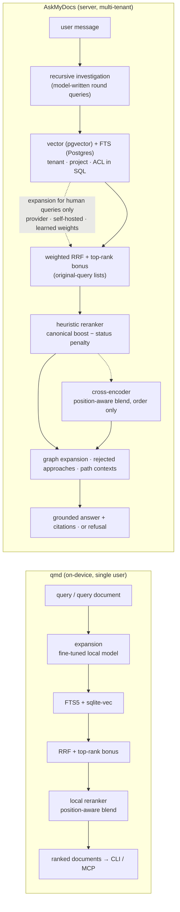

## Motivation / problem

[`tobi/qmd`](https://github.com/tobi/qmd) is a small, sharp, on-device search engine
for markdown: SQLite FTS5 for keywords, `sqlite-vec` for vectors, and local GGUF
models for embedding, query expansion and reranking, driven from a CLI and an MCP
server. It runs on one person's laptop, offline, with no server.

It matters to us for one reason: its **ranking tail** — what happens between "here are
some candidates" and "here is the order" — was better than ours. A review of the
project at commit `86d2365` (2026-10-14) found that we had no pair-reading re-scorer,
no query expansion, bare-chunk embeddings, no per-result explanation and no code
ingestion, while our *platform* (tenancy, ACL in SQL, grounded answers, the canonical
graph, PII, FinOps, connectors, OCR, an evaluation gate) was far ahead of anything a
single-user tool needs. [ADR 0035](https://github.com/lopadova/AskMyDocs/blob/main/docs/adr/0035-v841-retrieval-quality-cycle.md)
is the record of closing that gap.

This page is the comparison an architect would ask for before choosing either: **what
each does, where we copied, where we deliberately did not, and what is still not
proven.**

<Note>
Every qmd statement here describes the commit we studied (`86d2365`). qmd moves fast;
check its README before relying on a specific claim about it. Every AskMyDocs feature
below that came out of the comparison ships **default-OFF** and is promoted only on
benchmark evidence.
</Note>

## Theory & background

Both systems implement the same modern hybrid-retrieval recipe, which is worth naming
because the comparison is really about its stages:

1. **Two retrievers.** A lexical one (BM25 / `ts_rank`) catches exact terms,
   identifiers and error codes; a dense one (bi-encoder cosine) catches paraphrase.
2. **Query expansion.** A small model rewrites the query into keyword variants, a
   paraphrase and a hypothetical answer passage (HyDE), each sent to the retriever it
   helps.
3. **Rank fusion.** Reciprocal Rank Fusion merges the lists by rank, not by
   incomparable raw scores — with a **top-rank bonus** so the head of a list is not
   flattened.
4. **Cross-encoder reranking.** A model that reads the (query, passage) *pair* re-scores
   the head, **blended by position** so it decides the tail without burying a clear
   winner.

qmd runs all four on local models in one process for one user. AskMyDocs runs them as
an optional, measured tail on a multi-tenant server whose job does not end at a ranked
list: it composes a grounded answer, cites it, or refuses.

## Design



The left pipeline ends at a ranked list for a human or an agent to read. The right one
is the retrieval half of a RAG system: every stage must preserve tenant isolation and
the refusal gate's inputs, and every model call must pass a provider/host allow-list,
PII masking and metering.

## Feature by feature

**Legend.** **Ahead** — AskMyDocs has it, qmd (as studied) does not. **Parity** — both
have it (✱ = adopted from qmd in ADR 0035). **Behind by design** — qmd has it and we
chose not to. **Behind** — qmd has it and we do not yet.

### Ranking

| Capability | qmd | AskMyDocs | Verdict |
|---|---|---|---|
| Lexical + dense retrieval | FTS5 BM25 + `sqlite-vec` | Postgres FTS (`plain` / `websearch` syntax, identifier phrases) + pgvector | Parity |
| Rank fusion | RRF | Weighted N-list RRF | Parity |
| Top-rank bonus | Yes | `TopRankBonus`, **original-query lists only** (a model-written variant can never earn the head) | Parity ✱ (stricter) |
| Typed expansion `lex` / `vec` / `hyde` | Yes | `QueryExpansionService`, closed JSON contract, strong-signal skip, `intent` never sent to the model | Parity ✱ |
| Query documents (`lex:` / `vec:` / `hyde:` / `intent:` lines) | Yes | `UserQueryDocument`, no model call | Parity ✱ |
| Expansion by a local model | In-process GGUF | `self_hosted` HTTP profile (vLLM / llama.cpp / Ollama / TGI), exact host allow-list | Parity ✱ (different transport) |
| **Fine-tuned expansion model** | **Ships one** | Learns from your own logs: per-type weights + few-shot now, a fine-tune (export or OpenAI) once logs exist — [Expansion learning loop](/expansion-learning-loop) | **Behind** (see below) |
| Cross-encoder reranking | Local reranker, position-aware blend | `CrossEncoderStage`, `self_hosted` or `api` profile, blend on a calibrated score, status penalty applied to the model score too | Parity ✱ |
| Refusal signal protected from the reranker | n/a (no answers) | `rerank_score` / `vector_score` never modified; expansion-only chunks re-scored against the **original** query | Ahead |
| Canonical trust gradient (accepted > superseded, human > auto) | No | Reranker boost/penalty, evidence tiers | Ahead |
| Graph expansion + rejected-approach injection | No | `GraphExpander`, `RejectedApproachInjector` | Ahead |
| Contextual embeddings | Context-aware embedding input | `title \| section \| text` + `embedding_fingerprint` + `kb:reembed-stale` | Parity ✱ |
| Model-written query handling | n/a | Investigation round queries skip expansion (`model_written_query`) | Ahead |

### Agent and operator affordances

| Capability | qmd | AskMyDocs | Verdict |
|---|---|---|---|
| Per-result explanation | `--explain` | `kb:search --explain`, HTTP, `KbRetrievalExplainTool`; `rrf.{base,top_rank_bonus,total}`; `--investigation` traces the chat path | Parity ✱ / Ahead (investigation) |
| Short document ids | `#docid` | `#` + content-hash prefix, ambiguity is an error with candidates | Parity ✱ |
| Batch read | `multi_get` | `kb:multi-get`, `POST /api/kb/documents/multi`, `KbMultiGetTool`; byte budget, `truncated` / `omitted` / `missing` declared | Parity ✱ |
| Output formats | `--json --csv --md --files`, `--min-score`, `--all`, `--line-numbers` | Same flags on `kb:search` (CSV formula-neutralised) | Parity ✱ |
| Path / collection context | Contexts on collections and paths | Admin-authored path contexts in the prompt and on citations, audited | Parity ✱ |
| Facets, did-you-mean, line-range reads | Not noted in the studied commit | `KbFacetsTool`, `SimilarDocumentFinder`, `from_line` / `max_lines` | Ahead |
| MCP server | Yes (local) | Yes, token + RBAC + tenant scoped | Parity |

### Platform

| Capability | qmd | AskMyDocs | Verdict |
|---|---|---|---|
| Users, tenants, projects | Single user | Multi-tenant, `tenant_id` on every table (R30/R31) | Ahead |
| Document ACL | Filesystem | Enforced **in SQL** on the retrieval path (R33) | Ahead |
| Grounded answers, citations, refusal | No (search only) | Yes | Ahead |
| PII redaction, GDPR tooling | No | 11 redaction touch-points, DSAR / erasure | Ahead |
| Spend governance | Local, free | FinOps ledger, budgets | Ahead |
| Ingestion | Markdown collections | Markdown, PDF, DOCX, OCR, source code, connectors (IMAP, Gmail / Outlook API, Freshdesk…) | Ahead |
| Source code | Markdown-first | Syntax-aware chunking, deny-list, secret redaction | Ahead |
| Labelled evaluation gate | Not part of the product | Benchmark v2 (90 labelled queries, per-class, `--gate`), eval-harness CI gate | Ahead |
| Runs offline on a laptop, zero server | **Yes** | No — Laravel + PostgreSQL + pgvector | **Behind by design** |
| Models inside the process | **Yes** (GGUF) | No — providers or operator-run HTTP endpoints | **Behind by design** |
| Document-level fusion | Per file | Per chunk (citations are per chunk) | **Behind by design** |
| Unauthenticated local HTTP | Yes | Never — Sanctum + RBAC + tenant | **Behind by design** |

## The one remaining "behind"

qmd ships a small expansion model **fine-tuned** for the job; ours is a general model
behind a fixed prompt, now adjustable per project. We did not copy the fine-tune, for
two reasons:

1. **Vocabulary is per tenant.** A model fine-tuned on public markdown rewrites
   "storno" or "DEC-0054" no better than a general model; one fine-tuned on a tenant's
   own successful rewrites might. That needs the tenant's logs.
2. **Training on user queries is a decision, not a default.** It is a new processing
   purpose, and sending the data to a provider is a transfer to a processor.

So W7 built the machinery instead: record which rewrite types actually find new
relevant chunks (`unique_in_top`), turn it into per-type weights and examples behind a
benchmark gate, and — when enough rewarded examples exist — export a training set for
an on-prem fine-tune or submit it to OpenAI for consenting tenants, with promotion left
to a human. Until a deployment has real traffic, this column honestly reads *behind*.

## Decision rationale (ADR-style)

- **Adopt the ranking tail, not the platform.** qmd's ranking tail is portable ideas;
  its platform choices (one user, one process, no auth) are correct for a laptop and
  wrong for a multi-tenant server. ADR 0035 "Rejected" lists each one.
- **Every adoption is default-OFF and measured.** A tail stage that helps qmd's corpus
  may not help a contract archive. Benchmark v2 runs before and after each flag; the
  build environment of the cycle had no real embeddings, so **no default was flipped**.
- **Stricter where tenants are involved.** The top-rank bonus is restricted to
  original-query lists; expansion never runs on model-written queries; the cross-encoder
  blend never touches the refusal gate's inputs; every model endpoint passes an exact
  host allow-list (`AllowListedEndpoint`).
- **Local models through HTTP, not in-process.** The `self_hosted` profiles (expansion,
  cross-encoder) give the qmd property that matters — no third-party processor — while
  keeping the model out of the PHP worker's trust boundary and memory.

## Worked example

The same query document works in both systems:

```text
come si annulla un ordine pagato
lex: storno documento "ordine pagato"
vec: how to cancel an order after payment
hyde: To cancel a paid order, open the order and issue a credit note (storno).
intent: customer-facing procedure, not the ERP internals
```

In AskMyDocs, with `KB_QUERY_DOCUMENTS_ENABLED=true`:

```bash
php artisan kb:search "$(cat query.txt)" --project=shop --files
```

```text
#3f9a1c2b4d5e,0.81,ops/storno-documenti.md
#b20e77a1c943,0.64,faq/ordini.md
```

No model was called for the expansion (`meta.query_expansion.status =
"user_document"`); the plain line is the original query and keeps the top-rank bonus;
the `intent` reached the cross-encoder, not the retrievers; each line opens with
`kb:show '#3f9a1c2b4d5e' --from=12`. *(Illustrative output.)*

## Gotchas & operations

- **Quality numbers are not measured live yet.** Benchmark v2 ran on a deterministic
  stub embedder: it proves the machinery and gates regressions, not that any stage
  improves answers on real models. Run `kb:benchmark --suite=v2` (and
  `--path=investigation`) on a real stack before and after each flag.
- **Chat does not expand.** With the recursive investigation on (default), chat's
  queries are model-written and skip expansion; compare like with like when you read
  qmd's expansion numbers.
- **Self-hosted is not "local".** The `self_hosted` profile still needs an endpoint you
  run and an exact allow-list entry; there is no in-process model.
- See the [rollout runbook](https://github.com/lopadova/AskMyDocs/blob/main/docs/runbooks/retrieval-quality-rollout.md)
  for the order in which to enable the stages.

<CardGroup cols={2}>
  <Card title="Retrieval pipeline" icon="layer-group" href="/architecture/retrieval-pipeline">
    The end-to-end design these stages live in.
  </Card>
  <Card title="Batch reads, references & query documents" icon="list-check" href="/batch-reads-and-references">
    multi_get, #refs, query documents and CLI formats in depth.
  </Card>
</CardGroup>
