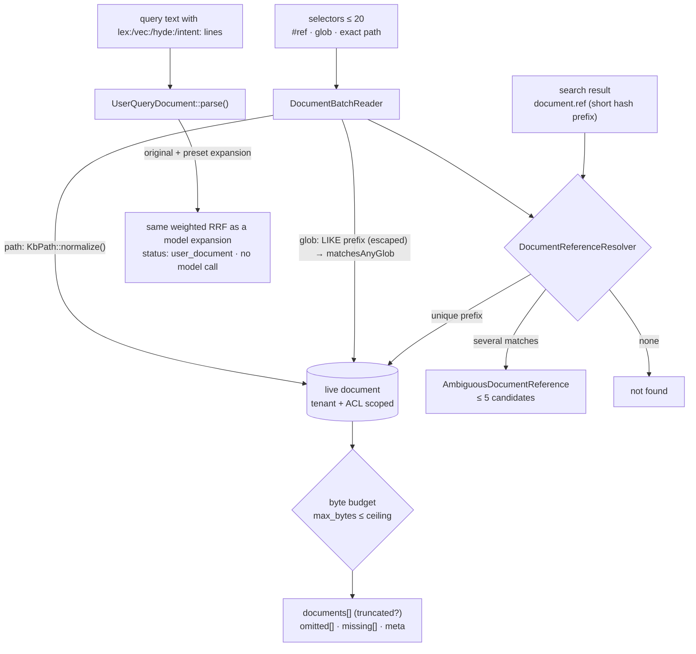

## Motivation / problem

An agent that answers from a knowledge base spends most of its turns not *searching*
but *moving between* what it found: re-opening a cited document, reading three related
policies, checking an exact line. Before W6 every one of those moves was a separate,
loosely-specified call:

- a citation carried a numeric document id that changes with every new version, so
  "open the document I cited yesterday" could land on different text;
- reading five documents meant five tool calls, each with its own size limit and its
  own way of failing;
- an agent that *knew* the right keywords and paraphrases still had to hand a single
  line to the search and hope the expansion model would think of them;
- operators piping `kb:search` into a script had to parse a human-readable table.

`tobi/qmd` solves these with `#docid`, `multi_get`, query documents and machine output
formats. W6 of [ADR 0035](https://github.com/lopadova/AskMyDocs/blob/main/docs/adr/0035-v841-retrieval-quality-cycle.md)
adopts all four, under the constraints a multi-tenant server adds: every read is tenant
and ACL scoped, every output is bounded, and every truncation or miss is declared.

## Theory & background

Three principles drive the design.

**Content addressing beats row addressing for citations.** A citation names *text*. The
row id of a document version is an implementation detail that changes on re-ingest; its
content hash (`document_hash`, SHA-256) names exactly the bytes that were cited. A short
prefix of a hash is the Git trick: human-sized, collision-checked, unambiguous until it
is not — and then the system must say so instead of guessing.

**Budgets are part of the contract.** A batch read that "returns everything" either
blows an agent's context window or silently cuts. The honest contract is a byte budget
with three explicit outcomes per selector: returned (perhaps `truncated`), `omitted`
(over budget — id and size, no content), or `missing` (with the reason).

**The author knows the vocabulary.** Query expansion exists because a short query shares
few words with the document that answers it. When the caller — a person or an agent —
already knows the other words, letting them write the expansion directly is both cheaper
(no model call) and more faithful (no drift).

## Design



### Short references (`#docid`)

`App\Services\Kb\Agent\DocumentReferenceResolver`:

- **Shape.** `#` followed by 6–64 lowercase hex characters, matched as a prefix of
  `document_hash`. Without the leading `#`, only an unmistakable hash counts — 12 or more
  hex characters containing at least one letter — so a numeric id or a path is never
  read as a reference.
- **Scope.** Tenant-scoped (R30) and read through Eloquent, so soft-deleted rows and
  documents the caller's ACL hides are invisible exactly as on every other read (R2,
  R33). Archived versions are excluded: a reference names the **live** text.
- **Ambiguity.** Several matches raise `AmbiguousDocumentReference` with up to five
  candidates (`id`, `ref`, `project_key`, `source_path`, `title`) — never a silent pick
  of the first row (R14).
- **Where refs appear.** Every search result carries `document.ref` (`#` + 12 hex,
  `DocumentReferenceResolver::shortRef()`), as do `kb:search` (`--files`, `--csv`,
  `--md`, `--json`), the explain payload, `kb:show --json`, `KbReadDocumentTool` and
  `multi_get`.
- **Where refs are accepted.** `kb:show '#3f9a1c'` (lists the candidates and fails on
  ambiguity), `KbReadDocumentTool { ref }` (an error naming the candidates), and as
  `multi_get` selectors (`ambiguous_reference` under `missing`, with the candidates).

No flag: the `ref` key is additive (R27).

### Batch reads (`multi_get`)

`App\Services\Kb\Agent\DocumentBatchReader::read(tenant, selectors, project?, maxBytes?)`
— the one core behind three surfaces (R44):

| Surface | Call |
|---|---|
| CLI | `kb:multi-get {selectors*} {--project=} {--tenant=default} {--max-bytes=} {--json}` |
| HTTP | `POST /api/kb/documents/multi` — `auth:sanctum`, `token.ability:kb:read`, `throttle:30,1`; body `{selectors: [...], project_key?, max_bytes?}` |
| MCP | `KbMultiGetTool { selectors, project_key?, max_bytes? }` — read-only, idempotent |

Selectors (1–20, deduplicated):

| Selector | Example | Resolution |
|---|---|---|
| Short reference | `#3f9a1c2b4d5e` | `DocumentReferenceResolver` |
| Glob | `policies/**`, `hr/*.md` | SQL pre-filter on the literal prefix before the first wildcard (escaped with `LikeEscaper`, R19), at most 500 candidates, then `KbPath::matchesAnyGlob()` — the repository's own glob semantics |
| Exact path | `hr/leave.md` | `KbPath::normalize()` (R1) |

Output, bounded and explicit:

- at most `KB_MULTI_GET_MAX_DOCUMENTS` (20) documents;
- a total byte budget `max_bytes` (default `KB_MULTI_GET_MAX_BYTES` = 65 536, capped by
  `KB_MULTI_GET_MAX_BYTES_CEILING` = 262 144); the document that crosses it is cut on a
  UTF-8 boundary and flagged `truncated`; documents after it go to `omitted` with id,
  ref, path and size — their text is never loaded (R3: the size comes from one aggregate
  over the chunks);
- selectors that matched nothing go to `missing` with `reason` = `not_found` (plus
  "did you mean" `suggestions` for an exact path), `no_match` (glob), `invalid_path`, or
  `ambiguous_reference` (plus `candidates`);
- `meta = {max_bytes, bytes_returned, max_documents, truncated, glob_capped}`.

The content is the **document view** (the document's chunks joined by a blank line) —
the same text `kb:show` and `KbReadDocumentTool` read, so line numbers agree across
surfaces.

**Why an authenticated-reader route and not an admin one?** Every document is read under
the caller's own ACL, so a batch can return nothing the caller could not open one by
one. **Why POST?** A list of selectors does not belong in a URL (logs, proxies,
length).

Flag `KB_MULTI_GET_ENABLED` (default OFF, R43): `404 multi_get_disabled` over HTTP,
`{disabled: true, flag: "KB_MULTI_GET_ENABLED"}` over MCP.

### Query documents

`App\Services\Kb\Retrieval\Expansion\UserQueryDocument` — with
`KB_QUERY_DOCUMENTS_ENABLED=true`, a query whose lines begin with `lex:`, `vec:`,
`hyde:` or `intent:` (case-insensitive) is parsed instead of searched literally:

- **plain lines** form the original query (if there is none: the first `vec`, else the
  first `lex`, else the `hyde` text);
- **`lex:`** lines go to the full-text branch (when hybrid search ran), **`vec:`** and
  **`hyde:`** to the vector branch, in one batched embedding call — the same weighted
  N-list fusion a model expansion uses, at `expansion_weight_ratio` of the original
  lists' weight (and multiplied by learned per-type weights when the
  [learning loop](/expansion-learning-loop) applied some);
- **`intent:`** fills an absent `intent` (it steers the cross-encoder and disables the
  strong-signal skip; it is not searched);
- bounds mirror the model contract: at most 5 `lex` and 5 `vec`, one `hyde`, per-line
  length caps, control characters stripped, variants equal to the original dropped.

`meta.query_expansion.status` reads `user_document` and **no model is called** — it
works even with `KB_QUERY_EXPANSION_ENABLED=false`. A text with no typed line is not a
query document and is searched exactly as before. The parse runs in both
`searchWithContext()` and `search()` and is idempotent.

### Output for scripts and spreadsheets

`kb:search` gained qmd's output flags (they apply to the direct retrieval and, with
`--investigation`, to the investigation's selected results):

| Flag | Output |
|---|---|
| `--json` | the full explain payload |
| `--files` | one CSV line per **document** (best chunk wins): `ref,score,source_path` (a path with a comma or a quote stays one field) |
| `--csv` | header `ref,score,source_path,heading_path,chunk_id,start_line,end_line`; formula-leading cells (`=` `+` `-` `@` tab CR, non-numeric) prefixed with `'` (SEC-CSV-001) |
| `--md` | a Markdown list with path, ref, score and line range |
| `--min-score=` | drop results below the score they are ordered by (`cross_encoder.blended` when that stage ran, else `rerank_score`, else `vector_score`) — after ranking, never a reorder |
| `--all` | up to `KB_RETRIEVAL_EXPLAIN_MAX_LIMIT` (20) results |
| `--line-numbers` | each chunk's `start_line` / `end_line` in the document view |

At most one of `--json` / `--files` / `--csv` / `--md`. `min_score` and `line_numbers`
are also accepted by `GET /api/admin/kb/retrieval/explain` and `KbRetrievalExplainTool`;
`min_score` by `KbSearchTool` (`ResultScoreFloor`).

## Decision rationale (ADR-style)

Recorded in the *W6* addendum of ADR 0035 (P2–P5).

- **A hash prefix, not the row id.** Stable across re-ingest of identical bytes, names
  the cited text, and reveals nothing about row counts. Rejected: slugs (only canonical
  documents have one), opaque random ids (a new column and a lookup table for no gain).
- **Ambiguity is an error.** A six-character prefix will collide in a large corpus; the
  only safe answer is "these candidates — use a longer prefix". A silent first match
  would cite the wrong document with confidence.
- **Declared truncation.** An agent that receives `truncated: true` and an `omitted`
  list can ask again with a narrower selector or a larger budget; one that receives a
  silently shortened text cannot know it is missing anything.
- **Query documents are opt-in.** A query that happens to begin with `vec:` today must
  keep its meaning until an operator decides otherwise.
- **Rejected:** document-level fusion (our citations are per chunk); unbounded globs (the
  500-candidate pre-filter cap is reported as `glob_capped`).

## Worked example

An agent cites two policies, then reads them plus a folder in one call:

```bash
curl -s -X POST https://kb.example.com/api/kb/documents/multi \
  -H "Authorization: Bearer $TOKEN" -H "Content-Type: application/json" \
  -d '{"selectors": ["#3f9a1c2b4d5e", "hr/leave.md", "policies/travel/**", "#ab12cd"], "max_bytes": 20000}'
```

```json
{
  "documents": [
    { "id": 812, "ref": "#3f9a1c2b4d5e", "project_key": "hr", "title": "Expense policy",
      "source_path": "policies/expenses.md", "source_type": "markdown",
      "bytes": 9120, "truncated": false, "content": "# Expense policy\n\n…" },
    { "id": 640, "ref": "#77c01d9e2b10", "project_key": "hr", "title": "Leave",
      "source_path": "hr/leave.md", "source_type": "markdown",
      "bytes": 14873, "truncated": true, "content": "# Leave\n\n…" }
  ],
  "omitted": [
    { "id": 905, "ref": "#c4e2a0f13b77", "source_path": "policies/travel/eu.md", "bytes": 6011 }
  ],
  "missing": [
    { "selector": "#ab12cd", "reason": "ambiguous_reference",
      "candidates": [ { "id": 77, "ref": "#ab12cd90e1f2", "project_key": "it", "source_path": "it/vpn.md", "title": "VPN" },
                      { "id": 91, "ref": "#ab12cd3377aa", "project_key": "it", "source_path": "it/mfa.md", "title": "MFA" } ] }
  ],
  "meta": { "max_bytes": 20000, "bytes_returned": 20000, "max_documents": 20, "truncated": true, "glob_capped": false }
}
```

The second document crossed the budget and was cut; the travel policy was omitted with
its size; the short prefix was ambiguous and the two candidates were returned. The agent
re-asks for `#ab12cd90e1f2` and `policies/travel/eu.md` with the remaining budget.
*(Illustrative values.)*

From a terminal, the same documents as a spreadsheet-safe list:

```bash
php artisan kb:search "rimborso spese trasferta" --project=hr --csv --line-numbers > hits.csv
php artisan kb:multi-get '#3f9a1c2b4d5e' 'policies/travel/**' --project=hr --max-bytes=50000 --json
```

## Gotchas & operations

- **Quote `#` in a shell.** `kb:show #3f9a1c` makes `#…` a comment in most shells; write
  `kb:show '#3f9a1c'`.
- **A reference follows the text, not the path.** Re-ingesting changed bytes produces a
  new `document_hash`, so an old reference stops resolving to the live version — by
  design. The path still resolves.
- **`truncated` on the meta is not a failure.** It means the budget, the document limit or
  the glob cap was reached; read `omitted` and `meta.glob_capped`.
- **Check your clients before enabling query documents.** A client that sends queries
  beginning with `lex:` / `vec:` / `hyde:` / `intent:` will see them parsed.
- **Not for writes.** None of these surfaces change data; writing documents stays on the
  ingestion and promotion paths.

<CardGroup cols={2}>
  <Card title="Retrieval pipeline" icon="layer-group" href="/architecture/retrieval-pipeline">
    Where query documents join the fusion.
  </Card>
  <Card title="MCP server" icon="plug" href="/mcp-server">
    The MCP tools an agent uses to search and read.
  </Card>
</CardGroup>
