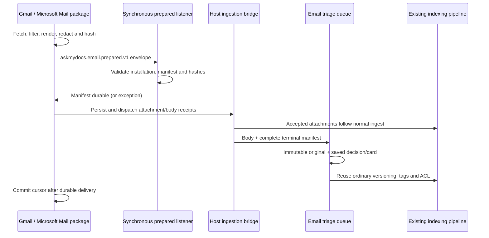

## Motivation

A mailbox has several identities. The visible address can change, a message can
carry several Gmail labels, and a Graph message can move between folders. If a
connector treats the label or filename as the identity, ordinary mailbox changes
can duplicate sources, lose attachments or repeat a paid classification.

Gmail and Microsoft Mail are separate acquisition packages. They delegate
indexing and triage to the same AskMyDocs host that already processes IMAP. This
separation keeps API transport and OAuth inside the provider package while
profiles, configuration assistance, immutable originals, Decisions usage and
versioned indexing remain in one email module.

## Theory: identity, content and delivery are different state

The API parent key contains tenant, installation, provider, stable mailbox ID and
native message ID. Labels, folder names and sender address do not participate.
Two installations of the same mailbox remain isolated; moving a message within
the same mailbox preserves its logical source path. IMAP retains its existing
mailbox/UIDVALIDITY/UID identity and `imap_doc_key`.

A SHA256 body hash identifies the final acquired Markdown, including the host's
required source redaction, before adding the automatic card. A separate revision
hash includes the semantic attachment manifest. Receipt transitions such as
`pending` to `saved` are delivery state and do not change the content revision.
This distinction permits replay after a crash without reopening completed files
or paying for an unchanged decision.

## Design



The prepared listener runs inline through Laravel's ordinary event dispatcher.
It is not a queued listener. This is essential: asynchronous preregistration could
race a fast attachment receipt or allow a cursor commit before the manifest exists.
A listener exception stops the provider batch. An installation with triage off
continues ordinary ingestion and does not stage a decision.

The body waits for its own durable receipt and each accepted attachment's terminal
receipt. Explicit exclusion or extraction/OCR refusal is visible coverage. An
unexpected fetch, write or dispatch failure prevents successful batch completion.
The Flow persistence boundary retains the native API connector key for final
revision, provenance and ACL checks. Attachments inherit the current parent
scope/grants, retain existing denials and manual tags, and cannot add access the
parent does not allow. They use the existing normal ingestion path independently of body
classification. The download worker never executes AI analysis.

## Data model and contract

The common v1 metadata on body and attachments includes:

| Field | Meaning |
| --- | --- |
| `connector`, `installation_id` | Provider key and scoped installation |
| `email_schema_version`, `email_provider` | Version 1; `gmail` or `microsoft-mail` |
| `email_mailbox_id`, `email_message_id` | Stable mailbox identity and case-sensitive native message ID |
| `email_message_key` | Shared composed parent key |
| `email_folder_ids`, `email_folder_names` | Native membership IDs and presentation names |
| `email_date`, `email_attachment_count` | Received date and all observed files, including exclusions |
| `email_body_hash`, `email_revision_hash` | Acquired body and semantic manifest attestation |

Attachments add `email_attachment_id` and `email_attachment_slot`, plus the
existing `attachment_filename` and `attachment_of_message_id` linkage. Two files
named `invoice.pdf` remain distinct because receipts match ID, slot and hash.
Provider fields remain source-aware `converter_hints`; generated search tags use
the existing `_derived` propagation. An OAuth identity does not increase source
trust: these sources default to untrusted external provenance.

The key uses SHA256 over JSON `[tenantId, installationId, connectorKey, mailboxId,
nativeMessageId]`, with unescaped Unicode/slashes and throwing JSON errors.
All entries are strings except the integer installation ID. The revision hashes
JSON of `[emailBodyHash, manifestTuples]`; a tuple is
`[slot, id, name, mime, hash, excluded ? reason : null]`.

## Decision rationale

[Connector extraction](/architecture/decisions) and
[ADR 0009](https://github.com/lopadova/AskMyDocs/blob/develop/docs/adr/0009-v46-connector-package-extraction.md)
place acquisition in Composer packages and dispatch/redaction/audit in the public
ingestion bridge. The prepared event extends that boundary without patching the
installed connector-base or coupling a package to `App` classes.

[Schema-driven settings](/connectors-sync-settings) and
[ADR 0022](https://github.com/lopadova/AskMyDocs/blob/develop/docs/adr/0022-v825-schema-driven-connector-settings.md)
keep editing and discovery common to credential and OAuth installations. Gmail
and Microsoft Mail advertise their native ID selectors and safe filters. The
shared UI uses their schema; it does not translate IDs into unstable folder slugs.

One host module also preserves the established cost behavior: changing read state
or membership alone does not require a new paid decision when the body, semantic
manifest and profile are unchanged. Disabling triage suspends queued AI and pauses
campaigns while downloads continue. Index retries reuse the saved card.

## Worked example: a bounded retrospective campaign

An administrator opens **Connectors → Edit → Triage email**, saves reviewed rules
and explicitly enables the profile after readiness checks. For a Gmail label
`Label_42`, the campaign preview request uses the existing route and shape:

```http
POST /api/admin/connectors/42/email-triage/campaign-preview
Content-Type: application/json

{
  "state": "never",
  "project": "support",
  "mailbox": "Label_42",
  "from": "2026-10-01",
  "to": "2026-10-14"
}
```

The legacy field name `mailbox` denotes a folder selector: an IMAP path, Gmail
label ID or Graph folder ID obtained through discovery. A Gmail message with
several labels is still one parent document. Preview returns the exact selected
count, availability checked on at most 100 originals and an explicit unchecked
count. Estimates use recent observed decision costs or configured rates; absent
evidence yields unavailable estimates. Starting is a separate request carrying
the previewed `profile_id`.

The campaign pins its profile revision and maximum selected document ID. New mail
cannot extend the campaign indefinitely. Pause stops new work at job boundaries;
resume retains cursor and snapshots. Missing originals are reported per item,
and recovery never reconstructs a body from retrieval chunks or refetches mail.

## Operations and concrete limits

Gmail uses delegated `gmail.readonly`, offline OAuth and a verified OIDC subject
for its stable mailbox. Microsoft Mail uses delegated Graph read permission and
immutable message IDs; shared-mailbox access requires explicit target and consent.
Neither connector mutates upstream mail to perform sync or triage.

**Sync settings** and the **Folders** action are available on OAuth accounts when
the package advertises the corresponding schema/discovery. Folder/label discovery
and package health do not ingest messages, change committed cursors or run AI.
The existing `test-fetch` sample download and `email-triage:pilot` command are
IMAP-only. API email sampling has no neutral host capability yet; an explicitly
requested triage preview of an already imported original remains available and
can incur Decisions usage.

Run the dedicated worker separately from downloads:

```sh
php artisan queue:work email-triage --queue=email-triage --sleep=1 --timeout=150 --tries=4
```

The scheduler's `email-triage:pump` recovers committed outbox work and advances
campaigns in finite batches. Immutable `.artifacts/email-triage` snapshots consume
tenant disk space and intentionally survive retries and retrospective analysis.
Google consent/restricted-scope verification and Microsoft organizational policies
remain deployment checks. Synthetic fixture tests prove contract behavior; they
do not certify a real OAuth grant or a live mailbox.

## Local package integration without production paths

Before the new packages have published versions, test their integration in an
isolated worktree with a separate dependency directory. The host test helper
generates an alternate Composer manifest from explicitly supplied repositories:

```sh
php tests/Support/prepare-email-api-composer.php \
  --gmail=/absolute/path/askmydocs-connector-gmail \
  --microsoft=/absolute/path/askmydocs-connector-microsoft-mail
COMPOSER=composer.email-local.json composer update \
  padosoft/askmydocs-connector-gmail padosoft/askmydocs-connector-microsoft-mail \
  --with-dependencies --no-scripts --prefer-dist --no-interaction
php artisan package:discover --ansi
vendor/bin/phpunit tests/Feature/Connectors/EmailApiPackageIntegrationTest.php
```

Run package discovery explicitly after `--no-scripts` so an existing Laravel
manifest cache includes both providers, their configuration and migrations.
After changing OAuth environment variables with cached configuration, run
`php artisan config:clear` in this local worktree before testing the connection.

The machine-local manifest and lock are ignored; the production
`composer.json` and `composer.lock` keep their existing dependency configuration.
The temporary `0.1.0` aliases identify local test copies and do not claim a remote
release. Composer mirrors each package into the isolated vendor directory, so
repeat the targeted update after provider changes.

`EmailApiPackageDiscovery` supplements the base registry's production-lockfile
discovery using actually installed Composer metadata. It retains the registry's
FQCN, interface and duplicate-key checks; an absent package does not appear in the
connector roster. Normal Laravel package discovery registers the providers in
the application. Testbench smoke tests register them explicitly because they
bypass the application's package-discovery cache.

The smoke exercises both providers' native discovery, health and full acquisition
through the real host bridge, with triage both on and off. HTTP, Storage and
queues use synthetic fixtures; no mailbox is read and no AI is paid. Fixture-only
contract tests still run when a package is unavailable. This check is distinct
from provider consent/live-mailbox verification.
