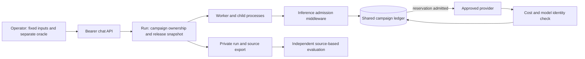

QA campaigns exercise the real chat controller, queue and worker while placing
every admitted inference under one shared spending ceiling. Use them to compare
a fixed baseline with a candidate revision on a development project. A campaign
does not turn a historical answer, simulated response or successful HTTP request
into evidence that an answer is correct.

## Why the budget lives in the database

A counter in the test client cannot protect a worker that continues after the
client disconnects. Independent collection workers, embeddings, typed decisions,
drafting and repair also cannot each receive a fresh copy of the allowance.
Campaign accounting therefore serializes reservations on a campaign row before
dispatch. Monetary amounts use integer billionths of a US dollar.



For every operation, `spent + reserved + new reservation` must fit inside the
same campaign budget. A row lock provides the shared admission decision on
PostgreSQL. The SQLite test path takes a write lock before reading the balance.
Completion is idempotent for each inference attempt. A missing bill retains its
reservation and stops further admission; it never becomes an assumed zero.

The ceiling is an application admission control, not a spending limit enforced
by the provider account. An anomalous provider charge above a reservation is
recorded and stops the campaign; the middleware cannot reverse that charge.

## Ownership and activation

Activation defaults to disabled. Outside local/testing, both the explicit
development tier and campaign flag are required:

```dotenv
ASKMYDOCS_QA_CAMPAIGNS_ENABLED=true
ASKMYDOCS_DEPLOYMENT_TIER=development
APP_RELEASE=<immutable Git SHA actually deployed>
```

Do not use the branch name as release identity. A queued run snapshots its
release, effective configuration, tenant, project and actor. A worker with a
different release refuses that run. Deploy configuration through the hosting
platform's normal lifecycle so web and queue processes receive the same values.

Campaign metadata is accepted only by the diagnostic Bearer chat API for an
administrator with `chat:debug`, access to the project and ownership of the
campaign. The campaign must belong to the same tenant, project and actor as the
conversation. Omitted live-source selections inherit the campaign's explicit
allowlist; they do not expand it. Follow-ups cannot drop or switch the campaign.
Document and record permissions continue to apply normally.

Campaign creation, database probes and recovery are intentionally operator-only
Artisan controls, not conversational or MCP tools. They must not become actions
that a model or retrieved document can request. PHP services contain their
implementation; the chat HTTP surface carries only the authorized QA context and
read-only campaign summary.

## Durable data and original content

| Record | Contents | Excluded content |
| --- | --- | --- |
| `qa_campaigns` | Ownership, fixed corpus hash, allowed model specifications, release/configuration snapshot, budget and aggregate balances | Customer prompts, expected answers and credentials |
| `qa_inference_attempts` | Run/scope, round/case/turn, request hash, requested and returned models, reservation, cost source, duration, status and generation reference | Provider request/response prose and caller arguments |
| `identity_json` | Confirmed embedding identity, generation reference, cost, verification time and provider response hash | Embedding vectors, source text and authentication headers |
| Manifest reconciliation event | Original stop reason, operator, revision, resolved attempt IDs and unchanged balances | A rewritten historical bill or erased failed attempt |

Private input, oracle and export files belong outside version control, with
restricted filesystem permissions. Normal conversation persistence still occurs
through the real chat path; the QA ledger does not create another prompt store.

## Freeze a corpus and verify the manifest

Freeze ten distinct first questions before changing the pipeline. Keep the
original documents and expected facts separate from the agent's inputs. Historical
assistant answers are not the oracle. Each expected assertion should identify
its original source, acquisition/version information and any residual uncertainty.

```sh
python3 scripts/qa/campaign.py freeze --history <private-history-directory> \
  --conversations 101 102 103 104 105 106 107 108 109 110 \
  --output <new-private-corpus-directory>
```

The example IDs are synthetic. The command refuses to replace an existing corpus.
Inspect the server's effective runtime before preparing the manifest:

```sh
php artisan qa:campaign runtime --tenant=acme --project=orders --actor=123
```

Enumerate the actual text, preprocessing, embedding and decision models. Shared
chat model settings can override individual synthesis or repair settings. Keep
the baseline's effective models, thresholds and limits; do not choose a different
model merely to make a manifest validate.

The manifest preparer reads public provider catalogs without running inference.
It checks canonical model identity and reserves the maximum published tariff
across endpoints and conditional tiers, without presumed cache hits or discounts.
Missing prices and unsupported billing dimensions stop preparation. An explicit
zero is different from an absent price. Text requests disable implicit web search;
streaming, implicit model routing, presets and unsupported modalities are rejected.

```sh
python3 scripts/qa/campaign.py manifest \
  --index <corpus>/index.json --sources <private>/sources.json \
  --text-model <actual-text-model> --embedding-model <actual-embedding-model> \
  --decision-model <actual-decision-model> --output-reserve-tokens 16384 \
  --output <private>/manifest.json
```

Repeat model options as needed. The output reserve must cover the existing maximum
output, including structured retries; it does not raise the requested token limit.
Review source allowlists, prices, identities and dates before creating one campaign
for both rounds. Never create a replacement campaign to renew an exhausted budget.

## Database preflight and real dialogs

```sh
php artisan qa:campaign probe --tenant=acme --project=orders --actor=123
php artisan qa:campaign create --manifest=<technical-manifest> \
  --tenant=acme --project=orders --actor=123
```

The probe runs two bootstrapped application processes against the configured
database, synchronizes incompatible reservations and verifies one admission and
one rejection. It also verifies duplicate completion. It blocks provider HTTP
requests, has no real chat actor and reports zero inference calls. Its simulated
ledger rows are distinguishable from the real campaign; they are not a live answer
quality result.

For each baseline case, send its fixed first question and at least two follow-ups
in the same conversation. Write follow-ups after reading the preceding answer.
Keep the first questions identical for the candidate, using new conversations;
evaluate adaptive follow-ups separately.

```sh
python3 scripts/qa/chat-api.py ask --campaign=<campaign-UUID> \
  --round=baseline --case=CASE-01 --turn=1 \
  --question-file=<corpus>/inputs/CASE-01.txt --debug \
  --output=<private>/baseline/CASE-01/turn-1
```

Additional turns remain numbered in the same campaign and consume its existing
allowance. Campaign, round and case are immutable within a conversation. Each new
turn must exceed every recorded turn; the conversation lock protects this check
before any message or job is created. Inconsistent legacy contexts fail closed.
Additional turns do not replace failed first outcomes. An uncertain POST must not
be submitted again. Resume observation with `watch --run` when a known run outlives
the client wait; a client timeout does not cancel the worker.

## Verify native embedding identities

The native response name `text-embedding-3-small` can differ from the requested
`openai/text-embedding-3-small`. This does not justify removing arbitrary vendor
prefixes. For that specific pair, the middleware requires a read-only provider
generation lookup confirming the same generation ID, embedding API type,
canonical model and recorded cost. It preserves the raw returned model and stores
the independent identity proof separately. Unavailable or discordant metadata
continues to stop the campaign.

A campaign previously stopped by that specific discrepancy can be reconciled
after deploying the identity-proof migration:

```sh
php artisan qa:campaign reconcile-embedding-identity --id=<existing-campaign-UUID> \
  --tenant=acme --project=orders --actor=123
```

The command rechecks current administrator access, ownership, terminal runs and
all ledger state under a lock. It rejects unknown charges, pending reservations,
other errors and exhausted limits. It does not change the budget, spent amount,
reserved amount or attempt count. Original error codes and timestamps remain;
an audit event records the stop and its verified resolution. It neither restarts
failed runs nor performs another inference.

## Evaluation, export and rollback

Compare answers independently with original sources. Report source support,
subquestion coverage, temporal consistency, case separation, literal values,
authorization, table boundaries and the separation of courteous requests from
facts. Use `pass`, `fail` or `unverifiable`; missing evidence is not approval.
Keep historical results, simulated tests and live results distinct.

```sh
php artisan qa:campaign export --id=<campaign-UUID> \
  --tenant=acme --project=orders --actor=123
```

Retain release/configuration snapshots, phase timings, calls, omissions,
fallbacks, costs and source versions for each round. An exhausted allowance means
the live validation is incomplete, even if deterministic tests pass.

Disable new QA inferences by setting the campaign flag to `false` and deploying
the configuration normally. Existing queued QA work must fail closed rather than
becoming unguarded ordinary chat. Already accepted provider calls cannot be undone.
Keep ledger tables, identity proofs and pending states readable; configuration
rollback does not require dropping their schema.
