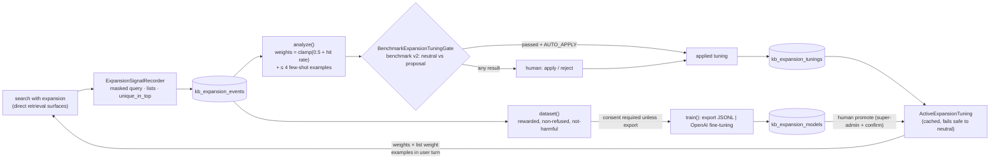

## Motivation / problem

Typed query expansion (`KB_QUERY_EXPANSION_ENABLED`, see the
[retrieval pipeline](/architecture/retrieval-pipeline#typed-query-expansion)) asks a
general model to propose keyword variants (`lex`), paraphrases (`vec`) and a
hypothetical answer passage (`hyde`) for a short or oddly-phrased query. The prompt
is fixed and the same for every knowledge base. That leaves two questions nobody
could answer:

1. **Which kinds of rewrite actually help *this* corpus?** A legal archive may be
   rescued by keyword variants (exact statutory terms) and hurt by hypothetical
   passages; a support knowledge base may be the opposite. With fixed list weights,
   a rewrite type that never finds anything new still dilutes the fusion every time.
2. **What does a good rewrite look like here?** The model has never seen an example
   of a rewrite that worked for these documents and this vocabulary.

`tobi/qmd` answers both by shipping a **fine-tuned** expansion model. We cannot ship
one model for every tenant's vocabulary, and should not train on a tenant's queries
without measuring and without consent. The expansion learning loop is the
alternative: learn from the deployment's **own** searches, measure every proposed
change before it can apply itself, and keep every step that changes live behaviour
or sends data outside behind a human.

<Note>
Everything on this page is **off by default** (`KB_EXPANSION_LEARNING_ENABLED=false`,
R43). Off means: no event is recorded, the live search reads the neutral tuning
(every weight 1.0, no examples, no promoted model), every HTTP endpoint answers
`404 expansion_learning_disabled`, the MCP tool answers `{disabled: true}`, and the
nightly slot is a silent no-op.
</Note>

## Theory & background

The loop is a small instance of **learning from implicit feedback**, the idea behind
click models in web search: the system cannot ask whether a rewrite was good, but it
can observe whether the rewrite *changed the outcome*. Two choices make the signal
honest.

**The reward is marginal, not absolute.** A `vec` paraphrase that returns the same
chunks the user's own words already returned has contributed nothing, even if those
chunks are excellent. So the reward for a variant type is **`unique_in_top`**: the
number of final top-k chunks that *only* lists of that type returned — the original
query's lists and every other type missed them. That is the clean measure of "this
kind of rewrite found something new that survived ranking".

**Two levels of adaptation, cheapest first.**

| Level | What changes | Cost | Reversibility |
|---|---|---|---|
| **Tuning** (no training) | per-type list weights + up to 4 in-context examples | none — a config row | `reject` → neutral, immediate |
| **Fine-tuned model** | the expansion model itself | a training run (external GPU or provider job) | `retire` → previous model, immediate |

The tuning level is a bandit-like reweighting plus few-shot prompting; it adapts in a
day and needs only tens of events. The fine-tuning level needs hundreds of rewarded
examples and a training run, and is only worth it once the tuning level has shown the
signal is real.

## Design



One core, `App\Services\Kb\Retrieval\Expansion\Learning\ExpansionLearningService`,
sits behind every surface (R44). Every method is tenant-scoped (R30).

### 1 · Signal

`ExpansionSignalRecorder::record()` is called from `KbSearchService::search()` right
after the ranking an expansion influenced — only when the expansion produced lists
and the loop is on. **It fails closed on privacy:** an event is recorded only when PII
redaction is actually active for the project (`ChunkRedactor::isActive()` — both
master switches on and the tenant/project policy enabled); with redaction off nothing
is recorded, so raw user text can never become a few-shot example or a training row.
When it records, it stores one `kb_expansion_events` row:

- the **PII-masked** query (one-way `mask`, at most 500 characters) and its SHA-256
  (`query_hash`);
- the typed variants that ran (`expansion`), **each masked too** (a user query
  document's lines are user text), the final top-k chunk ids (`top_chunk_ids`, never
  chunk text), whether the result was a refusal (`refused`);
- `list_stats`: per type `lex` / `vec` / `hyde` → `{lists, in_top, unique_in_top}`.

It never blocks the user path: any failure is caught and logged by exception class
only. Recording is suppressed while the benchmark gate runs
(`ExpansionSignalRecorder::suppressed()`), so gate traffic never becomes learning
data.

<Warning>
**Signal comes from direct retrieval only.** When `KB_RECURSIVE_RETRIEVAL_ENABLED=true`
(the default), chat runs the recursive investigation, whose round queries are
model-written and therefore **never expanded** (`reason: model_written_query`). Those
turns record nothing. Events come from `kb:search`, the MCP search tools, the widget's
search tool, the benchmark's `direct` path, user query documents, and chat when the
investigation switch is off.
</Warning>

### 2 · Analyse

`analyze(tenant, project)` reads the window (`KB_EXPANSION_LEARNING_WINDOW_DAYS`,
30) and refuses to propose anything below `KB_EXPANSION_LEARNING_MIN_EVENTS` (30). For
each type:

```
hit_rate(type) = events where unique_in_top(type) > 0
               / events where the type produced at least one list
weight(type)   = clamp(0.5 + hit_rate, 0.25, 1.5)      // no evidence → 1.0
```

A type that finds something new half of the time keeps its weight (1.0); one that
always does is boosted to 1.5; one that never does is damped to 0.5 (and never below
0.25, so it can recover). Alongside, up to **four** examples: the highest-reward
events that were not refusals and not labelled harmful, keeping only the variant
types that earned a unique hit. Admin feedback on an event adds +2 to its reward (+1)
or excludes it (−1). The proposal row records the evidence (`events_analyzed`,
`refusal_rate`, per-type totals and hit rates) and the gate result.

### 3 · Gate

`BenchmarkExpansionTuningGate` (behind the `ExpansionTuningGate` contract) runs
benchmark v2 **twice** on its own labelled corpus — once with the neutral tuning, once
with the proposal forced through `ActiveExpansionTuning::with()` — and compares nDCG@5
and MRR:

| Result | Meaning |
|---|---|
| `passed` | candidate ≥ baseline − `KB_EXPANSION_LEARNING_GATE_TOLERANCE` on both metrics |
| `failed` | a regression beyond the tolerance |
| `not_measurable` | `query_expansion_disabled`, `benchmark_error` or `partial_corpus` |

"No evidence" is never "no regression": `not_measurable` cannot be auto-applied. The
gate ingests the benchmark corpus into a dedicated, non-operational tenant
(`KB_EXPANSION_LEARNING_GATE_TENANT`, default `system-expansion-gate` — never the
customer's tenant, R30) under the project `KB_EXPANSION_LEARNING_GATE_PROJECT`
(`expansion-gate`), with signal recording suppressed, and makes embedding + expansion
calls — so it runs in the CLI or a queued job, never inside an HTTP request. Each
evaluated payload gets its own expansion-cache identity, so the candidate run never
replays expansions cached for the baseline.

### 4 · Apply

At most one `applied` tuning per (tenant, project). `apply()` locks the whole
(tenant, project) scope — two concurrent applies of different proposals serialise
instead of both committing `applied` (R21) — and supersedes the previous one; on
PostgreSQL a partial unique index (`uq_kb_exp_tunings_one_applied`) enforces the
invariant as well. `reject()` on a proposal discards it and on the applied row is the
**rollback** to neutral. Auto-apply happens only with
`KB_EXPANSION_LEARNING_AUTO_APPLY=true` **and** a `passed` gate. Every mutation —
apply, reject, rollback, train, promote, retire — writes an `admin_command_audit` row
(`command = kb:expansion-learn <action>`, ids and statuses only, never query text)
inside the same transaction, so a failed audit write rolls the change back.

On the hot path, `ActiveExpansionTuning::for(tenant, project)` (cached for
`KB_EXPANSION_LEARNING_CACHE_TTL` seconds, forgotten on every apply/promote) feeds:

- the **weights**, which multiply each expansion list's fusion weight
  (`semantic_weight × expansion_weight_ratio × weight(vec|hyde)`,
  `fts_weight × ratio × weight(lex)`);
- the **examples**, which ride in the **user** turn inside an `<examples>` block
  labelled *data, not instructions* — they come from user queries, so they never enter
  the system prompt (SEC-LLM-001);
- the tuning id, which is part of the expansion cache key, so a new tuning never
  replays an old answer.

Any read error yields the neutral tuning: a learning-loop outage cannot change or
break retrieval.

### 5 · Train

`dataset()` builds an OpenAI-chat-format SFT set from rewarded, non-refused,
not-harmful events: the system turn is `QueryExpansionService::systemPrompt()` (so
training and serving match), the user turn the masked query between `<query>`
delimiters, the assistant turn the JSON expansion **keeping only the types that earned
a unique hit**. `train()` writes it to `KB_EXPANSION_TRAINING_DISK` under
`expansion-training/<tenant>/<uuid>.jsonl` (a failed write raises
`TrainingDatasetStorageFailed` — HTTP `503 storage_failed`, never a "submitted" run,
R4) and hands it to a backend:

| Backend | What happens | Data leaves the deployment? | Ends at |
|---|---|---|---|
| `export` (default) | nothing — the JSONL waits for an external trainer (Unsloth, TRL, Axolotl…); serve the result through the `self_hosted` expansion profile | **No** | `exported` |
| `openai` | `POST /files` + `POST /fine_tuning/jobs`; `refresh` polls `GET /fine_tuning/jobs/{id}` | Yes — **consent required** | `submitted` → `training` → `ready` / `failed` |

Guardrails on `openai`: the tenant must be listed in
`KB_EXPANSION_TRAINING_CONSENTED_TENANTS` (fail-closed: empty = nobody); the base model
must be in the code-owned `OpenAiFineTuningBackend::BASE_MODELS`
(`gpt-4.1-mini-2025-04-14`, `gpt-4.1-nano-2025-04-14`, `gpt-4o-mini-2024-07-18`); the
API base (`KB_EXPANSION_TRAINING_OPENAI_BASE_URL`) must pass the exact-host check
against `KB_EXPANSION_TRAINING_OPENAI_ALLOWED_HOSTS`; no redirects; 4xx is permanent;
provider ids are shape-checked; failures are recorded with a machine reason and never
logged with the provider body. At least `KB_EXPANSION_TRAINING_MIN_ROWS` (50, floor
10) rewarded examples are required.

### 6 · Promote / retire

A `ready` run with a provider model id becomes the tenant's expansion model only by
`promote()` — super-admin + `confirm: true` over HTTP, `--yes` on the CLI; the
previously promoted model is retired in the same transaction (every promotion of a
tenant is serialised; on PostgreSQL `uq_kb_exp_models_one_promoted` allows one
promoted model per tenant). While `KB_QUERY_EXPANSION_PROFILE=provider`, expansion
then calls the OpenAI provider with that `ft:` id (a self-hosted profile always wins).
`retire()` is the rollback; it also discards a `ready` / `exported` / `failed` run,
and refuses a run still `submitted` / `training` at the provider (cancel the provider
job first, or it would finish and bill unseen). `retired_by` / `retired_at` record
who and when.

## Data model / contract

Migration `2026_11_05_000004_create_kb_expansion_learning_tables.php` — three
tenant-aware tables, `tenant_id` first in every composite index (R31):

| Table | Key columns |
|---|---|
| `kb_expansion_events` | `tenant_id`, `project_key`, `query_hash` (char 64), `masked_query` (≤ 500), `source`, `expansion` JSON, `list_stats` JSON, `top_chunk_ids` JSON, `refused`, `feedback` (−1 / 1 / null), `feedback_by` · index `(tenant_id, project_key, created_at)` |
| `kb_expansion_tunings` | `project_key`, `status` (`proposed` · `applied` · `superseded` · `rejected`), `weights` JSON, `few_shot` JSON, `evidence` JSON, `gate` JSON, `proposed_by`, `decided_by`, `decided_at` · index `(tenant_id, project_key, status)` |
| `kb_expansion_models` | `project_key`, `backend`, `base_model`, `dataset_path`, `dataset_rows`, `provider_file_id`, `provider_job_id`, `model_id`, `status` (`pending` · `exported` · `submitted` · `training` · `ready` · `failed` · `promoted` · `retired`), `failure_reason`, `created_by`, `promoted_by`, `promoted_at`, `retired_by`, `retired_at` · index `(tenant_id, status)` |

On PostgreSQL the migration also creates two partial unique indexes:
`uq_kb_exp_tunings_one_applied (tenant_id, project_key) WHERE status = 'applied'` and
`uq_kb_exp_models_one_promoted (tenant_id) WHERE status = 'promoted'`.

### Surfaces (R44)

| Surface | Entry points |
|---|---|
| **CLI** | `kb:expansion-learn {status\|analyze\|apply\|reject\|train\|refresh\|promote\|retire\|prune\|nightly}` with `--tenant=default`, `--project=`, `--id=`, `--backend=export\|openai`, `--base-model=`, `--days=`, `--no-gate`, `--yes`. `status` and `nightly` work with the loop off; `train` and `promote` need `--yes`. |
| **Scheduler** | slot `kb_expansion_learn` → `kb:expansion-learn nightly`, `50 3 * * *` (`SCHEDULE_KB_EXPANSION_LEARN_ENABLED`, `SCHEDULE_KB_EXPANSION_LEARN_CRON`): prune, analyse every (tenant, project) with enough recent events, then poll every provider training job still `submitted` / `training`. |
| **HTTP** (`role:admin\|super-admin`, R32 matrix row `/api/admin/kb/expansion-learning`) | `GET /api/admin/kb/expansion-learning` · `POST …/analyze` (queued `AnalyzeExpansionLearningJob`, **202**) · `POST …/tunings/{id}/apply` · `POST …/tunings/{id}/reject` · `POST …/events/{id}/feedback` (`value` −1/0/1) · `POST …/training` (`backend`, `base_model`, `project_key`, `confirm`; super-admin; 201) · `POST …/models/{id}/refresh` · `POST …/models/{id}/promote` (super-admin + `confirm`) · `POST …/models/{id}/retire`. Domain refusals are 422; a foreign or missing id is 404. |
| **MCP** | `KbExpansionLearningTool` — **read-only** status (events, applied tuning, proposals with gate, model runs). Documented R44 exception: no MCP apply/train/promote — changing live expansion or sending data to a provider is a human decision (the ADR 0003 boundary, applied to the retrieval model). Admin principals only. |
| **Admin UI** | Knowledge › Quality › **Expansion learning** — KPIs, applied tuning with one-click rollback, proposals with their gate result, training form (consent hint, confirm), model runs. |

### Configuration (`kb.expansion_learning.*`)

| Env | Default | Effect |
|---|---|---|
| `KB_EXPANSION_LEARNING_ENABLED` | `false` | Master switch (recording, tuning, every surface) |
| `KB_EXPANSION_LEARNING_AUTO_APPLY` | `false` | Apply a proposal without a human **only** on a `passed` gate |
| `KB_EXPANSION_LEARNING_WINDOW_DAYS` | `30` | Analysis window |
| `KB_EXPANSION_LEARNING_MIN_EVENTS` | `30` | Minimum events to propose anything |
| `KB_EXPANSION_LEARNING_RETENTION_DAYS` | `90` | Event retention (`0` disables the prune) |
| `KB_EXPANSION_LEARNING_CACHE_TTL` | `300` | Seconds the applied tuning is cached on the hot path |
| `KB_EXPANSION_LEARNING_GATE_TENANT` | `system-expansion-gate` | Dedicated non-operational tenant the gate's benchmark corpus lives in |
| `KB_EXPANSION_LEARNING_GATE_PROJECT` | `expansion-gate` | Project the gate ingests the benchmark corpus into |
| `KB_EXPANSION_LEARNING_GATE_TOLERANCE` | `0.0` | Allowed nDCG/MRR drop for `passed` |
| `KB_EXPANSION_TRAINING_CONSENTED_TENANTS` | empty | Tenants with recorded consent + DPA for provider training |
| `KB_EXPANSION_TRAINING_BASE_MODEL` | `gpt-4.1-mini-2025-04-14` | Default base model (must be in the code-owned list) |
| `KB_EXPANSION_TRAINING_MIN_ROWS` | `50` | Minimum rewarded examples (floor 10) |
| `KB_EXPANSION_TRAINING_DISK` | `local` | Private disk for the JSONL dataset |
| `KB_EXPANSION_TRAINING_OPENAI_BASE_URL` | `https://api.openai.com/v1` | Fine-tuning API base |
| `KB_EXPANSION_TRAINING_OPENAI_ALLOWED_HOSTS` | `api.openai.com` | Exact host allow-list for that base |

## Decision rationale (ADR-style)

The full record is the *W7* addendum of
[ADR 0035](https://github.com/lopadova/AskMyDocs/blob/main/docs/adr/0035-v841-retrieval-quality-cycle.md).

- **Why `unique_in_top` and not clicks or answer ratings?** It exists for every
  expansion, with no UI, and measures exactly the claim expansion makes — "a rewrite
  finds relevant text the user's words miss". Answer ratings are sparse and conflate
  retrieval with generation; admin feedback is kept as an *adjustment*, not the base.
- **Why reweight before fine-tuning?** A weight row costs nothing, applies instantly
  and rolls back instantly. If reweighting shows no signal, a fine-tune would not
  either — and would have cost a training run and a data transfer to find out.
- **Why a benchmark gate, and why can it say "not measurable"?** Every earlier stage
  of ADR 0035 is promoted only on measured evidence; a learning loop that applied
  itself on faith would break that rule. A gate that cannot measure (expansion off,
  partial corpus) must not be read as a pass.
- **Why examples in the user turn?** They are derived from user queries — untrusted
  text. Putting them in the system prompt would let a crafted query, replayed as an
  "example", become an instruction (SEC-LLM-001).
- **Why export as the default backend?** It keeps the data inside the deployment and
  pairs with the `self_hosted` expansion profile, which is the qmd posture (a local
  model) reached the server-side way.
- **Why is promotion human, and why no MCP write tool?** Promotion changes how every
  future query of the tenant is rewritten. ADR 0003 keeps canonical knowledge
  human-gated; the same boundary applies to the model that shapes retrieval.
- **Rejected:** training inside the app process (no GPU, wrong trust boundary);
  per-user models (too little data, a profiling risk); storing raw queries "for
  better training" (masked only, by design).

## Worked example

```bash
# Week 0 — expansion has been on for a while; start recording.
KB_EXPANSION_LEARNING_ENABLED=true

# Week 2 — the nightly slot has produced a proposal for project "support".
php artisan kb:expansion-learn status --project=support
```

```json
{
  "enabled": true,
  "auto_apply": false,
  "training_consent": false,
  "events": { "total": 412, "last_30_days": 412, "with_feedback": 6 },
  "applied": null,
  "proposals": [{
    "id": 7, "project_key": "support", "status": "proposed",
    "weights": { "lex": 1.309, "vec": 0.94, "hyde": 0.622 },
    "few_shot_count": 4,
    "evidence": { "events_analyzed": 412, "window_days": 30, "refusal_rate": 0.083,
      "types": { "lex":  { "events_with_lists": 388, "events_with_unique": 314, "unique_in_top": 701, "hit_rate": 0.8093 },
                 "vec":  { "events_with_lists": 405, "events_with_unique": 178, "unique_in_top": 233, "hit_rate": 0.4395 },
                 "hyde": { "events_with_lists": 401, "events_with_unique":  49, "unique_in_top":  52, "hit_rate": 0.1222 } } },
    "gate": { "status": "passed", "tolerance": 0.0,
              "baseline":  { "ndcg_at_k": 0.812, "mrr": 0.874, "corpus_failures": 0 },
              "candidate": { "ndcg_at_k": 0.826, "mrr": 0.881, "corpus_failures": 0 } }
  }],
  "models": []
}
```

Keyword variants are doing the work in this corpus (support tickets use exact error
codes); hypothetical passages rarely find anything new. The gate passed on the
benchmark corpus. An admin spot-checks a few real queries with
`kb:search "…" --project=support --explain`, then:

```bash
php artisan kb:expansion-learn apply --id=7
# … a week later, if the support team reports worse answers:
php artisan kb:expansion-learn reject --id=7      # rollback: neutral weights, no examples
```

Months later, with ~2 000 rewarded events, a super-admin exports a dataset for an
on-prem fine-tune — nothing leaves the deployment:

```bash
php artisan kb:expansion-learn train --project=support --backend=export --yes
# → status "exported", dataset_rows 1874, dataset_path expansion-training/default/<uuid>.jsonl
```

*(Illustrative numbers — see "What is not verified" below.)*

## Gotchas & operations

- **Turn expansion — and PII redaction — on first.** With
  `KB_QUERY_EXPANSION_ENABLED=false` nothing is recorded (no expansion lists) and every
  gate says `not_measurable`; user query documents still produce lists. With PII
  redaction inactive for the project (`pii-redactor.enabled`, `kb.pii_redactor.enabled`
  and the project policy), **nothing is recorded at all** — by design.
- **The gate measures the benchmark, not your corpus.** A proposal can pass on
  benchmark v2 and be neutral on a tenant's documents. Keep auto-apply off until
  several gate results have matched what users report.
- **Analysis is heavy.** It ingests the benchmark corpus and makes embedding +
  expansion calls. Over HTTP it is always queued (202); `--no-gate` skips it (and
  therefore makes auto-apply impossible).
- **Training runs advance on a poll.** The nightly slot polls every `submitted` /
  `training` run; to advance one now use `kb:expansion-learn refresh --id=` or
  `POST …/models/{id}/refresh`. There is no provider webhook.
- **A promoted model only serves the `provider` profile.** With
  `KB_QUERY_EXPANSION_PROFILE=self_hosted` the self-hosted model wins; serve an
  exported fine-tune there.
- **GDPR.** Recording is a new processing purpose (masked queries stored to improve
  retrieval) — update the record of processing before enabling it. Provider training
  is a transfer to a processor: list a tenant in
  `KB_EXPANSION_TRAINING_CONSENTED_TENANTS` only with recorded consent and a DPA.
  Retention is deployment-wide by age (`kb:expansion-learn prune [--days=]`).
- **Rollback is always one call.** `reject` the applied tuning, `retire` the promoted
  model, or turn the master switch off — the hot path reads neutral at once (each
  decision forgets the cached tuning; with the switch off the cache is not read).

### What is not verified

No real query log existed when the loop shipped; every test runs on synthetic events
(`tests/Feature/Kb/Retrieval/ExpansionLearningLoopTest.php`), and the OpenAI
fine-tuning API was faked. No GPU training ran. Whether learned weights and examples
improve a real tenant's answers is the first thing to measure once traffic exists.

<CardGroup cols={2}>
  <Card title="Retrieval pipeline" icon="layer-group" href="/architecture/retrieval-pipeline">
    Where expansion sits in the end-to-end path.
  </Card>
  <Card title="AskMyDocs vs qmd" icon="scale-unbalanced" href="/askmydocs-vs-qmd">
    Why we learn from our own logs instead of shipping one fine-tuned model.
  </Card>
</CardGroup>
