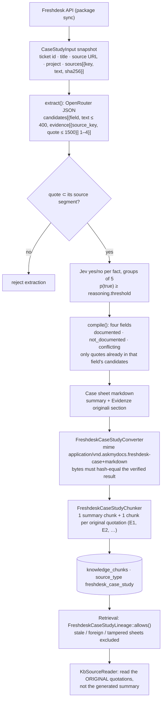

<Warning>
**Known gap in this release.** The host's case-study generator
(`App\Connectors\Freshdesk\OpenRouterCaseStudyGenerator`) implements
`Padosoft\AskMyDocsConnectorFreshdesk\CaseStudies\CaseStudyGeneratorContract`,
but the committed `composer.lock` pins `padosoft/askmydocs-connector-freshdesk`
at **1.0.0**, which does not ship that contract. A clean install from the lock
therefore cannot load the generator, and the consolidation's validation report
records the full PHPUnit run stopping at `FreshdeskCaseStudyTest`. A package
release that contains the contract must be published and locked before case-study
generation can work from a clean install. The rest of this page describes the
design as implemented in the host.
</Warning>

## Motivation

A help desk is the most honest record of how a product actually fails: the
symptom a customer reported, what the agents tried, what turned out to be the
cause, and whether the fix worked. It is also the noisiest source a knowledge
base can ingest. A ticket thread is full of hypotheses ("it could be the
firmware"), proposals ("try resetting it"), and status changes that say nothing
about the outcome ("closed — no reply"). Indexing raw threads makes retrieval
find them and the model summarise them — turning a hypothesis into a "cause" and
a closed ticket into a "resolution".

The Freshdesk integration does two different things:

1. **Case studies** — offline, a resolved ticket is compiled into a structured
   *case sheet* with four fields — **problem**, **cause**, **intervention**,
   **outcome** — where every statement must be backed by literal quotes from the
   ticket and independently verified. The sheet is what gets indexed.
2. **Live tools** — online, authenticated Freshdesk tools are offered to the
   chat agent as a live source, so a question about a *current* ticket reads it
   from the API rather than from a stale index.

## Theory: extraction is not evidence

The case sheet applies the same discipline as
[claim grounding](/architecture/claim-grounding), at ingest time:

- **Typed epistemic categories.** A cause must be *explicitly confirmed*, never a
  hypothesis; an intervention must have been *performed*, never just proposed; an
  outcome must be *explicitly observed*, never inferred from the ticket status or
  from silence. Negative and contradictory observations are preserved.
- **Three field states.** `documented`, `not_documented` (empty text and
  evidence — the honest default), `conflicting` (both incompatible quotations
  retained).
- **Quotes are literal substrings of a named source segment.** A quote that
  does not occur in the segment it cites rejects the whole extraction.
- **Independent verification.** A separate decision model checks each candidate
  fact *in the full original context*, because a literal quote can still be
  misleading when the surrounding sentence negates or qualifies it.

## Design

### Generation (`OpenRouterCaseStudyGenerator`)

`extract()` sends the ticket's source segments to OpenRouter
(`chatWithProvider('openrouter', …)`, temperature 0, JSON object response,
model `connector-freshdesk.case_studies.model` or the question-preprocessor
model). Every candidate is validated against the input, and every quote must be
an exact substring of the segment it names. A truncated response
(`finish_reason = length`) is an error, not a partial result.

`verifyExtractedFacts()` then asks Jev, in groups of five, one yes/no question
per fact: *is it explicitly documented when its quotes are read in the full
provided original source context?* Only facts with
`probability_true ≥ reasoning.threshold` (validated to lie in `(0.5, 1]`)
survive.

`compile()` asks for exactly four fields, may only cite quotes that a verified
candidate of the *same* field already carried, and fails visibly — rather than
dropping contradictory facts — when the evidence exceeds the decision budget.
With no verified candidates, all four fields are `not_documented`.

### Indexing

The sheet is ingested with the mime type
`application/vnd.askmydocs.freshdesk-case+markdown`, mapped to the source type
`freshdesk_case_study` (`SourceType::FRESHDESK_CASE_STUDY`,
`config/kb-pipeline.php`).

- `FreshdeskCaseStudyConverter` re-validates the lineage and re-renders the
  expected markdown from the stored verified result; if the incoming bytes do
  not hash-equal it, conversion throws — an edited sheet cannot be indexed.
- `FreshdeskCaseStudyChunker` emits one summary chunk (heading *Problema →
  Causa → Intervento → Esito*) and one chunk per original quotation section
  (`### E1 — …`, `### E2 — …`, heading *Evidenze originali*). Each is atomic: a
  section larger than `kb.chunking.hard_cap_tokens` throws instead of being
  split, because a split quotation would lose its provenance.

### Retrieval reads the evidence, not the summary

`FreshdeskCaseStudyLineage` is consulted on every read path:

- `allows()` — applied in `KbSearchService::filterByFolderGlobs()`, which is
  shared by semantic, hybrid, runner-up, literal and remembered reads — drops a
  case-study chunk whose case record is missing, belongs to another project or
  tenant, or whose snapshot source hashes no longer match.
- `originalEvidence()` — used by `KbSourceReader` during the
  [investigation](/architecture/recursive-investigation) — returns the ticket
  number, title, source URL and the **original quotations**, so the assessor and
  the answer are grounded on what the customer and agents actually wrote, with
  `evidence_origin = original_freshdesk_quotes`.

### Live tools and historical import

`FreshdeskChatToolSource` (key `freshdesk`) exposes the package's Freshdesk tools
to the agent for a project the user may read. It refuses the widget channel, a
tenant mismatch, or a tool not in the user's catalog for that project, and
returns results with provenance and a physical request count, so they flow
through the same evidence and claim-grounding path as every API/MCP tool.

`FreshdeskHistoricalImportAction` registers the installation action
`historical-import`, reachable at
`GET|POST /api/admin/connectors/{installationId}/actions/historical-import`:
*Importa storico dalla data* when `history.start_date` is set in the connector
settings, otherwise *Prendi tutto*. The ordinary sync window is unchanged;
published articles are not filtered by date; an interrupted import resumes its
original period. The action is enabled only when ingestion is on, the package's
`freshdesk_sync_runs` table exists and the installation is `active` or
`errored`.

## Data model / contract

| Item | Value |
|---|---|
| Composer package | `padosoft/askmydocs-connector-freshdesk` (`^1.0`; lock at 1.0.0 — see the warning) |
| Case-study switch | `CONNECTOR_FRESHDESK_CASE_STUDIES_ENABLED` → `kb.freshdesk_case_studies.enabled` (default `true`), copied to `connector-freshdesk.case_studies.enabled` |
| Source type / mime | `freshdesk_case_study` / `application/vnd.askmydocs.freshdesk-case+markdown` |
| Case fields | `problem`, `cause`, `intervention`, `outcome`; status `documented` · `not_documented` · `conflicting` |
| Sync queue | Redis connection `freshdesk` with `retry_after = 660` (long batches have a 600 s timeout) |
| Connection probe | `GET /agents/me` with the submitted domain and API key |

The host registers everything only when
`Padosoft\AskMyDocsConnectorFreshdesk\FreshdeskServiceProvider` exists, and sets
the package's sync middleware to `App\Connectors\ConnectorTenantScopeMiddleware`
so ingestion, deletion and audit in queue workers run in the installation's
tenant.

## Decision rationale (ADR-style)

- **Index verified sheets, not threads.** The summary chunk makes a case
  findable by meaning; the quotation chunks make it citable by fact.
- **Answer from quotations.** A generated summary, even a verified one, is a
  derived artifact. The reader goes back to the original words, the same rule the
  rest of the platform applies to model output.
- **Hash-locked derived documents.** Because the sheet is generated, the index
  only accepts the exact bytes the verifier produced; lineage is re-checked at
  read time so a deleted or changed case stops being evidence instead of
  lingering.
- **Live API for live state.** A ticket's current status belongs to the API,
  through an authorized tool, not to the index.

## Worked example

A resolved ticket says: *"Could it be the charger?"* (agent), *"Replaced the
charger, still not charging"* (agent), *"Battery swapped under warranty, now
charges normally"* (agent), *"Confirmed, working"* (customer).

- **problem** — documented: device does not charge.
- **cause** — `not_documented`: the charger was a hypothesis and was ruled out;
  no root cause is confirmed.
- **intervention** — documented: charger replacement (did not help) and battery
  swap, each with its quote.
- **outcome** — documented: charges normally, confirmed by the customer.

A later chat question *"have we seen devices that stop charging?"* retrieves the
summary chunk; the reader hands the assessor the four quotations; the answer
cites them, and does not claim a root cause.

## Gotchas & operations

- **Resolve the package gap first** (warning above) before enabling case-study
  generation on a fresh install.
- **Run a dedicated `freshdesk` queue worker**; the 660 s reservation is
  deliberately longer than ordinary workers' leases.
- **Live tools are not available in the KITT widget**, by design.
- **`not_documented` is a result.** Many tickets honestly have no confirmed
  cause; the sheet says so instead of guessing.

<CardGroup cols={2}>
  <Card title="Connectors" icon="plug" href="/connectors">Installing and configuring connectors.</Card>
  <Card title="Claim grounding" icon="scale-balanced" href="/architecture/claim-grounding">The verification model the sheets share.</Card>
</CardGroup>
