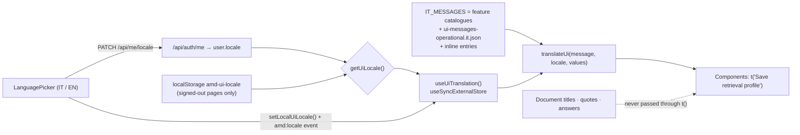

## Motivation

AskMyDocs is used by Italian teams over Italian documents, and by international
teams over English ones. The interface has to speak the user's language; the
knowledge must not be touched. Those two requirements pull in different
directions as soon as a translation layer is introduced: a naive "translate
everything on screen" approach also rewrites a document title, a quoted email or
an assistant answer — and a translated quotation is no longer evidence.

The localization layer therefore has one narrow job: **translate interface copy
— labels, buttons, empty states, validation messages — and nothing else.** The
module's own docstring states the rule: *"Catalogues contain interface copy
only; document and conversation content is never translated."*

## Theory: the source string is the key

There are two classic catalogue designs. **Opaque keys** (`chat.composer.send`)
decouple wording from code but require a lookup to read any component, and a
missing key renders as a cryptic identifier. **Source-string keys** (gettext
style: the English text *is* the key) keep components readable, degrade
gracefully — a missing translation simply shows English — and make it obvious in
review when a string has no Italian entry yet.

AskMyDocs uses source-string keys with English as the base language. Italian
catalogues map English → Italian. Interpolation uses `{name}` placeholders whose
**values** are inserted after translation, so a document called `Terms {2026}`
stays exactly `Terms {2026}` inside an Italian sentence.

## Design



### Resolving the locale

`getUiLocale()` in `frontend/src/lib/ui-locale.ts` returns `'it' | 'en'`:

1. A signed-in user with a saved `locale` → Italian if it starts with `it`
   (`it`, `it-IT`), otherwise English. Unsupported values such as `fr` fall back
   to English **without** overwriting the stored value.
2. A signed-in user whose server omits `locale` (older servers, embedded
   clients) → English, preserving their previous interface.
3. No user (login, registration) → the `amd-ui-locale` key in `localStorage`
   (`en` → English, anything else → Italian); if storage is unavailable, Italian.

### Switching without remounting

`useUiTranslation()` subscribes through React's `useSyncExternalStore` to three
signals: the auth store, a custom `amd:locale` window event and the `storage`
event (other tabs). Changing the language re-renders text in place — a form being
edited keeps its draft (the test *"changes the interface without remounting or
losing a draft"* pins this). `LanguagePicker` persists the choice for a
signed-in user with `PATCH /api/me/locale`, updates the auth store with the
normalised value the server returns, calls `setLocalUiLocale()`, and sets
`document.documentElement.lang`; `AppShell` and `AuthLayout` keep `<html lang>`
in sync as well.

### Translating

`translateUi(message, locale, values)`:

1. Decodes a handful of HTML entities in the English source (`&amp;`, `&nbsp;`,
   `&rsquo;`, `&ldquo;`, `&rdquo;`, `&lt;`, `&gt;`, `&#123;`, `&#125;`) so a
   string copied from JSX matches its catalogue key.
2. In Italian, looks up the raw message, then the decoded one, in
   `IT_MESSAGES`, falling back to the English text.
3. Replaces `{token}` placeholders with `values[token]`; an unknown token is
   left as written.

## Data model / contract

| File | Role |
|---|---|
| `frontend/src/lib/ui-locale.ts` | `UiLocale`, `getUiLocale`, `setLocalUiLocale`, `translateUi`, `useUiTranslation` |
| `frontend/src/lib/ui-messages.it.ts` | `IT_MESSAGES`: spreads feature catalogues + the operational JSON + inline entries |
| `frontend/src/lib/ui-messages-operational.it.json` | The bulk of shared shell / chat / admin copy (~890 entries) |
| `frontend/src/features/admin/*/…messages.it.ts` | Per-feature catalogues (AI usage, path contexts, expansion learning, settings, MCP tokens, MCP tools) |
| `frontend/src/components/shell/LanguagePicker.tsx` | The IT/EN selector |

Server side: `PATCH /api/me/locale` (`UserLocaleController@update`) validates
the value with `App\Support\SupportedLocale::isSupported()` and stores the
normalised form on `users.locale`; `GET /api/me/locale` reads it. The supported
set for server-generated text (agent answers, refusals) is
`AGENT_SUPPORTED_LOCALES` (default `en,it`), with `APP_LOCALE` as the fallback.
The interface catalogue covers Italian only; any other supported locale renders
the English interface.

## Decision rationale (ADR-style)

- **Interface copy only.** Translating content would put a model or a dictionary
  between the user and the evidence. Answers are produced in the user's language
  by the pipeline itself (the interpreter detects `language`); quoted sources are
  shown verbatim.
- **Account locale over browser locale.** A shared workstation or a browser set
  to English should not override what the user chose in the product.
- **English fallback, never a key.** A missing Italian entry shows readable
  English, which is visible and fixable in review, instead of an identifier.
- **One merged map.** Feature catalogues live next to their features but are
  merged into `IT_MESSAGES`, so components use one hook regardless of where the
  string is defined.
- **Not the BE taxonomy.** Server-localized strings (refusal bodies, validation
  messages) are rendered verbatim, following R24 — the client never re-translates
  them, so the two surfaces cannot drift.

## Worked example — adding a string

1. Write the component with the English text as the key:

   ```tsx
   const { t } = useUiTranslation();
   return <p role="status">{t('{count} documents waiting for review', { count })}</p>;
   ```

2. Add the Italian entry. For a feature with its own catalogue, add it there:

   ```ts
   // frontend/src/features/admin/path-contexts/path-contexts.messages.it.ts
   export const PATH_CONTEXTS_MESSAGES_IT: Record<string, string> = {
       // …existing entries…
       '{count} documents waiting for review': '{count} documenti in attesa di revisione',
   };
   ```

   For shared shell / chat copy, add it to `ui-messages-operational.it.json`.
   For a **new** feature catalogue, export a `…_MESSAGES_IT` object and spread it
   into `IT_MESSAGES` in `lib/ui-messages.it.ts`.

3. Cover it with a test that switches locale:

   ```tsx
   act(() => setLocalUiLocale('it'));
   expect(screen.getByText('3 documenti in attesa di revisione')).toBeInTheDocument();
   ```

## Gotchas & operations

- **Keys must match exactly**, punctuation and ellipsis (`…` vs `...`) included;
  a near-miss silently falls back to English.
- **Never wrap user or document content in `t()`.** A document title that
  happens to equal a catalogue key would be translated.
- **Spread order matters.** In `IT_MESSAGES`, later spreads and inline entries
  override earlier ones for the same key.
- **Signed-out pages default to Italian** unless `amd-ui-locale` is `en`;
  signed-in pages follow the account.
- **Validation messages produced on the client** need their own entries (the
  path-contexts suite asserts every validator message has one).

<CardGroup cols={2}>
  <Card title="Admin panel" icon="table-columns" href="/admin-panel">The screens these catalogues translate.</Card>
  <Card title="Chat & retrieval" icon="comments" href="/chat-and-retrieval">Where answers get their language.</Card>
</CardGroup>
