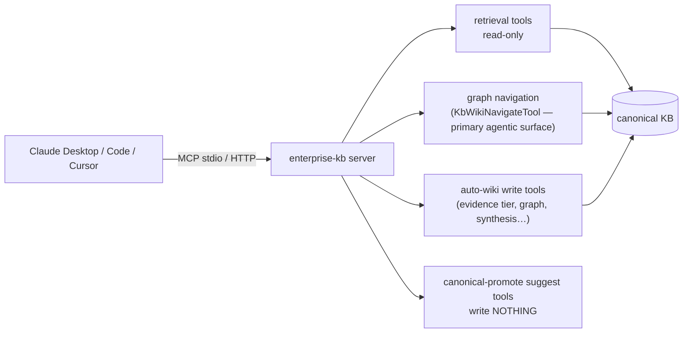

## Motivation

Retrieval is most useful when an *agent* can reach it. AskMyDocs exposes its
knowledge base as **MCP (Model Context Protocol) tools**, so Claude Desktop,
Claude Code, Cursor, or any custom agent can search, navigate the graph, and
surface promotion candidates — over the same retrieval stack the chat UI uses.

## The `enterprise-kb` server

The MCP server (`app/Mcp/Servers/KnowledgeBaseServer.php`, registered name
`enterprise-kb`) exposes **25 tools** across four categories:

- **Read-only retrieval** (hybrid search, document/chunk reads, recent changes,
  project-scoped search).
- **Graph navigation** (neighbours, subgraph, canonical lookups by slug/type,
  the multi-hop `KbWikiNavigateTool` — primary agentic surface, see [Auto-Wiki](/auto-wiki)).
- **Write surfaces** for auto-wiki operations: evidence tier (`KbSetEvidenceTierTool`),
  graph link rebuild (`KbRebuildWikiLinksTool`), concept synthesis
  (`KbSynthesizeConceptsTool`), index build (`KbBuildWikiIndexTool`), page review
  (`KbWikiReviewTool`), suggestion apply (`KbApplySuggestionTool`), wiki
  maintenance (`KbWikiMaintainTool`), and auto→human-vouched tier promotion
  (`KbWikiPromoteTool`).
- **Document-intelligence read surface (v8.36):** `KbOcrStatusTool` reports whether a
  document was OCR'd, with which driver, per-page confidence and figure count — read-only
  by design; an agent cannot start an OCR run or spend (see
  [Documents & OCR](/documents-and-ocr)). `KbDocumentVersionsTool` lists a document's
  version family — status, live flag, who created each version and why, the artifact
  content hash, whether a stored conversion artifact is readable and verified
  (`has_artifact`) and its verified state (`artifact_state`) — newest first,
  bounded and paged (`limit`, at most `KB_VERSIONS_TIMELINE_LIMIT`, `offset`
  skips the newest; `total` is the family size, `truncated` says when it holds
  more than the page reaches; an invalid page is an error, never a silently
  satisfied request) — metadata only: the
  artifact content and the artifact-aware diff stay on the role-gated HTTP surface
  because the artifact is un-redacted converter output (a documented R44 exception).
- **Write-nothing propose/suggest** tools that surface candidate artifacts for
  human review — the **canonical promotion pipeline** (suggest → candidates →
  promote via `CanonicalWriter`) stays human-gated
  (see [canonical & promotion](/canonical-and-promotion)).

New capabilities land tri-surface (R44): every Auto-Wiki and KB capability is
also an MCP tool.

## Connecting a client

Expose the server and point your MCP client at it. The host ships an
`askmydocs:mcp:connect` Artisan helper that prints the bootstrap snippet for a
consumer client. Access is **token-gated** — mint a personal access token (Sanctum) or an
MCP token in the admin (`/app/admin/mcp/tokens`) and the per-tool authorizer
enforces the caller's RBAC on every invocation.

## The MCP pack

The transport, multi-turn tool-calling orchestrator, hash-only audit, and RBAC
hooks are factored into the standalone **`padosoft/askmydocs-mcp-pack`** package
(framework-agnostic; AskMyDocs requires `^2.0`). The host binds three adapters
(`McpHostBridge`, server registry, tool authorizer) so the pack drives the real
AskMyDocs retrieval + Spatie RBAC + Eloquent audit. The host admin SPA
(`/app/admin/mcp-tools`) surfaces server CRUD, the tool catalogue, and the audit
log; the optional standalone `padosoft/askmydocs-mcp-pack-admin` panel (default
`/admin/mcp-pack`) adds the circuit-breaker dashboard and the OpenAPI explorer.

### Upgrading to pack 2.0

- **Run `php artisan migrate`.** The pack adds `mcp_tasks`, `mcp_artifacts` and
  `mcp_request_states`, and four nullable columns on `mcp_tool_call_audit`.
- **Artifact download stays off.** The pack mounts a signed-URL route,
  `GET /mcp-pack/v2/artifacts/{artifact}/download`, and ships it on. AskMyDocs
  returns no MCP artifacts, so `config/mcp-pack.php` turns it off
  (`MCP_PACK_ARTIFACTS_ENABLED=false`). Enable it only together with an
  authorization-matrix row for the route.
- **A tool call is several messages.** The pack negotiates before every
  `tools/call`: `server/discover` plus the call against a current server (2
  messages), and against a legacy server one `initialize` per protocol revision
  it rejects, then `notifications/initialized`, and another round if the session
  has to be recovered, up to 11 messages. The agent budget refuses a call before
  any traffic unless that worst case still fits under `agent.limits.physical_hard`,
  then charges the count the pack really sent.
- **Errors keep their meaning.** JSON-RPC errors now arrive as
  `McpRemoteErrorException`; the host catches the common `McpException`, so a
  server that answers `tools/list` with an error still stays `active` with a
  `tools_list_warning`, and remote errors keep the `transport_error` audit status.
- **Guzzle.** Pack 2.0 requires `guzzlehttp/guzzle ^7.8.2`, so the lock resolves
  Guzzle 7.x until the pack also allows 8.

## Gotchas & operations

- The **canonical promotion pipeline** (suggest → candidates → promote via
  `CanonicalWriter`) is human-gated and no MCP tool triggers it. Auto-wiki write
  tools (evidence tier, graph rebuild, concept synthesis, etc.) DO write to storage
  — they are RBAC-authorized and audited.
- Every tool invocation is RBAC-authorized + audited (hash-only) — bypassing the
  authorizer is a defect.
- Adding a new MCP tool: extend `Laravel\Mcp\Server\Tool`, register it on
  `KnowledgeBaseServer::$tools`, and bump the registration-count test.

<CardGroup cols={2}>
  <Card title="Auto-Wiki" icon="wand-magic-sparkles" href="/auto-wiki">
    The agentic navigation surface MCP exposes.
  </Card>
  <Card title="Sister packages" icon="cubes" href="/sister-packages">
    The padosoft/* ecosystem, including the MCP pack.
  </Card>
</CardGroup>
