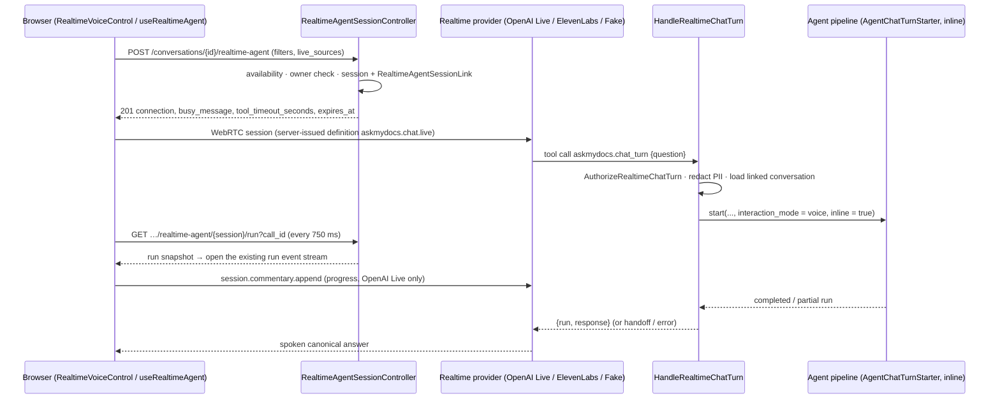

## Motivation

Speaking to a knowledge base is natural; trusting what a realtime voice model
says is not. Realtime speech models are optimised for latency and conversational
flow, and they answer *something* immediately — from their own pretraining, from
the transcript, from whatever the UI showed. That is the opposite of a grounded
system.

AskMyDocs' voice mode therefore treats the realtime model as **an interface,
not an answerer**. Its only route to facts is a single server-side tool,
`askmydocs.chat_turn`, which submits the user's request to the same agent
pipeline the text chat uses — [investigation](/architecture/recursive-investigation),
live tools, [claim grounding](/architecture/claim-grounding) — and returns the
canonical response for the voice model to read out. The voice turn and the text
turn produce the same message, in the same conversation, with the same
citations.

<Note>
Voice is **off by default** (`REALTIME_AGENT_ENABLED=false`). With the flag off,
starting a session returns `503` with `code: realtime_agent_unavailable` and
`reason: disabled`; the rest of the chat is unaffected.
</Note>

## Theory: delegation instead of generation

Agent frameworks call this pattern **delegation** or *tool-mediated answering*:
the front model handles turn-taking, speech and small talk, while a back-end
agent owns retrieval and reasoning. The front model's instructions are written
as a policy:

- *for every substantive user request, call `askmydocs.chat_turn` exactly once
  — once per user request, not once per session;*
- *never answer from memory, general knowledge, the realtime transcript, or UI
  context;*
- *do not delegate for a greeting, a request to repeat the canonical answer, or
  a progress question* — progress comes only from the application's confirmed
  request status.

The tool is declared server-side (`ToolTarget::Server`), confirmation-free (it
only reads), authorized per call, and the agent pipeline serialises turns: while
one request is in progress, a second returns a localized *busy* notice instead
of starting another run. *A busy result is a waiting notice, not permission to
retry.*

## Design

### Starting a session

`POST /conversations/{conversation}/realtime-agent`
(`RealtimeAgentSessionController@store`, session auth, `tenant.authorize`, the
chat POST middleware) accepts the same scope rules as an agent message
(`AgentChatScopeRules`: `filters`, `live_sources`). It refuses another user's
conversation (`403`), checks `RealtimeAgentAvailability` (`503` with a reason:
`disabled`, `missing_credentials` or `provider_unavailable`), and then — in one
transaction — starts the fixed definition `askmydocs.chat.live` with the
server-owned instructions, the single tool `AskMyDocsChatTurnTool`, interaction
level *Guide* and agent goals disabled, and stores a
`RealtimeAgentSessionLink` binding the session to tenant, user, conversation,
filters and live sources, expiring after `REALTIME_AGENT_SESSION_TTL_MINUTES`.
The client never chooses the instructions or the tools.

### The tool call

`HandleRealtimeChatTurn::handle()` re-derives everything from the server side:
the session owner must be a `User`, the link must exist for that user and
session (`RealtimeSessionAccess`, also behind the
`useAskMyDocsRealtimeSession` gate), the conversation is loaded `forTenant()`
with `user_id` matching, and the question is PII-redacted and bounded to 10,000
characters. The run is started **inline** — the realtime tool call is itself the
long request — with `interaction_mode = voice` and the session and call IDs in
`input_json`. The result is one of:

- `response` — the canonical answer, for a `completed` or `partial` run;
- `handoff` — the run is waiting for a confirmation or MCP input that must
  happen in the text UI;
- `error` — `agent_run_failed` (or the run's own code).

During an inline voice turn `AgentChatTurnStarter` raises the PHP time limit to
the agent job budget when it is lower, and restores it afterwards.

### Surviving the proxy

The tool's HTTP request can outlive a reverse proxy (a FastCGI gateway that
closes at 60 s) while PHP keeps working and persists the result. The browser
therefore polls a **read-only receipt** —
`GET /conversations/{conversation}/realtime-agent/{session}/run?call_id=…`
(`RealtimeAgentSessionController@run`) — every 750 ms while the call is
pending. It checks tenant, owner, conversation, session link and call ID, and
returns the matching run snapshot plus, once the call has saved its complete
result, that `result`. The client uses it twice: to open the normal run event
stream early, so the question, task list and progress appear without waiting
for the spoken answer; and, if the tool POST failed with a dropped connection or
`502` / `503` / `504`, to recover the saved result **without repeating the
POST** or starting another search.

### Spoken progress without invented content

On OpenAI Live a long search receives short spoken updates through
`session.commentary.append` on the same WebRTC data channel
(`OpenAILiveSessionRequest` adds that client event and the
`session.commentary.appended` server event to the handshake). The first update
waits 8 s and only starts once the receipt has confirmed a run; later ones are
at least 15 s apart and deferred until 6 s without new transcription. Phrases
come from a fixed catalogue (`realtime-waiting-phrases.ts`), and counts of found
sources come only from `retrieval.completed` events. No document content, tool
payload or model reasoning is read aloud, and the updates never become
questions, tool calls, answer text or chat memory. ElevenLabs keeps its existing
behaviour without spoken progress.

### Usage and retention

`ProjectRealtimeUsageToFinOps` listens to the bridge's `AgentUsageRecorded`
event and projects realtime usage into the host FinOps ledger, priced from
`realtime-agent.audit.pricing` (per-minute for `gpt-live-1`, per-token for the
back-end and transcription models). Sessions, events, tool calls, messages and
usage are kept for `REALTIME_AGENT_RETENTION_DAYS` (90) and pruned by
`realtime-agent:prune` (scheduled `25 3 * * *` by default, toggled with
`SCHEDULE_REALTIME_AGENT_PRUNE_ENABLED` / `SCHEDULE_REALTIME_AGENT_PRUNE_CRON`;
options `--days`, `--tenant`, `--dry-run`).

## Data model / contract

Package: `agents-full-duplex/laravel-realtime-agent` (`^0.1`), configured by
`config/realtime-agent.php`. Tables (migrations `2026_09_15_125135` …
`2026_09_15_125141`): `realtime_agent_sessions`, `realtime_agent_events`,
`realtime_agent_tool_calls`, `realtime_agent_provider_tools`,
`realtime_agent_messages`, `realtime_agent_usage`, and the host link table
`realtime_agent_session_links` (`session_id` ULID primary key → session,
`tenant_id`, `user_id`, `conversation_id`, `filters`, `live_sources`,
`expires_at`).

| Env | Default | Meaning |
|---|---|---|
| `REALTIME_AGENT_ENABLED` | `false` | Host rollout fence for starting sessions |
| `REALTIME_AGENT_PROVIDER` | `fake` (code) / `openai` (`.env.example`) | `fake`, `openai`, `elevenlabs` |
| `REALTIME_AGENT_SESSION_TTL_MINUTES` | `30` | Session and link expiry |
| `REALTIME_AGENT_RETENTION_DAYS` | `90` | Prune horizon |
| `REALTIME_AGENT_STATE_DRIVER` | `database` | Session state store |
| `OPENAI_LIVE_MODEL` / `OPENAI_LIVE_BACKEND_MODEL` / `OPENAI_LIVE_VOICE` | `gpt-live-1` / `gpt-5.6-terra` / `marin` | OpenAI Live |
| `OPENAI_LIVE_STORE` | `false` | Provider-side storage |
| `ELEVENLABS_API_KEY` / `ELEVENLABS_AGENT_ID` | — | ElevenLabs provider |

Security block (`realtime-agent.security`): authorization required, ability
`useAskMyDocsRealtimeSession`, tool arguments redacted, payloads ≤ 256 KB, at
most 120 tool calls per minute.

Session start response (`201`): the provider connection payload plus
`conversation_id`, `busy_message`, `tool_timeout_seconds`
(`max(30, AGENT_JOB_TIMEOUT)`) and `expires_at`.

## Decision rationale (ADR-style)

- **One canonical pipeline.** A separate "voice RAG" would drift from the text
  chat in permissions, grounding and memory. Delegation gives voice the same
  guarantees for free and makes a voice turn auditable as an ordinary run.
- **Server-owned definition.** The client cannot add tools, change instructions
  or enable agent goals; the only capability exposed to the model is a
  read-only, per-call-authorized chat turn.
- **Recover, never repeat.** Repeating a timed-out tool POST would start a
  second paid investigation and possibly a different answer; the receipt
  returns the first one.
- **Narration from status only.** Filler speech is useful for perceived latency
  and dangerous for grounding; restricting it to a fixed catalogue and confirmed
  events keeps it content-free.

## Worked example

1. In `.env`: `REALTIME_AGENT_ENABLED=true`, `REALTIME_AGENT_PROVIDER=openai`,
   `OPENAI_API_KEY=…`; clear the config cache and restart workers.
2. In a conversation, press the voice control and ask *"Qual è lo stato della
   spedizione RL-2024-0815?"*.
3. The realtime model calls `askmydocs.chat_turn` with that question; the chat
   shows the same user message and the run's task list via the event stream.
4. After 8 s a short spoken progress phrase plays; the run completes; the model
   reads the canonical answer. The same answer, with citations, is in the
   conversation history.
5. Ask *"Ripeti"* — no new tool call; the model repeats the canonical answer.

## Gotchas & operations

- **`.env.example` and the code disagree on the default provider** (`openai` vs
  `fake`). With `fake`, availability is always `true` — fine for tests, wrong
  for production.
- **Closing Live does not cancel the research.** It stops polling and ignores
  late callbacks; the canonical run finishes and is saved in the conversation.
- **Handoffs need the text UI.** A run that waits for confirmation or MCP input
  cannot be completed by voice.
- **Real audio is a deployment check.** Synthetic tests cover the delivery of
  results; validate final speech playback with real audio before rollout.

<CardGroup cols={2}>
  <Card title="Durable research runs" icon="list-check" href="/architecture/durable-research-runs">The run the voice tool starts.</Card>
  <Card title="AI FinOps" icon="coins" href="/ai-finops">Where realtime usage is metered.</Card>
</CardGroup>
