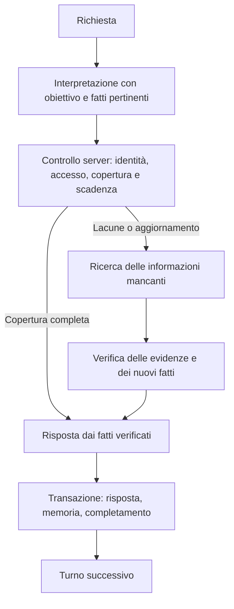

# Memoria verificata di sessione

AskMyDocs controlla i fatti già acquisiti prima di iniziare una nuova ricerca.
La missione della piattaforma rimane comprendere la richiesta e trovare le
informazioni nelle fonti autorizzate: documenti ingeriti e record API/MCP. Il
tenant aggiunge contesto e criteri operativi, senza sostituire questo contratto.

## Flusso



## Contratto

- Ogni acquisizione scade dopo **300 secondi**. Il riuso non aggiorna
  `acquired_at` o `expires_at`. Alla scadenza esatta il fatto non è più corrente.
- Una richiesta esplicita di aggiornamento e `recheck` escludono il riuso anche
  prima della scadenza. Un riepilogo storico può utilizzare osservazioni scadute,
  conservandone la data. Acquisizione e data dell'evento aziendale sono distinte.
- Il modello propone `memory_decisions` per sotto richiesta; il server verifica
  i riferimenti e ammette soltanto fatti della stessa sessione, tenant e progetto,
  con permessi e fonti ancora validi. Un dato assente o non verificabile resta
  una lacuna. Per una copertura parziale il planner riceve `missing_question`.
- Gli attributi scalari dei record con identità verificata sono conservati con
  percorso originale del record e del campo. I fatti narrativi aggiuntivi
  (`memory_candidates`) passano dai controlli di grounding e da una decisione
  semantica indipendente, con slot durevole `session_memory_decision`.
- I candidati narrativi non devono comparire nella risposta per essere ammessi.
  I trasporti KB senza submission strutturata estraggono i candidati dalle fonti
  originali, senza usare la prosa dell'assistente come evidenza. Un errore di
  estrazione non promuove fatti e non elimina la memoria precedente.
- Le collezioni sono riutilizzabili soltanto con un'attestazione esplicita della
  fonte (`meta.complete=true`, `meta.has_more=false`), mantenendo argomenti e
  ambito. Una raccolta parziale non attesta assenza, completezza o ordinamento.
- Le selezioni live correnti continuano a delimitare i tool autorizzati. Un
  cambio di documento, revoca dell'accesso o modifica del payload invalida il
  riuso prima della scadenza. Una verifica remota fallita non rinnova il vecchio dato.

## Persistenza e debug

`session_memory_observations` conserva ogni acquisizione una sola volta, con
provenienza e clock originali. `session_memory_facts` conserva i singoli fatti e
le prove. Le chiavi distinguono namespace delle fonti, soggetti, campi e valori;
la cancellazione della conversazione o della sessione widget elimina entrambi.

`reasoning_state.schema_version=2` conserva una proiezione compatta e i riferimenti
al registro. Il modello riceve al massimo 100 fatti / 32 KiB; il registro non viene
tagliato insieme al prompt. Un identificativo esplicito cerca prima i fatti
pertinenti nel registro locale. I vecchi riepiloghi rimangono navigazione e non
sono migrati automaticamente a fatti verificati.

Nel transcript amministrativo `conversation.verified_session_memory` contiene il
registro completo; `question_understanding.memory_resolution` e `session_memory`
nei run documentano riusi, lacune, scadenze ed esclusioni. Il testo della chat
rimane una risposta, senza un pannello o un blocco JSON aggiuntivo.

Le risposte complete dalla memoria hanno `model=verified_session_memory` nel
grounding e contatori di nuove ricerche/tool a zero. L'accesso locale alle fonti
per i controlli non incrementa tali contatori.

## Installazione

```dotenv
CHAT_REASONING_ENABLED=true
CHAT_VERIFIED_SESSION_MEMORY_ENABLED=true
CHAT_VERIFIED_SESSION_MEMORY_TTL_SECONDS=300
```

Applicare la migrazione additiva prima dell'attivazione, senza reset o ingest:

```sh
php artisan migrate --path=database/migrations/2026_10_30_120000_create_session_memory_tables.php --force
php artisan config:clear
php artisan queue:restart
```

In produzione ricostruire la cache di configurazione secondo il deploy corrente.
Il dominio locale rimane `https://askmydocsdev.test`, servito da Herd.
Per rollback impostare `CHAT_VERIFIED_SESSION_MEMORY_ENABLED=false`: i dati del
registro restano conservati e il sistema riprende la precedente politica.

## Verifica

```sh
vendor/bin/phpunit tests/Feature/Chat/VerifiedSessionMemoryTest.php
```

La suite verifica riuso, dettagli non pubblicati, richieste parziali, scadenza
assoluta e riapertura dopo dieci giorni, aggiornamento esplicito, riepilogo storico,
isolamento, integrità, revoche, rollback atomico, cancellazione, orchestrazione
classica/wave, chat sincrona e SSE, completamento durevole e retry senza duplicati.
I test legacy disabilitano il nuovo flag; questa suite lo abilita esplicitamente.
